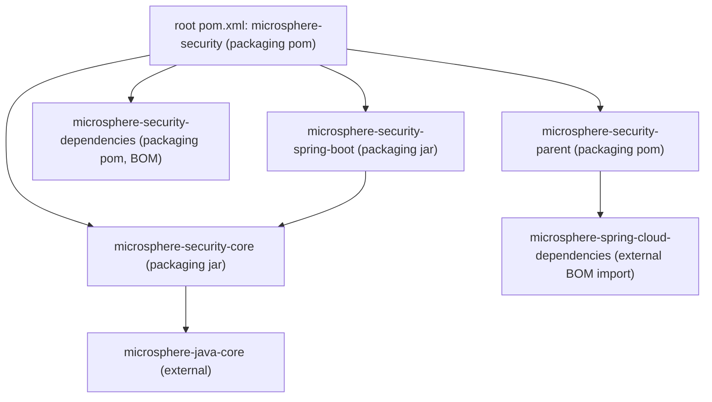

# microsphere-security — Developer Guide

> **Version-line note:** This repository currently has no `release` or `release-1.x` branch. The `current` documentation line is generated from the `main` branch (revision `0.0.1-SNAPSHOT`, pre-1.0, nothing released). `@since 1.0.0` javadoc tags are forward promises. Snapshots only: `https://s01.oss.sonatype.org/content/repositories/snapshots`.

This guide is for people who change the code of `microsphere-security`. For people who
*use* the library in an application, see the [user guide](../user-guide/README.md). For the
project overview, see the [repository README](../../../README.md).

## Documentation map

| Document | Contents |
| --- | --- |
| [README.md](README.md) | This index: build requirements, build commands, module map, conventions. |
| [architecture.md](architecture.md) | Maven reactor and inheritance hierarchy, module dependency graph, layering, external dependency provenance, build/release topology. |
| [microsphere-security-core.md](microsphere-security-core.md) | The constants layer: `SecurityConstants`, property-prefix composition, tests. |
| [microsphere-security-parent.md](microsphere-security-parent.md) | The shared POM parent module and the imported external Spring Cloud BOM chain. |
| [microsphere-security-dependencies.md](microsphere-security-dependencies.md) | The published BOM, its managed coordinates and the known starter-name discrepancy. |
| [microsphere-security-spring-boot.md](microsphere-security-spring-boot.md) | Deep dive: every class of the Spring Boot integration module, design patterns, request flow, conditional gating. |

Each document has a Chinese mirror beside it (`*.zh.md`), with identical structure and
identical code and diagram blocks.

## Build requirements

| Requirement | Value / provenance |
| --- | --- |
| JDK | **Not declared in this repository.** `maven.compiler.source` / `maven.compiler.target` derive from the `java.version` property of the external parent `io.github.microsphere-projects:microsphere-build:0.0.21`. Repository-local evidence (`.github/workflows/maven.yml` matrix and `.idea/misc.xml` language level) points at Java 8, but the authoritative value lives in the external parent — read it there before asserting a number. |
| Apache Maven | The wrapper pins `apache-maven-3.9.0` (`.mvn/wrapper/maven-wrapper.properties`). Any Maven 3.9-compatible install also works. |
| Network / repositories | The root POM declares repository `snapshot` → `https://s01.oss.sonatype.org/content/repositories/snapshots` with `<snapshots>enabled</snapshots>` and `<releases>disabled</releases>`, because the external `microsphere-spring-cloud-dependencies` BOM is imported at `${revision}`. |
| Operating system | Plain Java/Maven; no OS-specific tooling. CI runs on `ubuntu-latest`. |

## Building

From the repository root:

```bash
# full build of every reactor module, tests included
mvn -B verify

# or use the wrapper (no local Maven needed)
./mvnw -B verify          # Git Bash / Linux / macOS
mvnw.cmd -B verify        # Windows cmd.exe

# build a single module after its reactor dependencies are installed
mvn -B -pl microsphere-security-spring-boot -am verify

# fast loop: unit tests only for one module
mvn -B -pl microsphere-security-core test

# the CI invocation (note the explicit revision override)
mvn --batch-mode --update-snapshots --file pom.xml -Drevision=0.0.1 clean install
```

`${revision}` (`0.0.1-SNAPSHOT` in the root POM, line 55) is the single source of truth for
every module version; passing `-Drevision=...` re-versions the whole reactor. The external
`microsphere-build` parent runs `flatten-maven-plugin` in `resolveCiFriendliesOnly` mode and
`.flattened-pom.xml` is git-ignored, so flattened POMs are build artefacts only.

## Module map



| Directory | `artifactId` | Packaging | Layer | Key source |
| --- | --- | --- | --- | --- |
| `microsphere-security-parent` | `microsphere-security-parent` | `pom` | Build / convention | none (POM only) |
| `microsphere-security-dependencies` | `microsphere-security-dependencies` | `pom` | Build / convention | none (POM only) |
| `microsphere-security-core` | `microsphere-security-core` | `jar` | Constants | `io.microsphere.security.constants.SecurityConstants` |
| `microsphere-security-spring-boot` | `microsphere-security-spring-boot` | `jar` (default, not declared) | Spring Boot integration | `io.microsphere.security.spring.boot.**` |

The aggregator lists all four modules; three of them additionally declare
`microsphere-security-parent` as their POM parent through an explicit
`<relativePath>../microsphere-security-parent/pom.xml</relativePath>`, so POM inheritance is
one level deeper than the directory layout suggests. See [architecture.md](architecture.md).

## Testing conventions

- JUnit 5 (`org.junit.jupiter:junit-jupiter-api`); no module POM in the reactor declares a
  JUnit 4 dependency.
- Plain assertions only in the constants test: `assertEquals` from
  `org.junit.jupiter.api.Assertions`.
- `spring-boot-starter-test` and `spring-boot-starter-webflux` are `test`-scoped in
  `microsphere-security-spring-boot`; WebFlux is present purely to obtain `WebTestClient`.
- Integration coverage is `@SpringBootTest` with `WebEnvironment.RANDOM_PORT` plus
  `@EnableAutoConfiguration`, asserting response headers over real HTTP.
- There is **no** `test-cases` directory and no separate test-plan module in this repository.

## Conventions used in these documents

- English files (`*.md`) are primary; Chinese files (`*.zh.md`) mirror them section by section,
  and code and mermaid blocks are kept byte-identical between the two.
- Property names, class names, artifact coordinates and constants are always shown verbatim,
  never translated.
- Anything that lives outside this repository is labelled **external** together with the exact
  coordinate it is pulled in at.

## 中文

[简体中文](README.zh.md)
