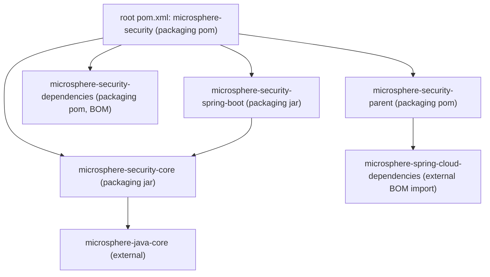

# microsphere-security — 开发者指南

> **版本线说明：** 本仓库当前没有 `release` 或 `release-1.x` 分支。`current` 文档线由 `main` 分支生成（revision 为 `0.0.1-SNAPSHOT`，处于 1.0 之前，尚未发布任何版本）。javadoc 中的 `@since 1.0.0` 标记是对未来的承诺。仅有快照仓库：`https://s01.oss.sonatype.org/content/repositories/snapshots`。

本指南面向需要修改 `microsphere-security` 代码的人。若只是把该库用在应用里，请看
[用户指南](../user-guide/README.zh.md)。项目总览请看[仓库 README](../../../README.md)。

## 文档地图

| 文档 | 内容 |
| --- | --- |
| [README.zh.md](README.zh.md) | 本索引：构建要求、构建命令、模块地图、约定。 |
| [architecture.zh.md](architecture.zh.md) | Maven reactor 与继承层级、模块依赖图、分层、外部依赖来源、构建与发布拓扑。 |
| [microsphere-security-core.zh.md](microsphere-security-core.zh.md) | 常量层：`SecurityConstants`、属性前缀的组合方式、测试。 |
| [microsphere-security-parent.zh.md](microsphere-security-parent.zh.md) | 共享 POM 父模块，以及被导入的外部 Spring Cloud BOM 链。 |
| [microsphere-security-dependencies.zh.md](microsphere-security-dependencies.zh.md) | 对外发布的 BOM、它管理的坐标，以及已知的 starter 命名不一致问题。 |
| [microsphere-security-spring-boot.zh.md](microsphere-security-spring-boot.zh.md) | 深入分析：Spring Boot 集成模块的每个类、设计模式、请求流程、条件装配门控。 |

每篇文档旁边都有一份中文镜像（`*.zh.md`），结构完全一致，代码块与图块也完全一致。

## 构建要求

| 要求 | 取值 / 来源 |
| --- | --- |
| JDK | **本仓库没有声明。** `maven.compiler.source` / `maven.compiler.target` 来自外部父工程 `io.github.microsphere-projects:microsphere-build:0.0.21` 的 `java.version` 属性。仓库内的证据（`.github/workflows/maven.yml` 的矩阵与 `.idea/misc.xml` 的语言级别）指向 Java 8，但权威取值位于外部父工程 —— 断言具体数字前请先去那里核对。 |
| Apache Maven | wrapper 固定为 `apache-maven-3.9.0`（`.mvn/wrapper/maven-wrapper.properties`）。任何兼容 Maven 3.9 的安装同样可用。 |
| 网络 / 仓库 | 根 POM 声明了仓库 `snapshot` → `https://s01.oss.sonatype.org/content/repositories/snapshots`，其中 `<snapshots>enabled</snapshots>`、`<releases>disabled</releases>`，因为外部 `microsphere-spring-cloud-dependencies` BOM 是以 `${revision}` 版本导入的。 |
| 操作系统 | 纯 Java/Maven，无操作系统相关工具。CI 运行于 `ubuntu-latest`。 |

## 构建方式

在仓库根目录执行：

```bash
# full build of every reactor module, tests included
mvn -B verify

# or use the wrapper (no local Maven needed)
./mvnw -B verify          # Git Bash / Linux / macOS
mvnw.cmd -B verify        # Windows cmd.exe

# build a single module after its reactor dependencies are installed
mvn -B -pl microsphere-security-spring-boot -am verify

# fast loop: unit tests only for one module
mvn -B -pl microsphere-security-core test

# the CI invocation (note the explicit revision override)
mvn --batch-mode --update-snapshots --file pom.xml -Drevision=0.0.1 clean install
```

`${revision}`（根 POM 第 55 行的 `0.0.1-SNAPSHOT`）是所有模块版本的唯一真相来源；传入
`-Drevision=...` 会一次性重编整个 reactor 的版本。外部 `microsphere-build` 父工程以
`resolveCiFriendliesOnly` 模式运行 `flatten-maven-plugin`，并且 `.flattened-pom.xml`
被 git 忽略，因此扁平化 POM 只是构建产物。

## 模块地图



| 目录 | `artifactId` | 打包类型 | 层次 | 关键源码 |
| --- | --- | --- | --- | --- |
| `microsphere-security-parent` | `microsphere-security-parent` | `pom` | 构建 / 约定 | 无（仅 POM） |
| `microsphere-security-dependencies` | `microsphere-security-dependencies` | `pom` | 构建 / 约定 | 无（仅 POM） |
| `microsphere-security-core` | `microsphere-security-core` | `jar` | 常量 | `io.microsphere.security.constants.SecurityConstants` |
| `microsphere-security-spring-boot` | `microsphere-security-spring-boot` | `jar`（默认值，未显式声明） | Spring Boot 集成 | `io.microsphere.security.spring.boot.**` |

聚合工程列出了全部四个模块；其中三个还通过显式的
`<relativePath>../microsphere-security-parent/pom.xml</relativePath>` 把
`microsphere-security-parent` 声明为自己的 POM 父工程，因此 POM 继承关系比目录结构看起来
多一层。参见 [architecture.zh.md](architecture.zh.md)。

## 测试约定

- JUnit 5（`org.junit.jupiter:junit-jupiter-api`）；reactor 中没有任何模块 POM 声明 JUnit 4 依赖。
- 常量测试只使用朴素断言：来自 `org.junit.jupiter.api.Assertions` 的 `assertEquals`。
- `spring-boot-starter-test` 与 `spring-boot-starter-webflux` 在
  `microsphere-security-spring-boot` 中为 `test` 作用域；引入 WebFlux 只是为了得到
  `WebTestClient`。
- 集成覆盖使用 `@SpringBootTest` 配合 `WebEnvironment.RANDOM_PORT` 与
  `@EnableAutoConfiguration`，通过真实 HTTP 断言响应头。
- 本仓库**没有** `test-cases` 目录，也没有独立的测试用例模块。

## 本文档集的写作约定

- 英文文件（`*.md`）为主，中文文件（`*.zh.md`）逐节镜像，代码块与 mermaid 块在两者之间保持字节级一致。
- 属性名、类名、坐标与常量始终原样呈现，绝不翻译。
- 凡是不在本仓库中的内容，都会标注 **外部**，并给出其被引入时使用的确切坐标。

## English

[English](README.md)
