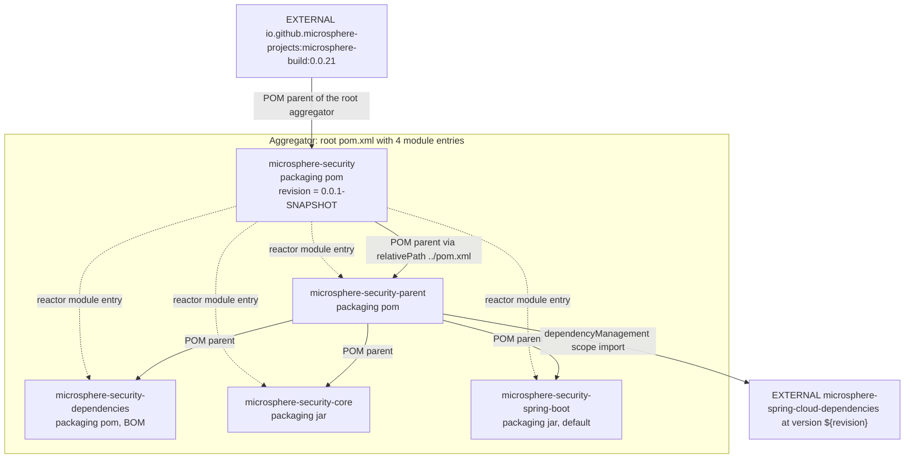
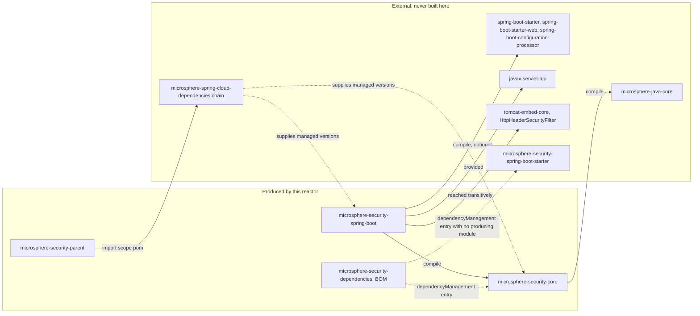
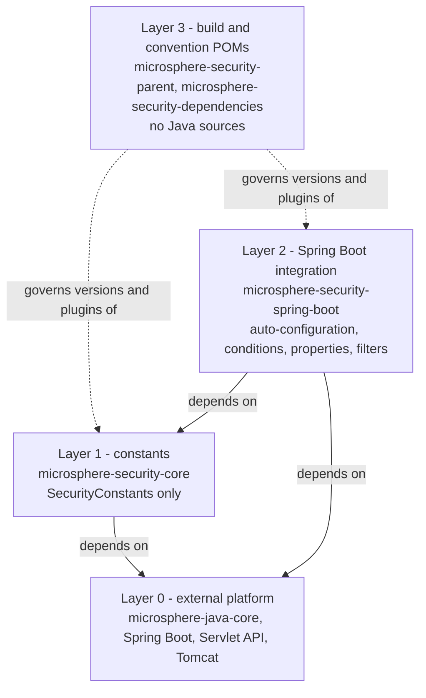

# Architecture

> **Version-line note:** This repository currently has no `release` or `release-1.x` branch. The `current` documentation line is generated from the `main` branch (revision `0.0.1-SNAPSHOT`, pre-1.0, nothing released). `@since 1.0.0` javadoc tags are forward promises. Snapshots only: `https://s01.oss.sonatype.org/content/repositories/snapshots`.

- Parent document: [README.md](README.md)
- Chinese mirror: [architecture.zh.md](architecture.zh.md)

## What the repository contains

`microsphere-security` is a four-module Maven reactor plus an aggregator POM. Only two
modules produce a jar; the other two are build/convention POMs. The one and only Java type in
the constants module is an interface of `String` constants; everything else is Spring Boot
integration. There is no web-flux/reactive integration, no CLI, and no sample application in
the reactor.

## Maven reactor and inheritance hierarchy

Reactor membership (`<modules>` in the root POM) and POM inheritance are **two different
graphs** in this repository, which is the single most confusing thing about it.

Solid arrows are POM inheritance; dashed arrows are `<module>` entries. Notes:

- The root aggregator `microsphere-security` is itself a child of the **external**
  `microsphere-build:0.0.21` parent, which supplies all plugin management, the
  `java.version` property, the flatten configuration and the deploy/GPG/source/javadoc
  wiring. Nothing in this repository re-declares a build plugin.
- `microsphere-security-dependencies`, `microsphere-security-core` and
  `microsphere-security-spring-boot` are listed directly under the root in `<modules>`, but
  their POM parent is `microsphere-security-parent`, referenced with an explicit
  `<relativePath>../microsphere-security-parent/pom.xml</relativePath>`. Directory nesting and
  inheritance nesting therefore differ by one level.
- Because `<relativePath>` is explicit everywhere, the reactor resolves parents from disk
  rather than from the local repository; removing the parent directory from a build would
  break all three leaf modules.

## Module dependency graph

| # | From | To | Kind | Declared in | Effect |
| --- | --- | --- | --- | --- | --- |
| 1 | `microsphere-security` (root) | `microsphere-build:0.0.21` | POM parent, **external** | `pom.xml` | All plugin management, compiler level, flatten, deploy conventions. |
| 2 | `microsphere-security` (root) | the four modules | Reactor aggregation | `pom.xml` `<modules>` | Build order and `mvn -pl` targeting. |
| 3 | `microsphere-security-parent` | `microsphere-security` | POM parent (`../pom.xml`) | parent POM | Inherits the external build conventions and `<repositories>`. |
| 4 | `microsphere-security-parent` | `microsphere-spring-cloud-dependencies:${revision}` | `dependencyManagement` import, **external** | parent POM | Every third-party version (`spring-boot-*`, `javax.servlet-api`, `commons-lang3`, JUnit) is pinned here — not in this repo. |
| 5 | `microsphere-security-core` | `microsphere-security-parent` | POM parent | core POM | Version and dependency management. |
| 6 | `microsphere-security-core` | `microsphere-java-core` | compile dependency, **external** | core POM, no `<version>` | Supplies `PropertyConstants.MICROSPHERE_PROPERTY_NAME_PREFIX` and `SymbolConstants.DOT_CHAR`, used to compose the property prefixes. |
| 7 | `microsphere-security-core` | `junit-jupiter-api` | test dependency, version managed externally | core POM | `SecurityConstantsTest`. |
| 8 | `microsphere-security-spring-boot` | `microsphere-security-core` | compile dependency, `${revision}` | spring-boot POM | The only in-repo runtime dependency edge. Property prefixes are referenced statically. |
| 9 | `microsphere-security-spring-boot` | `spring-boot-starter`, `spring-boot-starter-web`, `spring-boot-configuration-processor` | compile, `optional` | spring-boot POM | Compile-time Spring Boot API; consumers must bring their own. Also the transitively-supplied source of Tomcat. |
| 10 | `microsphere-security-spring-boot` | `javax.servlet-api` | `provided` | spring-boot POM | `Filter`, `HttpServletRequest`, `DispatcherType` at compile time; supplied by the container. |
| 11 | `microsphere-security-spring-boot` | `tomcat-embed-core` | undeclared, reached transitively | — | `org.apache.catalina.filters.HttpHeaderSecurityFilter` is imported by name in the auto-configuration. |
| 12 | `microsphere-security-spring-boot` | `spring-boot-starter-test`, `spring-boot-starter-webflux` | test scope | spring-boot POM | `WebTestClient` over a random-port servlet container. |
| 13 | `microsphere-security-dependencies` | `microsphere-security-core` | `dependencyManagement` entry | dependencies POM | Consumers pin nothing; the BOM sets `${revision}`. |
| 14 | `microsphere-security-dependencies` | `microsphere-security-spring-boot-starter` | `dependencyManagement` entry | dependencies POM | **Dangling**: no module in this reactor produces that `artifactId`. See below. |
| 15 | `microsphere-security-dependencies` | — | not consumed by anything in the reactor | — | It is published for downstream applications, not used internally. |

### Edge 14: the starter-name discrepancy

`microsphere-security-dependencies` manages
`io.github.microsphere-projects:microsphere-security-spring-boot-starter:${revision}`, but the
reactor module is `microsphere-security-spring-boot` (no `-starter` suffix) and there is no
`-starter` module directory. A consumer that imports this BOM and depends on the starter
coordinate therefore gets no artifact from this build. Treat it as a forward-looking
placeholder and re-verify before documenting it as available.

## Layering

The layers are strict:

- **Constants layer.** Framework-free apart from a compile dependency on `microsphere-java-core`
  for two symbols. It owns the vocabulary of property prefixes; the Spring Boot layer never
  re-types a prefix literal.
- **Spring Boot integration layer.** All knowledge of `@ConditionalOnProperty`,
  `FilterRegistrationBean`, Tomcat's `HttpHeaderSecurityFilter` and Spring's `CorsFilter`
  lives here, so the constants module stays usable in non-Spring contexts.
- **Build/convention layer.** Two `pom`-packaging modules that carry no code: one centralises
  the inherited external parent plus the external BOM import, the other publishes managed
  coordinates for downstream consumers.

Direction of allowed change: a new property prefix belongs in layer 1 and is *referenced* in
layer 2. Adding a Spring annotation to layer 1 would invert the layering.

## External dependency context (provenance)

| Coordinate | Kind | Declared where | Owned by |
| --- | --- | --- | --- |
| `io.github.microsphere-projects:microsphere-build:0.0.21` | POM parent | root `pom.xml`, hard-coded version | separate repository, **external** |
| `io.github.microsphere-projects:microsphere-spring-cloud-dependencies:${revision}` | BOM import | `microsphere-security-parent` | separate repository, **external** |
| `io.github.microsphere-projects:microsphere-java-core` | compile dependency, unversioned here | `microsphere-security-core` | separate repository, **external** |
| Spring Boot, Jackson, `javax.servlet-api`, `commons-lang3`, JUnit | versions | nowhere in this repository | transitively via the external BOM chain |

No version number for any third-party library appears in this repository. Do not state one in
code review or documentation without resolving it from the external chain.

## Build and release topology

- **One version token.** `revision` is defined once in the root POM (`0.0.1-SNAPSHOT`) and every
  module declares `<version>${revision}</version>`. The parent POM additionally mirrors it into
  `microsphere-spring-cloud.version` so the external BOM import tracks the same number.
- **CI-friendly flattening.** `flatten-maven-plugin` runs in `resolveCiFriendliesOnly` mode from
  the external parent, replacing `${revision}` in the published POMs; `.flattened-pom.xml` is
  git-ignored.
- **Deployment targets.** `distributionManagement` sends `-SNAPSHOT` builds to
  `https://s01.oss.sonatype.org/content/repositories/snapshots` and release builds to the
  `ossrh` staging URL, both under server id `ossrh`.
- **Consumption of snapshots.** The `snapshot` repository in the root POM is what makes
  `microsphere-spring-cloud-dependencies:${revision}` resolvable; without it a clean machine
  cannot build the reactor.
- **CI.** `.github/workflows/maven.yml` builds on push and pull request to `main` with
  `mvn --batch-mode --update-snapshots --file pom.xml -Drevision=0.0.1 clean install`.

## In this guide

| Module | Document |
| --- | --- |
| constants | [microsphere-security-core.md](microsphere-security-core.md) |
| build parent | [microsphere-security-parent.md](microsphere-security-parent.md) |
| BOM | [microsphere-security-dependencies.md](microsphere-security-dependencies.md) |
| Spring Boot integration | [microsphere-security-spring-boot.md](microsphere-security-spring-boot.md) |

User-facing configuration documentation starts at the user guide index:
[../user-guide/README.md](../user-guide/README.md).

## 中文

[简体中文](architecture.zh.md)
