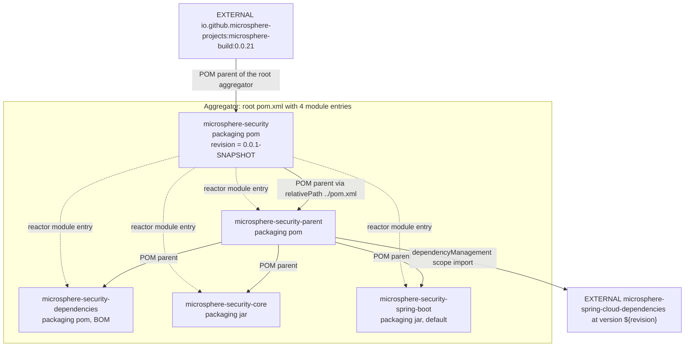
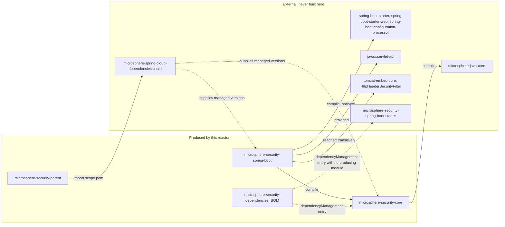
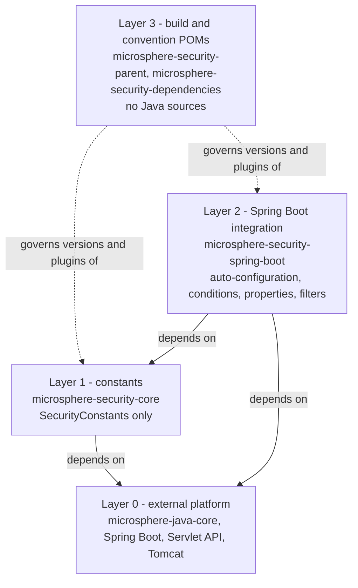

# 架构

> **版本线说明：** 本仓库当前没有 `release` 或 `release-1.x` 分支。`current` 文档线由 `main` 分支生成（revision 为 `0.0.1-SNAPSHOT`，处于 1.0 之前，尚未发布任何版本）。javadoc 中的 `@since 1.0.0` 标记是对未来的承诺。仅有快照仓库：`https://s01.oss.sonatype.org/content/repositories/snapshots`。

- 上级文档：[README.zh.md](README.zh.md)
- 英文原文：[architecture.md](architecture.md)

## 仓库包含的内容

`microsphere-security` 是一个由四个模块组成的 Maven reactor，外加一个聚合 POM。只有两个模块
产出 jar，其余两个是构建/约定 POM。常量模块里唯一的 Java 类型是一个只包含 `String` 常量的
接口；其余内容全是 Spring Boot 集成。reactor 中没有 WebFlux/响应式集成，没有 CLI，也没有
示例应用。

## Maven reactor 与继承层级

在本仓库中，reactor 成员关系（根 POM 的 `<modules>`）与 POM 继承是**两张不同的图**，这是
最容易让人困惑的一点。

实线表示 POM 继承，虚线表示 `<module>` 条目。要点：

- 根聚合工程 `microsphere-security` 本身是**外部**父工程 `microsphere-build:0.0.21` 的子工程，
  由后者提供全部插件管理、`java.version` 属性、flatten 配置以及 deploy/GPG/source/javadoc
  相关装配。本仓库没有任何一处重新声明构建插件。
- `microsphere-security-dependencies`、`microsphere-security-core` 与
  `microsphere-security-spring-boot` 在 `<modules>` 中直接挂在根下，但它们的 POM 父工程是
  `microsphere-security-parent`，并通过显式的
  `<relativePath>../microsphere-security-parent/pom.xml</relativePath>` 引用。因此目录嵌套层级
  与继承嵌套层级相差一层。
- 由于 `<relativePath>` 处处显式声明，reactor 会从磁盘解析父 POM 而非本地仓库；把 parent
  目录从构建中移除会同时破坏三个叶子模块。

## 模块依赖图

| # | 起点 | 终点 | 关系类型 | 声明位置 | 作用 |
| --- | --- | --- | --- | --- | --- |
| 1 | `microsphere-security`（根） | `microsphere-build:0.0.21` | POM 父工程，**外部** | `pom.xml` | 提供全部插件管理、编译级别、flatten、deploy 约定。 |
| 2 | `microsphere-security`（根） | 四个模块 | reactor 聚合 | `pom.xml` 的 `<modules>` | 决定构建顺序与 `mvn -pl` 的目标选择。 |
| 3 | `microsphere-security-parent` | `microsphere-security` | POM 父工程（`../pom.xml`） | parent POM | 继承外部构建约定与 `<repositories>`。 |
| 4 | `microsphere-security-parent` | `microsphere-spring-cloud-dependencies:${revision}` | `dependencyManagement` 导入，**外部** | parent POM | 所有第三方版本（`spring-boot-*`、`javax.servlet-api`、`commons-lang3`、JUnit）都在那里锁定 —— 不在本仓库。 |
| 5 | `microsphere-security-core` | `microsphere-security-parent` | POM 父工程 | core POM | 版本与依赖管理。 |
| 6 | `microsphere-security-core` | `microsphere-java-core` | compile 依赖，**外部** | core POM，未写 `<version>` | 提供 `PropertyConstants.MICROSPHERE_PROPERTY_NAME_PREFIX` 与 `SymbolConstants.DOT_CHAR`，用于组合属性前缀。 |
| 7 | `microsphere-security-core` | `junit-jupiter-api` | test 依赖，版本由外部管理 | core POM | 支撑 `SecurityConstantsTest`。 |
| 8 | `microsphere-security-spring-boot` | `microsphere-security-core` | compile 依赖，`${revision}` | spring-boot POM | 仓库内唯一的运行期依赖边。属性前缀以静态引用方式使用。 |
| 9 | `microsphere-security-spring-boot` | `spring-boot-starter`、`spring-boot-starter-web`、`spring-boot-configuration-processor` | compile，`optional` | spring-boot POM | 编译期 Spring Boot API；使用者需自行引入。同时也是 Tomcat 的传递来源。 |
| 10 | `microsphere-security-spring-boot` | `javax.servlet-api` | `provided` | spring-boot POM | 编译期需要 `Filter`、`HttpServletRequest`、`DispatcherType`；运行期由容器提供。 |
| 11 | `microsphere-security-spring-boot` | `tomcat-embed-core` | 未声明，经传递依赖获得 | — | 自动配置类按名称导入了 `org.apache.catalina.filters.HttpHeaderSecurityFilter`。 |
| 12 | `microsphere-security-spring-boot` | `spring-boot-starter-test`、`spring-boot-starter-webflux` | test 作用域 | spring-boot POM | 在随机端口 servlet 容器上使用 `WebTestClient`。 |
| 13 | `microsphere-security-dependencies` | `microsphere-security-core` | `dependencyManagement` 条目 | dependencies POM | 下游无需写版本；BOM 给出 `${revision}`。 |
| 14 | `microsphere-security-dependencies` | `microsphere-security-spring-boot-starter` | `dependencyManagement` 条目 | dependencies POM | **悬空**：本 reactor 中没有任何模块产出该 `artifactId`。见下文。 |
| 15 | `microsphere-security-dependencies` | — | 未被 reactor 内任何模块消费 | — | 它是为下游应用发布的，不是内部使用的。 |

### 边 14：starter 命名不一致

`microsphere-security-dependencies` 管理了
`io.github.microsphere-projects:microsphere-security-spring-boot-starter:${revision}`，但
reactor 里的模块是 `microsphere-security-spring-boot`（没有 `-starter` 后缀），也不存在
`-starter` 模块目录。因此导入了该 BOM 并依赖 starter 坐标的使用者，无法从本次构建中得到
对应构件。请把它视为面向未来的占位，在断言其可用之前重新核对。

## 分层

分层是严格的：

- **常量层。** 除为了两个符号而引入 `microsphere-java-core` 的 compile 依赖外不依赖任何框架。
  它拥有属性前缀这套词汇表；Spring Boot 层从不重新键入前缀字面量。
- **Spring Boot 集成层。** 关于 `@ConditionalOnProperty`、`FilterRegistrationBean`、Tomcat 的
  `HttpHeaderSecurityFilter` 以及 Spring `CorsFilter` 的全部知识都集中在这一层，因此常量模块
  在非 Spring 场景下依然可用。
- **构建/约定层。** 两个 `pom` 打包模块，不含代码：一个集中了继承的外部父工程与外部 BOM 导入，
  另一个为下游使用者发布受管理的坐标。

允许的变更方向：新增属性前缀属于第 1 层，并在第 2 层被*引用*。往第 1 层添加 Spring 注解会
破坏分层方向。

## 外部依赖上下文（来源标注）

| 坐标 | 类别 | 声明位置 | 归属 |
| --- | --- | --- | --- |
| `io.github.microsphere-projects:microsphere-build:0.0.21` | POM 父工程 | 根 `pom.xml`，版本硬编码 | 独立仓库，**外部** |
| `io.github.microsphere-projects:microsphere-spring-cloud-dependencies:${revision}` | BOM 导入 | `microsphere-security-parent` | 独立仓库，**外部** |
| `io.github.microsphere-projects:microsphere-java-core` | compile 依赖，本仓库未写版本 | `microsphere-security-core` | 独立仓库，**外部** |
| Spring Boot、Jackson、`javax.servlet-api`、`commons-lang3`、JUnit | 版本 | 本仓库中没有任何声明 | 经外部 BOM 链传递而来 |

本仓库中不存在任何第三方库的版本号。在代码评审或文档中断言某个版本之前，必须先从外部链中
解析确认。

## 构建与发布拓扑

- **单一版本令牌。** `revision` 只在根 POM 定义一次（`0.0.1-SNAPSHOT`），每个模块都声明
  `<version>${revision}</version>`。parent POM 还把它镜像进 `microsphere-spring-cloud.version`，
  使外部 BOM 导入跟随同一数字。
- **CI 友好的扁平化。** `flatten-maven-plugin` 由外部父工程以 `resolveCiFriendliesOnly` 模式运行，
  在发布的 POM 中替换掉 `${revision}`；`.flattened-pom.xml` 已被 git 忽略。
- **部署目标。** `distributionManagement` 把 `-SNAPSHOT` 构建送到
  `https://s01.oss.sonatype.org/content/repositories/snapshots`，把正式版送到 `ossrh` staging URL，
  两者的 server id 都是 `ossrh`。
- **快照的消费。** 根 POM 中的 `snapshot` 仓库正是让
  `microsphere-spring-cloud-dependencies:${revision}` 可被解析的原因；没有它，干净的机器无法构建
  该 reactor。
- **CI。** `.github/workflows/maven.yml` 在 push 与针对 `main` 的 pull request 时执行
  `mvn --batch-mode --update-snapshots --file pom.xml -Drevision=0.0.1 clean install`。

## 本指南中的位置

| 模块 | 文档 |
| --- | --- |
| 常量 | [microsphere-security-core.zh.md](microsphere-security-core.zh.md) |
| 构建父工程 | [microsphere-security-parent.zh.md](microsphere-security-parent.zh.md) |
| BOM | [microsphere-security-dependencies.zh.md](microsphere-security-dependencies.zh.md) |
| Spring Boot 集成 | [microsphere-security-spring-boot.zh.md](microsphere-security-spring-boot.zh.md) |

面向用户的配置文档从用户指南索引开始：
[../user-guide/README.md](../user-guide/README.zh.md)。

## English

[English](architecture.md)
