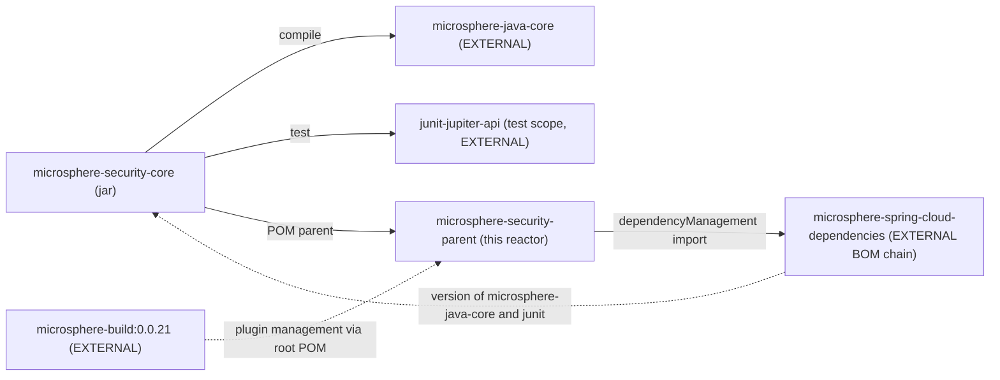

# microsphere-security-core

> **Version-line note:** This repository currently has no `release` or `release-1.x` branch. The `current` documentation line is generated from the `main` branch (revision `0.0.1-SNAPSHOT`, pre-1.0, nothing released). `@since 1.0.0` javadoc tags are forward promises. Snapshots only: `https://s01.oss.sonatype.org/content/repositories/snapshots`.

- Index: [README.md](README.md) · Architecture: [architecture.md](architecture.md)
- User-facing docs: [../user-guide/microsphere-security-core.md](../user-guide/microsphere-security-core.md)
- Chinese mirror: [microsphere-security-core.zh.md](microsphere-security-core.zh.md)

## Purpose

The constants layer of the project. It contains exactly one production type,
`io.microsphere.security.constants.SecurityConstants`, an `interface` whose members are the
`microsphere.security.*` configuration-property prefixes used by the Spring Boot module. Its
job is to keep those literals defined once, composed from the platform-wide prefixes supplied
by the external `microsphere-java-core`, so that no other module has to re-type them.

The module deliberately has no framework dependency of its own; it is safe to use from
non-Spring code.

## Module layout

```text
microsphere-security-core/
├── pom.xml
└── src/
    ├── main/java/io/microsphere/security/constants/
    │   └── SecurityConstants.java
    └── test/java/io/microsphere/security/constants/
        └── SecurityConstantsTest.java
```

## Dependencies



| Dependency | Scope | Version declared here | Notes |
| --- | --- | --- | --- |
| `io.github.microsphere-projects:microsphere-java-core` | compile | **no** | Version arrives from the external BOM imported by `microsphere-security-parent`. |
| `org.junit.jupiter:junit-jupiter-api` | test | **no** | Same provenance. |

`microsphere-security-spring-boot` depends on this module with an explicit
`<version>${revision}</version>`; nothing else in the reactor consumes it.

## Source analysis

`SecurityConstants` is declared as:

```java
public interface SecurityConstants {

    String PROPERTY_NAME_PREFIX = MICROSPHERE_PROPERTY_NAME_PREFIX + "security" + DOT_CHAR;

    String WEB_SECURITY_PROPERTY_NAME_PREFIX = PROPERTY_NAME_PREFIX + "web";

    String WEB_SECURITY_FILTER_PROPERTY_NAME_PREFIX = WEB_SECURITY_PROPERTY_NAME_PREFIX + DOT_CHAR + "filter" + DOT_CHAR;

    String WEB_SECURITY_CSP_PROPERTY_NAME_PREFIX = WEB_SECURITY_PROPERTY_NAME_PREFIX + DOT_CHAR + "csp" + DOT_CHAR;

    String WEB_SECURITY_CORS_PROPERTY_NAME_PREFIX = WEB_SECURITY_PROPERTY_NAME_PREFIX + DOT_CHAR + "cors" + DOT_CHAR;
}
```

with the two external symbols imported statically:

```java
import static io.microsphere.constants.PropertyConstants.MICROSPHERE_PROPERTY_NAME_PREFIX; // "microsphere."
import static io.microsphere.constants.SymbolConstants.DOT_CHAR;                            // '.'
```

### Resolved values

`MICROSPHERE_PROPERTY_NAME_PREFIX` is `"microsphere."` (already dot-terminated) and
`DOT_CHAR` is `'.'`, both owned by the external `microsphere-java-core`. Substituting them:

| Constant | Composed from | Resolved value | Trailing dot |
| --- | --- | --- | --- |
| `PROPERTY_NAME_PREFIX` | `"microsphere." + "security" + '.'` | `microsphere.security.` | yes |
| `WEB_SECURITY_PROPERTY_NAME_PREFIX` | `PROPERTY_NAME_PREFIX + "web"` | `microsphere.security.web` | **no** |
| `WEB_SECURITY_FILTER_PROPERTY_NAME_PREFIX` | `WEB_SECURITY_PROPERTY_NAME_PREFIX + '.' + "filter" + '.'` | `microsphere.security.web.filter.` | yes |
| `WEB_SECURITY_CSP_PROPERTY_NAME_PREFIX` | `WEB_SECURITY_PROPERTY_NAME_PREFIX + '.' + "csp" + '.'` | `microsphere.security.web.csp.` | yes |
| `WEB_SECURITY_CORS_PROPERTY_NAME_PREFIX` | `WEB_SECURITY_PROPERTY_NAME_PREFIX + '.' + "cors" + '.'` | `microsphere.security.web.cors.` | yes |

`SecurityConstantsTest` asserts exactly these five strings, so the table above is machine-checked
rather than inferred.

### Why the `web` prefix has no trailing dot

The asymmetry is functional, not accidental. The five constants feed two consumers with
*opposite* trailing-dot requirements:

- `WEB_SECURITY_PROPERTY_NAME_PREFIX` is used as `@ConfigurationProperties(prefix = ...)`. A
  binding prefix must be in canonical dot-separated form, so appending `.` would be wrong there.
- `PROPERTY_NAME_PREFIX`, `WEB_SECURITY_FILTER_PROPERTY_NAME_PREFIX`,
  `WEB_SECURITY_CSP_PROPERTY_NAME_PREFIX` and `WEB_SECURITY_CORS_PROPERTY_NAME_PREFIX` are used
  as `@ConditionalOnProperty(prefix = ..., name = ENABLED_PROPERTY_NAME)`, where Spring Boot
  concatenates the prefix with the property name.

The practical consequence for developers: the constants are *not* interchangeable. Pasting
`WEB_SECURITY_PROPERTY_NAME_PREFIX` where a dot-terminated prefix is expected, or adding a new
constant with the wrong termination, produces a silently non-matching property name rather than
a compile error. If you add a constant, add a matching `assertEquals` to the test and state in
the javadoc whether it is dot-terminated.

### The interface-as-constants-holder choice

Holding constants on an `interface` means any type that `implements SecurityConstants` inherits
all five names unqualified, and the interface can be implemented by accident. It also prevents
the usual `final class + private constructor` guard. The current codebase never implements the
interface — it is only ever referenced through `SecurityConstants.CONSTANT` or a static import —
so the exposure is theoretical. Keep that invariant if you add types: prefer static imports
(what `microsphere-security-spring-boot` does) over `implements`.

## Extension points

- **Add a property prefix.** Add one constant composed from `WEB_SECURITY_PROPERTY_NAME_PREFIX`
  plus `DOT_CHAR`, assert its literal in `SecurityConstantsTest`, then reference it from the
  Spring Boot module via a static import. Never inline the literal there.
- **Add a non-web prefix.** Compose from `PROPERTY_NAME_PREFIX`, keeping the `microsphere.security.`
  root intact so `@ConditionalOnEnabledSecurity` continues to govern it.
- Nothing in this module is pluggable at runtime; it is compile-time data.

## Building and testing

```bash
mvn -B -pl microsphere-security-core -am test        # from the repository root
mvn -B -pl microsphere-security-core test            # once the parent POM is installed
```

The test is a plain JUnit 5 class with five `assertEquals` checks and no Spring context, so it
runs in milliseconds and needs no container.

## Pitfalls

1. **Don't drop the module's only compile dependency.** `microsphere-java-core` supplies both
   imported symbols; without it `SecurityConstants` does not compile, and because the version is
   managed externally the dependency must stay version-free in this POM.
2. **Don't "fix" the trailing dots wholesale.** Changing
   `WEB_SECURITY_PROPERTY_NAME_PREFIX` to end with `.` breaks its use as a binding prefix;
   changing the `filter.`/`csp.`/`cors.` constants to drop their trailing dot breaks their use as
   condition prefixes. Each constant's termination is part of its contract.
3. **Property names are not validated at compile time.** A wrong constant yields a property that
   simply never matches; the generated `spring-configuration-metadata.json` in the Spring Boot
   module is the artefact to diff against when in doubt.
4. **`@since 1.0.0`** in the javadoc is a forward promise; nothing is released yet — see the
   version-line note above.

## Next

- Consumer of these constants: [microsphere-security-spring-boot.md](microsphere-security-spring-boot.md)
- Version provenance: [microsphere-security-parent.md](microsphere-security-parent.md)

## 中文

[简体中文](microsphere-security-core.zh.md)
