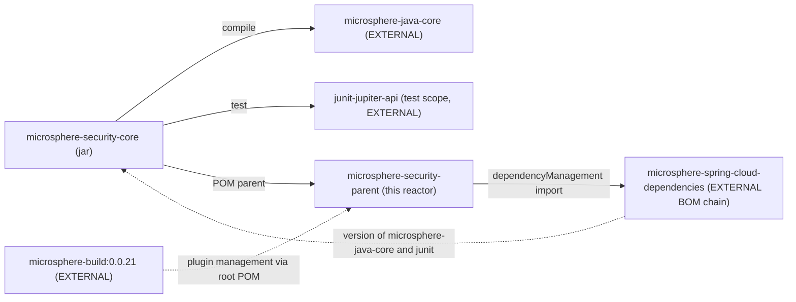

# microsphere-security-core

> **版本线说明：** 本仓库当前没有 `release` 或 `release-1.x` 分支。`current` 文档线由 `main` 分支生成（revision 为 `0.0.1-SNAPSHOT`，处于 1.0 之前，尚未发布任何版本）。javadoc 中的 `@since 1.0.0` 标记是对未来的承诺。仅有快照仓库：`https://s01.oss.sonatype.org/content/repositories/snapshots`。

- 索引：[README.zh.md](README.zh.md) · 架构：[architecture.zh.md](architecture.zh.md)
- 面向用户的文档：[../user-guide/microsphere-security-core.md](../user-guide/microsphere-security-core.zh.md)
- 英文原文：[microsphere-security-core.md](microsphere-security-core.md)

## 目的

项目的常量层。它只包含一个生产类型
`io.microsphere.security.constants.SecurityConstants`，这是一个 `interface`，其成员就是
Spring Boot 模块所使用的 `microsphere.security.*` 配置属性前缀。它的职责是把这些字面量集中
定义一次，并基于外部 `microsphere-java-core` 提供的平台级前缀组合而来，使其他模块无需重新
键入它们。

本模块有意不引入任何自己的框架依赖；从非 Spring 代码中使用它是安全的。

## 模块结构

```text
microsphere-security-core/
├── pom.xml
└── src/
    ├── main/java/io/microsphere/security/constants/
    │   └── SecurityConstants.java
    └── test/java/io/microsphere/security/constants/
        └── SecurityConstantsTest.java
```

## 依赖



| 依赖 | 作用域 | 本模块是否声明版本 | 说明 |
| --- | --- | --- | --- |
| `io.github.microsphere-projects:microsphere-java-core` | compile | **否** | 版本来自 `microsphere-security-parent` 导入的外部 BOM。 |
| `org.junit.jupiter:junit-jupiter-api` | test | **否** | 来源相同。 |

`microsphere-security-spring-boot` 以显式的 `<version>${revision}</version>` 依赖本模块；
reactor 中没有其他模块消费它。

## 源码分析

`SecurityConstants` 的声明为：

```java
public interface SecurityConstants {

    String PROPERTY_NAME_PREFIX = MICROSPHERE_PROPERTY_NAME_PREFIX + "security" + DOT_CHAR;

    String WEB_SECURITY_PROPERTY_NAME_PREFIX = PROPERTY_NAME_PREFIX + "web";

    String WEB_SECURITY_FILTER_PROPERTY_NAME_PREFIX = WEB_SECURITY_PROPERTY_NAME_PREFIX + DOT_CHAR + "filter" + DOT_CHAR;

    String WEB_SECURITY_CSP_PROPERTY_NAME_PREFIX = WEB_SECURITY_PROPERTY_NAME_PREFIX + DOT_CHAR + "csp" + DOT_CHAR;

    String WEB_SECURITY_CORS_PROPERTY_NAME_PREFIX = WEB_SECURITY_PROPERTY_NAME_PREFIX + DOT_CHAR + "cors" + DOT_CHAR;
}
```

其中两个外部符号通过静态导入引入：

```java
import static io.microsphere.constants.PropertyConstants.MICROSPHERE_PROPERTY_NAME_PREFIX; // "microsphere."
import static io.microsphere.constants.SymbolConstants.DOT_CHAR;                            // '.'
```

### 解析后的取值

`MICROSPHERE_PROPERTY_NAME_PREFIX` 是 `"microsphere."`（本身已带结尾点），`DOT_CHAR` 是 `'.'`，
两者都由外部 `microsphere-java-core` 拥有。代入后得到：

| 常量 | 组合来源 | 解析结果 | 结尾点 |
| --- | --- | --- | --- |
| `PROPERTY_NAME_PREFIX` | `"microsphere." + "security" + '.'` | `microsphere.security.` | 有 |
| `WEB_SECURITY_PROPERTY_NAME_PREFIX` | `PROPERTY_NAME_PREFIX + "web"` | `microsphere.security.web` | **无** |
| `WEB_SECURITY_FILTER_PROPERTY_NAME_PREFIX` | `WEB_SECURITY_PROPERTY_NAME_PREFIX + '.' + "filter" + '.'` | `microsphere.security.web.filter.` | 有 |
| `WEB_SECURITY_CSP_PROPERTY_NAME_PREFIX` | `WEB_SECURITY_PROPERTY_NAME_PREFIX + '.' + "csp" + '.'` | `microsphere.security.web.csp.` | 有 |
| `WEB_SECURITY_CORS_PROPERTY_NAME_PREFIX` | `WEB_SECURITY_PROPERTY_NAME_PREFIX + '.' + "cors" + '.'` | `microsphere.security.web.cors.` | 有 |

`SecurityConstantsTest` 断言的正是上述五个字符串，因此这张表是被机器校验过的，而不是推断出来的。

### 为什么 `web` 前缀没有结尾点

这种不对称是功能性的，而非疏忽。五个常量服务于两类消费者，而它们对结尾点的要求恰好*相反*：

- `WEB_SECURITY_PROPERTY_NAME_PREFIX` 被用作 `@ConfigurationProperties(prefix = ...)`。绑定前缀
  必须是规范化的点分隔形式，因此在那里追加 `.` 是错误的。
- `PROPERTY_NAME_PREFIX`、`WEB_SECURITY_FILTER_PROPERTY_NAME_PREFIX`、
  `WEB_SECURITY_CSP_PROPERTY_NAME_PREFIX` 与 `WEB_SECURITY_CORS_PROPERTY_NAME_PREFIX` 被用作
  `@ConditionalOnProperty(prefix = ..., name = ENABLED_PROPERTY_NAME)`，由 Spring Boot 把前缀与
  属性名拼接起来。

对开发者的实际影响是：这些常量*不能*互相替换。把 `WEB_SECURITY_PROPERTY_NAME_PREFIX` 贴到期望
带点前缀的位置，或者新增一个结尾点选择错误的常量，产生的都是一个永远匹配不上的属性名，而
不是编译错误。若要新增常量，请同时在测试中补一条对应的 `assertEquals`，并在 javadoc 里写明
它是否以点结尾。

### 关于用接口承载常量

把常量放在 `interface` 上意味着任何 `implements SecurityConstants` 的类型都会不加限定地继承
这五个名字，而且该接口可能被意外实现。它也无法使用常见的 `final class + private constructor`
防护。当前代码库从未实现该接口 —— 它只通过 `SecurityConstants.CONSTANT` 或静态导入被引用 ——
因此这一风险仅是理论上的。新增类型时请保持该不变式：优先使用静态导入（这正是
`microsphere-security-spring-boot` 的做法）而不是 `implements`。

## 扩展点

- **新增属性前缀。** 基于 `WEB_SECURITY_PROPERTY_NAME_PREFIX` 加 `DOT_CHAR` 组合出一个常量，
  在 `SecurityConstantsTest` 中断言其字面量，然后通过静态导入被 Spring Boot 模块引用。
  绝不要在那里内联字面量。
- **新增非 web 前缀。** 从 `PROPERTY_NAME_PREFIX` 组合而来，保持 `microsphere.security.` 这个
  根不变，`@ConditionalOnEnabledSecurity` 才能继续管辖它。
- 本模块没有任何运行期可插拔点；它是编译期数据。

## 构建与测试

```bash
mvn -B -pl microsphere-security-core -am test        # from the repository root
mvn -B -pl microsphere-security-core test            # once the parent POM is installed
```

测试是一个纯 JUnit 5 类，包含五条 `assertEquals` 断言，不创建 Spring 上下文，因此毫秒级完成，
也不需要容器。

## 陷阱

1. **不要移除本模块唯一的 compile 依赖。** `microsphere-java-core` 提供了两个被导入的符号；
   缺少它 `SecurityConstants` 无法编译；又因为版本由外部管理，该依赖在本 POM 中必须保持
   不写版本。
2. **不要“统一”结尾点。** 把 `WEB_SECURITY_PROPERTY_NAME_PREFIX` 改成以 `.` 结尾会破坏它作为
   绑定前缀的用法；把 `filter.`/`csp.`/`cors.` 常量改成去掉结尾点会破坏它们作为条件前缀的用法。
   每个常量的结尾形式都是其契约的一部分。
3. **属性名不会在编译期被校验。** 用错常量只会得到一个永不匹配的属性；有疑问时应比对 Spring
   Boot 模块生成的 `spring-configuration-metadata.json`。
4. javadoc 中的 **`@since 1.0.0`** 是对未来的承诺；目前尚未发布任何版本 —— 见上方的版本线说明。

## 下一步

- 这些常量的消费者：[microsphere-security-spring-boot.zh.md](microsphere-security-spring-boot.zh.md)
- 版本来源：[microsphere-security-parent.zh.md](microsphere-security-parent.zh.md)

## English

[English](microsphere-security-core.md)
