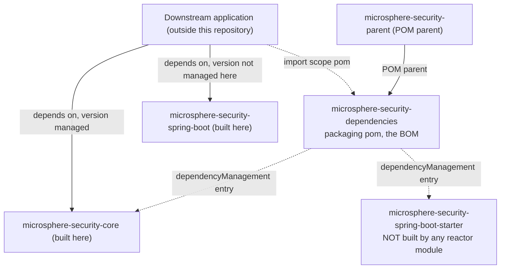

# microsphere-security-dependencies

> **Version-line note:** This repository currently has no `release` or `release-1.x` branch. The `current` documentation line is generated from the `main` branch (revision `0.0.1-SNAPSHOT`, pre-1.0, nothing released). `@since 1.0.0` javadoc tags are forward promises. Snapshots only: `https://s01.oss.sonatype.org/content/repositories/snapshots`.

- Index: [README.md](README.md) · Architecture: [architecture.md](architecture.md)
- User-facing docs: [../user-guide/microsphere-security-dependencies.md](../user-guide/microsphere-security-dependencies.md)
- Chinese mirror: [microsphere-security-dependencies.zh.md](microsphere-security-dependencies.zh.md)

## Purpose

`microsphere-security-dependencies` is the published **BOM** of this project: a `pom`-packaging
module whose only content is a `dependencyManagement` block listing the project's own
coordinates at `${revision}`, so that a downstream application can import it and then depend on
microsphere-security artifacts without repeating versions.

It is a *leaf* in the dependency graph: nothing inside this reactor imports it. It is produced
for consumers, which means a mistake here does not break the local build — see Pitfalls.

## What it manages and who consumes it



| Managed coordinate | Produced by this reactor? | Consumer impact |
| --- | --- | --- |
| `io.github.microsphere-projects:microsphere-security-core:${revision}` | **yes** — `microsphere-security-core/pom.xml` | Version-free dependency works. |
| `io.github.microsphere-projects:microsphere-security-spring-boot-starter:${revision}` | **no** — the module's `artifactId` is `microsphere-security-spring-boot` | A consumer that relies on the BOM for this coordinate resolves an artifact this build does not produce. |

## Source analysis

```xml
<parent>
    <groupId>io.github.microsphere-projects</groupId>
    <artifactId>microsphere-security-parent</artifactId>
    <version>${revision}</version>
    <relativePath>../microsphere-security-parent/pom.xml</relativePath>
</parent>

<artifactId>microsphere-security-dependencies</artifactId>
<version>${revision}</version>
<packaging>pom</packaging>

<dependencyManagement>
    <dependencies>
        <dependency>
            <groupId>io.github.microsphere-projects</groupId>
            <artifactId>microsphere-security-core</artifactId>
            <version>${revision}</version>
        </dependency>
        <dependency>
            <groupId>io.github.microsphere-projects</groupId>
            <artifactId>microsphere-security-spring-boot-starter</artifactId>
            <version>${revision}</version>
        </dependency>
    </dependencies>
</dependencyManagement>
```

Key structural facts:

- It inherits from `microsphere-security-parent`, so it also carries the external
  `microsphere-spring-cloud-dependencies` import in its own effective model. The two blocks do
  **not** merge into the child's *declared* `dependencyManagement` — the published POM lists
  only the two microsphere-security entries, and the inherited/external management is what a
  consumer gets after Maven resolves the parent chain.
- No `<properties>`, no `<modules>`, no `<build>`, no `src/`.
- Both entries use `<version>${revision}</version>` rather than `${project.version}`, matching
  the CI-friendly convention used across the repository.
- The BOM does not manage `microsphere-security-parent` or itself; those are POMs, not
  consumable libraries.

## The starter-name discrepancy (known issue)

The root POM's `<modules>` are `microsphere-security-parent`,
`microsphere-security-dependencies`, `microsphere-security-core`,
`microsphere-security-spring-boot`, and there is no directory or `artifactId` ending in
`-starter`. Therefore:

- `microsphere-security-spring-boot` is a *managed-library-shaped* jar (no `spring-boot-starter`
  dependency of its own, no `-starter` artifact) that is published under its real name;
- the `-starter` entry in this BOM is **forward-looking placeholder** text. It may anticipate a
  future starter module, but as of revision `0.0.1-SNAPSHOT` nothing produces it.

If you need to reference the integration from an application today, depend on
`microsphere-security-spring-boot` explicitly (and add the Servlet container/starter yourself,
because the Spring Boot dependencies in that module are `optional`). Do not document the starter
coordinate as available without re-checking the reactor.

## Extension points

| Want to… | Do this |
| --- | --- |
| Add a module to the BOM | Append a `<dependency>` with `<version>${revision}</version>` **and** add the module to the root `<modules>`; the two lists are not linked by Maven. |
| Rename a module | Update its `<artifactId>`, this BOM's entry, and every consumer-facing doc in the same change — the mismatch is silent. |
| Also manage external artifacts | Add them to `microsphere-security-parent` (or rely on the external BOM), not here; this file is deliberately project-owned coordinates only. |

A useful review checklist: for every `artifactId` declared with `<packaging>jar</packaging>` in
this reactor, there should be exactly one entry here — which today is not true (`-spring-boot`
is missing, `-spring-boot-starter` is unsupported).

## Building and verifying

```bash
mvn -B -pl microsphere-security-dependencies install   # BOM into the local repository
mvn -B deploy                                          # to the ossrh targets from the root POM
```

To confirm what the BOM actually contains after CI-friendly flattening, inspect the
**installed/deployed** POM rather than the source file: the external `microsphere-build` parent
runs `flatten-maven-plugin` with `flattenMode=resolveCiFriendliesOnly` and
`pomElements.dependencyManagement=interpolate`, so `${revision}` substitution is a property of
that plugin configuration. Verify the emitted POM instead of assuming the literal was replaced.

## Pitfalls

1. **Silent failure mode.** Because no reactor module imports this BOM, a wrong `artifactId`,
   a typo or a dangling coordinate cannot fail `mvn verify` here. Only a downstream consumer
   notices. Add the checklist above to code review.
2. **Import order matters for consumers.** If an application imports both this BOM and the
   external `microsphere-spring-cloud-dependencies`, the *first* import wins for any coordinate
   present in both, so keep this BOM narrow.
3. **`${revision}` here must equal the root's `revision`.** It does today; if you ever introduce a
   second version property, remember that the `-starter` entry has no producing module to
   validate it against.
4. **Do not "fix" the discrepancy by deleting the entry** without checking downstream usage; the
   coordinate may already be referenced by applications outside this repository. The safe change
   is to add a `-starter` module or to document the real name.

## Next

- What the managed jar actually contains: [microsphere-security-core.md](microsphere-security-core.md),
  [microsphere-security-spring-boot.md](microsphere-security-spring-boot.md)
- Where the inherited versions come from: [microsphere-security-parent.md](microsphere-security-parent.md)

## 中文

[简体中文](microsphere-security-dependencies.zh.md)
