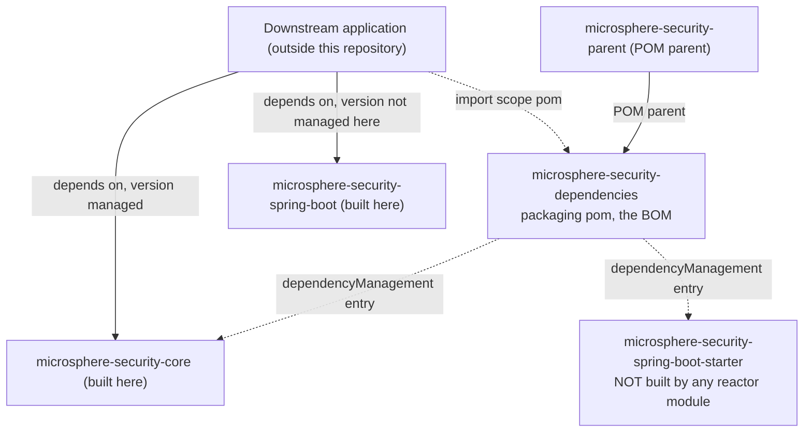

# microsphere-security-dependencies

> **版本线说明：** 本仓库当前没有 `release` 或 `release-1.x` 分支。`current` 文档线由 `main` 分支生成（revision 为 `0.0.1-SNAPSHOT`，处于 1.0 之前，尚未发布任何版本）。javadoc 中的 `@since 1.0.0` 标记是对未来的承诺。仅有快照仓库：`https://s01.oss.sonatype.org/content/repositories/snapshots`。

- 索引：[README.zh.md](README.zh.md) · 架构：[architecture.zh.md](architecture.zh.md)
- 面向用户的文档：[../user-guide/microsphere-security-dependencies.md](../user-guide/microsphere-security-dependencies.zh.md)
- 英文原文：[microsphere-security-dependencies.md](microsphere-security-dependencies.md)

## 目的

`microsphere-security-dependencies` 是本项目对外发布的 **BOM**：一个 `pom` 打包类型的模块，
其唯一内容是一个 `dependencyManagement` 块，以 `${revision}` 列出本项目自身的坐标，使下游应用
可以导入它、然后依赖 microsphere-security 的构件而无需重复版本。

它在依赖图中是一个*叶子*：本 reactor 内没有任何模块导入它。它是为使用者产出的，这意味着这里
出错不会让本地构建失败 —— 见「陷阱」。

## 它管理什么、谁消费它



| 被管理的坐标 | 是否由本 reactor 产出 | 对使用者的影响 |
| --- | --- | --- |
| `io.github.microsphere-projects:microsphere-security-core:${revision}` | **是** —— `microsphere-security-core/pom.xml` | 不写版本的依赖可以正常工作。 |
| `io.github.microsphere-projects:microsphere-security-spring-boot-starter:${revision}` | **否** —— 该模块的 `artifactId` 是 `microsphere-security-spring-boot` | 依赖该 BOM 的这个坐标去解析的使用者，会解析到本次构建并不产出的构件。 |

## 源码分析

```xml
<parent>
    <groupId>io.github.microsphere-projects</groupId>
    <artifactId>microsphere-security-parent</artifactId>
    <version>${revision}</version>
    <relativePath>../microsphere-security-parent/pom.xml</relativePath>
</parent>

<artifactId>microsphere-security-dependencies</artifactId>
<version>${revision}</version>
<packaging>pom</packaging>

<dependencyManagement>
    <dependencies>
        <dependency>
            <groupId>io.github.microsphere-projects</groupId>
            <artifactId>microsphere-security-core</artifactId>
            <version>${revision}</version>
        </dependency>
        <dependency>
            <groupId>io.github.microsphere-projects</groupId>
            <artifactId>microsphere-security-spring-boot-starter</artifactId>
            <version>${revision}</version>
        </dependency>
    </dependencies>
</dependencyManagement>
```

关键的结构事实：

- 它继承自 `microsphere-security-parent`，因此其 effective model 中也带有外部的
  `microsphere-spring-cloud-dependencies` 导入。两个块**不会**合并进子 POM *声明的*
  `dependencyManagement` —— 发布的 POM 里只列出这两条 microsphere-security 条目；使用者在
  Maven 解析完父链之后得到的才是继承来的/外部管理内容。
- 没有 `<properties>`，没有 `<modules>`，没有 `<build>`，没有 `src/`。
- 两个条目都使用 `<version>${revision}</version>` 而不是 `${project.version}`，与全仓库统一的
  CI 友好约定一致。
- 该 BOM 不管理 `microsphere-security-parent`，也不管理自身；它们是 POM，不是可消费的库。

## starter 命名不一致（已知问题）

根 POM 的 `<modules>` 是 `microsphere-security-parent`、`microsphere-security-dependencies`、
`microsphere-security-core`、`microsphere-security-spring-boot`，不存在以 `-starter` 结尾的
目录或 `artifactId`。因此：

- `microsphere-security-spring-boot` 是一个*受管理库形态*的 jar（它自己不依赖
  `spring-boot-starter`，也不是 `-starter` 构件），以真实名称发布；
- 本 BOM 中的 `-starter` 条目是**面向未来的占位**文字。它可能预示着一个未来的 starter 模块，
  但在 revision `0.0.1-SNAPSHOT` 上没有任何东西产出它。

如果你今天就需要在应用里引用这套集成，请显式依赖 `microsphere-security-spring-boot`（并且自行
引入 Servlet 容器/starter，因为该模块里的 Spring Boot 依赖是 `optional`）。在没有重新核对
reactor 之前，不要把 starter 坐标写成可用能力。

## 扩展点

| 想要…… | 做法 |
| --- | --- |
| 往 BOM 里加一个模块 | 追加一条 `<version>${revision}</version>` 的 `<dependency>`，**并且**把该模块加进根 `<modules>`；这两份列表之间没有 Maven 层面的联动。 |
| 重命名一个模块 | 在同一次变更里更新它的 `<artifactId>`、本 BOM 的条目以及所有面向使用者的文档 —— 不一致是静默的。 |
| 同时管理外部构件 | 加到 `microsphere-security-parent`（或依赖外部 BOM），不要加在这里；本文件刻意只收录项目自有坐标。 |

一条有用的评审清单：本 reactor 中每个 `<packaging>jar</packaging>` 的 `artifactId`，这里都应当
恰好有一条对应条目 —— 而今天并不成立（缺了 `-spring-boot`，而 `-spring-boot-starter` 没有支撑）。

## 构建与验证

```bash
mvn -B -pl microsphere-security-dependencies install   # BOM into the local repository
mvn -B deploy                                          # to the ossrh targets from the root POM
```

要确认经 CI 友好扁平化后的 BOM 究竟包含什么，请检查**已安装/已部署**的 POM，而不是源文件：
外部 `microsphere-build` 父工程以 `flattenMode=resolveCiFriendliesOnly` 和
`pomElements.dependencyManagement=interpolate` 运行 `flatten-maven-plugin`，因此 `${revision}`
的替换是该插件配置的性质。请核验产出的 POM，而不要假定字面量已被替换。

## 陷阱

1. **静默失败。** 由于 reactor 内没有模块导入本 BOM，错误的 `artifactId`、拼写错误或悬空坐标都
   不会让这里的 `mvn verify` 失败。只有下游使用者才会发现。请把上面的清单纳入代码评审。
2. **导入顺序对使用者很重要。** 如果某个应用同时导入本 BOM 与外部的
   `microsphere-spring-cloud-dependencies`，对两者都存在的坐标而言*先*导入的生效，因此请让本
   BOM 保持精简。
3. **这里的 `${revision}` 必须与根 POM 的 `revision` 相同。** 目前成立；一旦引入第二个版本属性，
   请记住 `-starter` 条目没有对应的产出模块可供校验。
4. **不要不加检查就“修掉”这个不一致** —— 本仓库之外的应用可能已经引用了该坐标。安全的做法是
   新增一个 `-starter` 模块，或者把真实名称写进文档。

## 下一步

- 被管理的 jar 里到底有什么：[microsphere-security-core.zh.md](microsphere-security-core.zh.md)、
  [microsphere-security-spring-boot.zh.md](microsphere-security-spring-boot.zh.md)
- 继承而来的版本来自哪里：[microsphere-security-parent.zh.md](microsphere-security-parent.zh.md)

## English

[English](microsphere-security-dependencies.md)
