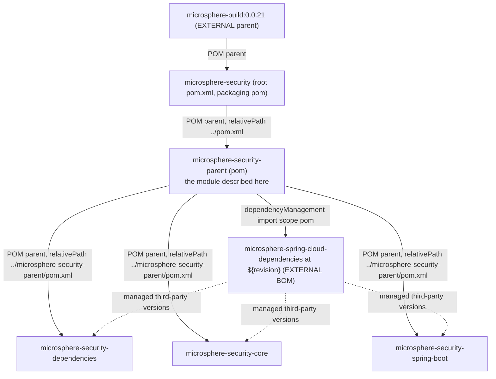
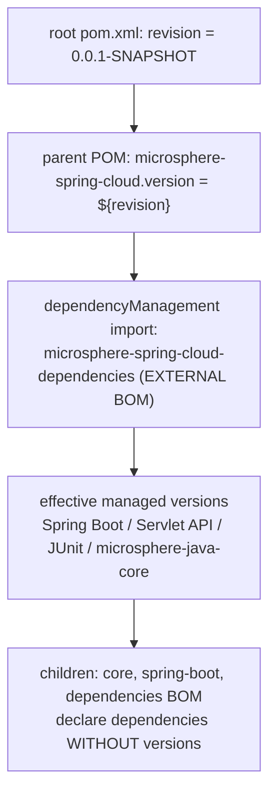

# microsphere-security-parent

> **Version-line note:** This repository currently has no `release` or `release-1.x` branch. The `current` documentation line is generated from the `main` branch (revision `0.0.1-SNAPSHOT`, pre-1.0, nothing released). `@since 1.0.0` javadoc tags are forward promises. Snapshots only: `https://s01.oss.sonatype.org/content/repositories/snapshots`.

- Index: [README.md](README.md) · Architecture: [architecture.md](architecture.md)
- User-facing docs: [../user-guide/microsphere-security-parent.md](../user-guide/microsphere-security-parent.md)
- Chinese mirror: [microsphere-security-parent.zh.md](microsphere-security-parent.zh.md)

## Architecture Design

`microsphere-security-parent` is a `pom`-packaging convention module. It is the POM parent of
all three buildable/consuming modules (`microsphere-security-dependencies`,
`microsphere-security-core`, `microsphere-security-spring-boot`) and its only content is a
single `dependencyManagement` block that imports the **external**
`microsphere-spring-cloud-dependencies` BOM. Through that import the whole reactor inherits the
versions of Spring Boot, the Servlet API, `commons-lang3`, JUnit and `microsphere-java-core` —
none of which are declared in this repository.

It has no `src/` directory, no `<modules>` element (it is *not* an aggregator) and no `<build>`
section.

## Module Dependencies



| Relationship | Mechanism | Result |
| --- | --- | --- |
| parent → root | `<parent>` with `<relativePath>../pom.xml</relativePath>` | Inherits the external `microsphere-build` conventions, `<repositories>` and `<distributionManagement>`. |
| parent → external BOM | `<scope>import</scope>`, `<type>pom</type>` | Third-party versions become available to the three child modules without repeating them. |
| parent → child modules | `<parent>` in each child POM | Child modules declare `<version>${revision}</version>` and no `<properties>`. |

## Source Code Analysis

The module is 40 lines of POM:

```xml
<parent>
    <groupId>io.github.microsphere-projects</groupId>
    <artifactId>microsphere-security</artifactId>
    <version>${revision}</version>
    <relativePath>../pom.xml</relativePath>
</parent>

<artifactId>microsphere-security-parent</artifactId>
<version>${revision}</version>
<packaging>pom</packaging>

<properties>
    <microsphere-spring-cloud.version>${revision}</microsphere-spring-cloud.version>
</properties>

<dependencyManagement>
    <dependencies>
        <dependency>
            <groupId>io.github.microsphere-projects</groupId>
            <artifactId>microsphere-spring-cloud-dependencies</artifactId>
            <version>${microsphere-spring-cloud.version}</version>
            <type>pom</type>
            <scope>import</scope>
        </dependency>
    </dependencies>
</dependencyManagement>
```

Observations that matter when editing this file:

1. **`groupId` and `name`/`description` are declared in full** (`io.github.microsphere-projects`,
   `Microsphere :: Security :: Parent`) even though the `groupId` is already inherited — a
   house style shared by every module POM in this repository.
2. **`<modelVersion>` comes after `<parent>`** in this POM and in all three child POMs. It is
   valid XML for Maven but differs from the ordering used in the root POM; do not "reformat"
   only one file.
3. **The version indirection is deliberate.** `microsphere-spring-cloud.version` exists so the
   import line reads as a property rather than `${revision}` directly. Its default is `${revision}`,
   so out of the box the external BOM is expected at *the same* revision as this repository.
4. **Nothing is managed for the project's own artifacts here.** That is the job of
   [microsphere-security-dependencies.md](microsphere-security-dependencies.md), which does not
   feed back into this POM.

## Design Patterns

- **Convention Parent** — a single `dependencyManagement` block (importing one external BOM) is
  declared once here and inherited by the three child modules, so no child repeats a version.
- **BOM Import / dependency mediation** — `<scope>import</scope>` pulls the external
  `microsphere-spring-cloud-dependencies` coordinates into this POM's managed space, mediating
  third-party versions the repository itself never declares.
- **CI-friendly versioning** — the `${revision}` placeholder plus the property indirection
  `microsphere-spring-cloud.version` keep versions flattenable and overridable at build time.

## Workflow

The flow below is resolved at *build* time, not runtime: the root `revision` feeds the parent's
version property, which selects the external BOM version, which in turn supplies the managed
versions the child modules declare without repeating. The exact third-party versions live in the
external `microsphere-spring-cloud-dependencies` chain, so resolve them with `help:effective-pom`
and never guess them.



## The revision coupling

Because `microsphere-spring-cloud.version` defaults to `${revision}`, building this reactor
requires `microsphere-spring-cloud-dependencies:0.0.1-SNAPSHOT` (today's value) to be resolvable
from the `snapshot` repository declared in the root POM. Practical consequences:

- The sibling `microsphere-spring-cloud` project must be published at the matching revision,
  otherwise dependency resolution fails before compilation starts.
- Bumping `revision` in the root POM moves the required external BOM version in lockstep. To
  decouple, override the property instead of editing the import:

```bash
mvn -B -Dmicrosphere-spring-cloud.version=<revision-of-the-external-project> clean verify
```

- Because the required BOM is normally a `-SNAPSHOT`, builds are reproducible only if snapshot
  updates are pinned; CI passes `--update-snapshots`, which deliberately does the opposite.

## Extension points

| Want to… | Do this |
| --- | --- |
| Pin/override one third-party version for all modules | Add a `<dependency>` **directly** inside this POM's `<dependencyManagement>`, *before* the import entry: locally declared management wins over imported BOMs. |
| Introduce a version property | Add it to `<properties>` here so all three children see it, following the existing `microsphere-spring-cloud.version` pattern. |
| Share a plugin configuration | Prefer the external `microsphere-build` parent; adding `<build>` here duplicates it in three published POMs and defeats the purpose of the convention layer. |
| Make a module inherit something else | Change that module's `<parent>` **and** its `<relativePath>`; both are explicit, and leaving `<relativePath>` stale silently resolves the parent from the local repository instead of the working tree. |

## Building and verifying

There is nothing to compile, so the useful checks are resolution checks:

```bash
mvn -B -N validate                                   # root only, no modules
mvn -B -pl microsphere-security-parent install       # makes the parent resolvable outside the reactor
mvn -B -pl microsphere-security-spring-boot help:effective-pom -Doutput=effective.xml
```

`help:effective-pom` on a child module is the fastest way to confirm which version of
`spring-boot-starter-web` (or anything else) the external chain actually supplies today — read it
instead of guessing.

## Pitfalls

1. **This module is a POM parent, not an aggregator.** It lists no `<modules>`; forgetting that
   and adding one turns it into a second reactor root and changes build order.
2. **Imported BOMs cannot see each other's overrides.** Anything added to
   `microsphere-security-dependencies` does **not** apply here — that BOM is a leaf.
3. **Version-free dependencies in children are only valid because of the import.** Removing the
   import breaks `microsphere-security-core` (`microsphere-java-core` has no `<version>`).
4. **External chain opacity.** Spring Boot and Servlet API versions are not written anywhere in
   this repository; treat any number you have not resolved from the effective POM as unknown.

## Next

- The published BOM: [microsphere-security-dependencies.md](microsphere-security-dependencies.md)
- The two code modules: [microsphere-security-core.md](microsphere-security-core.md),
  [microsphere-security-spring-boot.md](microsphere-security-spring-boot.md)

## 中文

[简体中文](microsphere-security-parent.zh.md)
