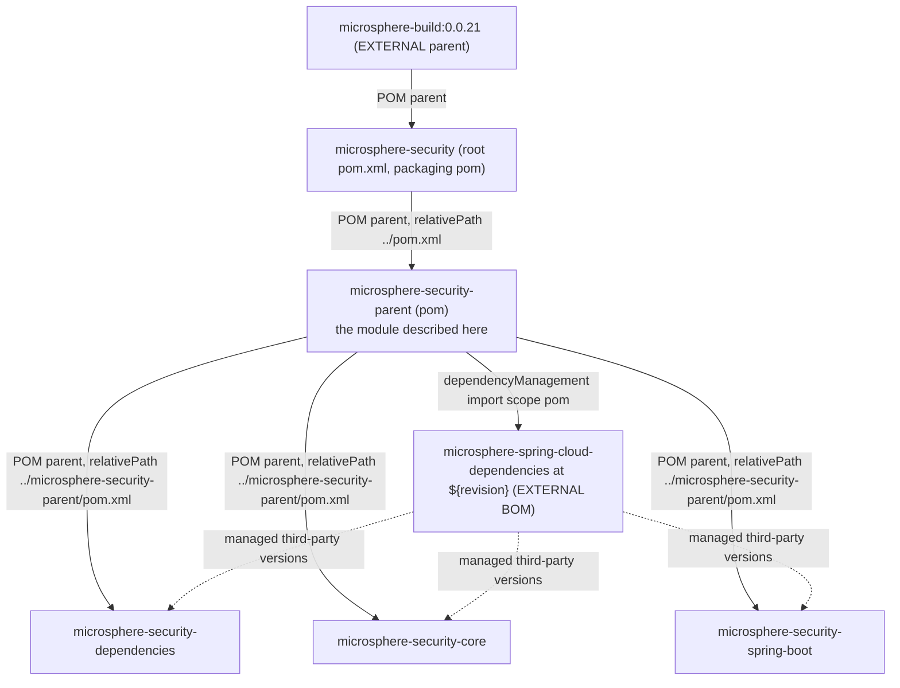

# microsphere-security-parent

> **版本线说明：** 本仓库当前没有 `release` 或 `release-1.x` 分支。`current` 文档线由 `main` 分支生成（revision 为 `0.0.1-SNAPSHOT`，处于 1.0 之前，尚未发布任何版本）。javadoc 中的 `@since 1.0.0` 标记是对未来的承诺。仅有快照仓库：`https://s01.oss.sonatype.org/content/repositories/snapshots`。

- 索引：[README.zh.md](README.zh.md) · 架构：[architecture.zh.md](architecture.zh.md)
- 面向用户的文档：[../user-guide/microsphere-security-parent.md](../user-guide/microsphere-security-parent.zh.md)
- 英文原文：[microsphere-security-parent.md](microsphere-security-parent.md)

## 目的

`microsphere-security-parent` 是一个 `pom` 打包类型的约定模块。它是三个可构建/可消费模块
（`microsphere-security-dependencies`、`microsphere-security-core`、
`microsphere-security-spring-boot`）的 POM 父工程，其唯一内容就是一个
`dependencyManagement` 块，用于导入**外部**的 `microsphere-spring-cloud-dependencies` BOM。
正是通过这个导入，整个 reactor 才继承了 Spring Boot、Servlet API、`commons-lang3`、JUnit 与
`microsphere-java-core` 的版本 —— 这些都没有写在本仓库里。

它没有 `src/` 目录，没有 `<modules>` 元素（它*不是*聚合器），也没有 `<build>` 段。

## 继承关系与作用



| 关系 | 机制 | 结果 |
| --- | --- | --- |
| parent → root | 带 `<relativePath>../pom.xml</relativePath>` 的 `<parent>` | 继承外部 `microsphere-build` 的约定、`<repositories>` 与 `<distributionManagement>`。 |
| parent → 外部 BOM | `<scope>import</scope>`、`<type>pom</type>` | 三个子模块无需重复声明即可获得第三方版本。 |
| parent → 子模块 | 每个子 POM 中的 `<parent>` | 子模块声明 `<version>${revision}</version>`，且不声明 `<properties>`。 |

## 源码分析

这个模块就是 40 行 POM：

```xml
<parent>
    <groupId>io.github.microsphere-projects</groupId>
    <artifactId>microsphere-security</artifactId>
    <version>${revision}</version>
    <relativePath>../pom.xml</relativePath>
</parent>

<artifactId>microsphere-security-parent</artifactId>
<version>${revision}</version>
<packaging>pom</packaging>

<properties>
    <microsphere-spring-cloud.version>${revision}</microsphere-spring-cloud.version>
</properties>

<dependencyManagement>
    <dependencies>
        <dependency>
            <groupId>io.github.microsphere-projects</groupId>
            <artifactId>microsphere-spring-cloud-dependencies</artifactId>
            <version>${microsphere-spring-cloud.version}</version>
            <type>pom</type>
            <scope>import</scope>
        </dependency>
    </dependencies>
</dependencyManagement>
```

修改这个文件时需要注意的几点：

1. **`groupId` 与 `name`/`description` 都是完整声明的**（`io.github.microsphere-projects`、
   `Microsphere :: Security :: Parent`），尽管 `groupId` 其实已经被继承 —— 这是本仓库每个模块
   POM 共用的内部风格。
2. **本 POM 中 `<modelVersion>` 出现在 `<parent>` 之后**，三个子 POM 也是如此。对 Maven 而言
   这是合法 XML，但与根 POM 使用的顺序不同；不要只“整理”其中一个文件。
3. **这层版本间接引用是刻意的。** `microsphere-spring-cloud.version` 的存在让导入行读起来是
   一个属性而不是直接的 `${revision}`。它的默认值就是 `${revision}`，因此开箱状态下，外部 BOM
   被期望与本仓库处于*同一个* revision。
4. **本工程自身的构件没有在这里被管理。** 那是
   [microsphere-security-dependencies.zh.md](microsphere-security-dependencies.zh.md) 的职责，
   并且它不会反向作用到本 POM。

## revision 耦合

由于 `microsphere-spring-cloud.version` 默认为 `${revision}`，构建本 reactor 要求
`microsphere-spring-cloud-dependencies:0.0.1-SNAPSHOT`（当前取值）能够从根 POM 声明的
`snapshot` 仓库解析到。实际影响：

- 兄弟项目 `microsphere-spring-cloud` 必须发布到匹配的 revision，否则依赖解析会在编译开始前就失败。
- 修改根 POM 的 `revision` 会让所需外部 BOM 版本同步变化。若要解耦，请覆盖该属性而不是修改导入：

```bash
mvn -B -Dmicrosphere-spring-cloud.version=<revision-of-the-external-project> clean verify
```

- 由于所需 BOM 通常是 `-SNAPSHOT`，只有在固定快照更新的前提下构建才是可复现的；而 CI 使用了
  `--update-snapshots`，这恰恰是有意选择了相反的策略。

## 扩展点

| 想要…… | 做法 |
| --- | --- |
| 为所有模块锁定/覆盖某个第三方版本 | 在本 POM 的 `<dependencyManagement>` 中**直接**添加 `<dependency>`，并放在导入条目*之前*：本 POM 声明的管理优先于导入的 BOM。 |
| 引入一个版本属性 | 加到本 POM 的 `<properties>`，三个子模块即可看到，沿用现有 `microsphere-spring-cloud.version` 的写法。 |
| 共享插件配置 | 优先放在外部 `microsphere-build` 父工程；写在这里会让三个发布出去的 POM 各自重复一份，违背约定层的初衷。 |
| 让某模块改认别的父工程 | 同时修改该模块的 `<parent>` **和** `<relativePath>`；两者都是显式的，`<relativePath>` 留在过期位置会静默地从本地仓库而非工作树解析父 POM。 |

## 构建与验证

这里没有代码可编译，因此有用的检查都是解析检查：

```bash
mvn -B -N validate                                   # root only, no modules
mvn -B -pl microsphere-security-parent install       # makes the parent resolvable outside the reactor
mvn -B -pl microsphere-security-spring-boot help:effective-pom -Doutput=effective.xml
```

对子模块执行 `help:effective-pom` 是确认外部链今天究竟提供哪个版本的
`spring-boot-starter-web`（或其他依赖）最快的方式 —— 去读它，而不是猜。

## 陷阱

1. **本模块是 POM 父工程，不是聚合器。** 它没有 `<modules>`；忘记这一点而加上一个，就会把它
   变成第二个 reactor 根，并改变构建顺序。
2. **导入的 BOM 之间彼此不可见。** 往 `microsphere-security-dependencies` 里加的任何内容都
   **不会**影响本 POM —— 那个 BOM 是叶子。
3. **子模块中的无版本依赖只是因为有了这个导入才成立。** 删掉导入会破坏
   `microsphere-security-core`（`microsphere-java-core` 没写 `<version>`）。
4. **外部链不透明。** Spring Boot 与 Servlet API 的版本在本仓库中无处可查；凡未从 effective POM
   解析出的数字，都应视为未知。

## 下一步

- 对外发布的 BOM：[microsphere-security-dependencies.zh.md](microsphere-security-dependencies.zh.md)
- 两个代码模块：[microsphere-security-core.zh.md](microsphere-security-core.zh.md)、
  [microsphere-security-spring-boot.zh.md](microsphere-security-spring-boot.zh.md)

## English

[English](microsphere-security-parent.md)
