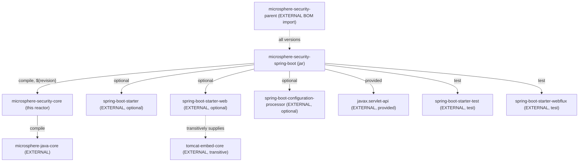
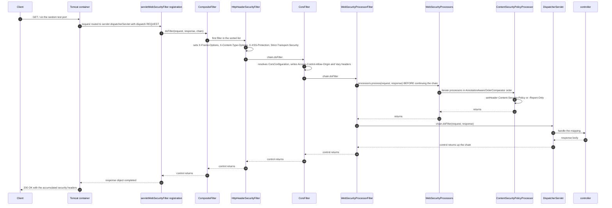
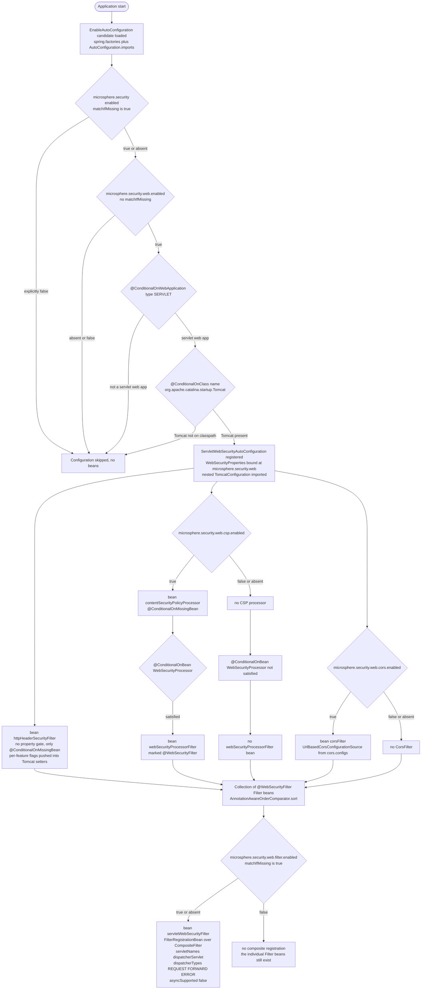
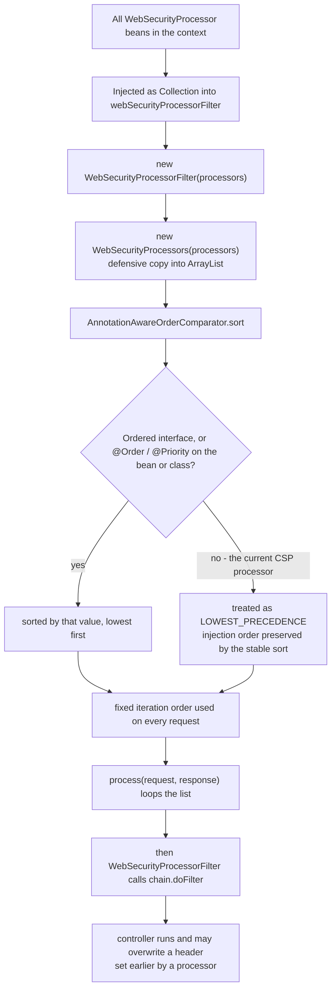

# microsphere-security-spring-boot

> **Version-line note:** This repository currently has no `release` or `release-1.x` branch. The `current` documentation line is generated from the `main` branch (revision `0.0.1-SNAPSHOT`, pre-1.0, nothing released). `@since 1.0.0` javadoc tags are forward promises. Snapshots only: `https://s01.oss.sonatype.org/content/repositories/snapshots`.

- Index: [README.md](README.md) · Architecture: [architecture.md](architecture.md)
- User-facing docs: [../user-guide/microsphere-security-spring-boot.md](../user-guide/microsphere-security-spring-boot.md)
- Chinese mirror: [microsphere-security-spring-boot.zh.md](microsphere-security-spring-boot.zh.md)

## Architecture Design

The Spring Boot integration layer. One auto-configuration class registers a set of servlet
filters that emit security response headers (HSTS, XSS protection, `X-Frame-Options`,
`X-Content-Type-Options`, `Content-Security-Policy`) and CORS handling, driven by one
`@ConfigurationProperties` aggregate. Everything is off unless switched on explicitly, and the
header emission for four of the features is delegated to Tomcat's own
`HttpHeaderSecurityFilter`.

### Module layout

```text
microsphere-security-spring-boot/
├── pom.xml                                            (no <packaging>: defaults to jar)
└── src/
    ├── main/java/io/microsphere/security/spring/boot/
    │   ├── annotation/WebSecurityFilter.java
    │   ├── condition/ConditionalOnEnabledSecurity.java
    │   ├── condition/ConditionalOnEnabledWebSecurity.java
    │   ├── autoconfigure/WebSecurityProperties.java
    │   ├── autoconfigure/web/servlet/ServletWebSecurityAutoConfiguration.java
    │   └── web/servlet/
    │       ├── WebSecurityProcessor.java
    │       ├── WebSecurityProcessors.java
    │       ├── WebSecurityProcessorFilter.java
    │       └── csp/ContentSecurityPolicyProcessor.java
    ├── main/resources/META-INF/
    │   ├── spring.factories
    │   └── spring/org.springframework.boot.autoconfigure.AutoConfiguration.imports
    └── test/java/io/microsphere/security/spring/boot/autoconfigure/web/servlet/
        └── ServletWebSecurityAutoConfigurationTest.java
```

## Module Dependencies



| Dependency | Scope | Why it is there |
| --- | --- | --- |
| `microsphere-security-core` | compile | Static imports of the five property prefixes. |
| `spring-boot-starter` | compile, `optional` | Auto-configuration, `@ConditionalOn*`, `FilterRegistrationBean`. |
| `spring-boot-starter-web` | compile, `optional` | `CompositeFilter`, `CorsFilter`, `UrlBasedCorsConfigurationSource`, Spring MVC types. |
| `spring-boot-configuration-processor` | compile, `optional` | Generates `spring-configuration-metadata.json` at build time. |
| `javax.servlet-api` | provided | `Filter`, `HttpServletRequest`, `DispatcherType`. |
| `tomcat-embed-core` | **not declared** | `org.apache.catalina.filters.HttpHeaderSecurityFilter` is imported directly; it is reached transitively through `spring-boot-starter-web`. |
| `spring-boot-starter-test` | test | JUnit 5 + AssertJ + `WebTestClient` support. |
| `spring-boot-starter-webflux` | test | Only needed to put `WebTestClient` on the classpath. |

`optional` and `provided` together mean this jar compiles against Spring Boot and Tomcat but
transmits **neither** to consumers: an application must bring `spring-boot-starter-web` (and a
Tomcat-based container) itself.

## Registration files

The auto-configuration class is registered twice over:

```text
# META-INF/spring.factories
org.springframework.boot.autoconfigure.EnableAutoConfiguration=\
io.microsphere.security.spring.boot.autoconfigure.web.servlet.ServletWebSecurityAutoConfiguration

# META-INF/spring/org.springframework.boot.autoconfigure.AutoConfiguration.imports
io.microsphere.security.spring.boot.autoconfigure.web.servlet.ServletWebSecurityAutoConfiguration
```

The `spring.factories` key is the Spring Boot 2.x mechanism; the
`...AutoConfiguration.imports` file is read from Spring Boot 2.7 onward. Both are present, so the
discovery side is prepared for the newer registration style. However, the code itself compiles
against `javax.servlet.*` and against Tomcat's `HttpHeaderSecurityFilter` from the `javax` era,
which is the Spring Boot 2.x servlet stack. **Do not read the presence of the imports file as
Spring Boot 3 support**: on Boot 3 the `javax` → `jakarta` namespace change would have to be done
first. Confirm against the Spring Boot version your application actually resolves (see
`help:effective-pom` in [microsphere-security-parent.md](microsphere-security-parent.md)).

## Source Code Analysis

### `annotation.WebSecurityFilter`

```java
@Target({ElementType.FIELD, ElementType.PARAMETER, ElementType.METHOD})
@Retention(RetentionPolicy.RUNTIME)
@Documented
@Inherited
@Qualifier
public @interface WebSecurityFilter {
}
```

A value-less custom `@Qualifier`. Its three uses in the module are all on `@Bean` **methods**
(`httpHeaderSecurityFilter`, `corsFilter`, `webSecurityProcessorFilter`) plus one on the
**injection parameter** of `servletWebSecurityFilter`. Because `@Target` excludes `TYPE`, you
cannot put it on a filter class — annotate your `@Bean` method instead.

The qualifier is what narrows `Collection<Filter>` to "the security filters" rather than "every
filter in the context", so a `CharacterEncodingFilter` or a business filter is not swept into the
composite.

### `condition.ConditionalOnEnabledSecurity`

```java
@ConditionalOnProperty(prefix = PROPERTY_NAME_PREFIX, name = ENABLED_PROPERTY_NAME, matchIfMissing = true)
public @interface ConditionalOnEnabledSecurity {
}
```

`PROPERTY_NAME_PREFIX` is `microsphere.security.` and `ENABLED_PROPERTY_NAME` is the external
`"enabled"`. **Default on**: only an explicit `microsphere.security.enabled=false` disables it.

### `condition.ConditionalOnEnabledWebSecurity`

```java
@ConditionalOnEnabledSecurity
@ConditionalOnProperty(prefix = WEB_SECURITY_PROPERTY_NAME_PREFIX, name = ENABLED_PROPERTY_NAME)
public @interface ConditionalOnEnabledWebSecurity {
}
```

Two `@ConditionalOnProperty` meta-annotations stacked on one annotation, with **no
`matchIfMissing`** on the web-level one. Since `WEB_SECURITY_PROPERTY_NAME_PREFIX` is
`microsphere.security.web` (no trailing dot), the effective web switch is
`microsphere.security.web.enabled`, and web security is **off by default**.

The declared *intent* of the stack is a two-level switch: `microsphere.security.enabled` as a
global kill switch, `microsphere.security.web.enabled` as the area switch. What this repository
does **not** pin down is how Spring Boot merges two `@ConditionalOnProperty` occurrences arriving
from different meta-annotation levels (`name` is array-valued and aggregates; `prefix` and
`matchIfMissing` are single-valued). Whether the global gate is consulted at all alongside the web
gate is therefore an unverified assumption here — check the condition-evaluation report
(`-Ddebug=true`) before documenting `microsphere.security.enabled=false` as sufficient on its own.

### `autoconfigure.WebSecurityProperties`

Bound at `@ConfigurationProperties(prefix = WEB_SECURITY_PROPERTY_NAME_PREFIX)`, i.e.
`microsphere.security.web`. Six nested sections, all instantiated eagerly (non-null getters), all
extending the **package-private** `BaseConfig`:

```java
static class BaseConfig {
    private boolean enabled = false;   // every feature is opt-in
    ...
    @Override public String toString() {
        return ReflectionToStringBuilder.toString(this, ToStringStyle.SHORT_PREFIX_STYLE);
    }
}
```

| Nested type | Property path | Extra fields (defaults) | Consumed by |
| --- | --- | --- | --- |
| `Hsts` | `microsphere.security.web.hsts` | `maxAgeInSeconds` (`0`), `includeSubDomains` (`false`), `preload` (`false`) | `initHsts` → Tomcat filter |
| `Xss` | `microsphere.security.web.xss` | none | `initXssProtection` |
| `XContentType` | `microsphere.security.web.x-content-type` | none | `initXContentTypeOptions` |
| `XFrame` | `microsphere.security.web.x-frame` | `option` (`"DENY"`), `uri` (`null`) | `initXFrameOptions` |
| `Csp` | `microsphere.security.web.csp` | `policyDirectives` (`null`), `reportOnly` (`false`) | `contentSecurityPolicyProcessor` |
| `Cors` | `microsphere.security.web.cors` | `configs` (`LinkedHashMap<String, Config>`) | `corsFilter` |

`Cors.Config` mirrors the shape of Spring's `CorsConfiguration`: `allowedOrigins`,
`allowedMethods`, `allowedHeaders`, `exposedHeaders` (all `List<String>`), `allowCredentials`
(`Boolean`) and `maxAge` (`Long`). The mapping is done with one line:

```java
private CorsConfiguration buildCorsConfiguration(WebSecurityProperties.Cors.Config config) {
    CorsConfiguration corsConfiguration = new CorsConfiguration();
    BeanUtils.copyProperties(config, corsConfiguration);
    return corsConfiguration;
}
```

**This is an implicit, name-and-type-coupled contract.** `BeanUtils.copyProperties` matches by
JavaBean property name and silently skips any pair whose getter type is not assignable to the
setter type. Two consequences for maintainers:

- Renaming a field in `Cors.Config` — or a Spring rename in `CorsConfiguration` — produces no
  error, only a CORS rule that quietly does nothing. There is no test in this repository covering
  `Access-Control-Allow-*` values, only the `Vary` triplet.
- `maxAge` is declared `Long` here, while modern Spring Framework's `CorsConfiguration.maxAge` is
  a `Duration`. Whether your `...cors.configs.<id>.max-age` reaches the filter depends on the
  resolved Spring version and its setter overloads. Verify empirically before documenting
  `max-age` as supported.

`ReflectionToStringBuilder` on `BaseConfig`/`WebSecurityProperties` means a `toString()` of these
objects dumps every field reflectively, including any origin lists you configure — keep that in
mind before logging the bean.

### `autoconfigure.web.servlet.ServletWebSecurityAutoConfiguration`

```java
@ConditionalOnEnabledWebSecurity
@ConditionalOnWebApplication(type = SERVLET)
@ConditionalOnClass(name = "org.apache.catalina.startup.Tomcat")
@AutoConfigureBefore(name = {
        "org.springframework.boot.autoconfigure.web.servlet.WebMvcAutoConfiguration",
        "org.springframework.boot.autoconfigure.web.servlet.DispatcherServletAutoConfiguration"
})
@Import(value = {ServletWebSecurityAutoConfiguration.TomcatConfiguration.class})
@EnableConfigurationProperties(WebSecurityProperties.class)
public class ServletWebSecurityAutoConfiguration {
```

- `@ConditionalOnClass(name = ...)` uses the **string** form so that `tomcat-embed-core` is not
  required as a class-level dependency of this configuration; yet the nested
  `TomcatConfiguration` imports `HttpHeaderSecurityFilter` directly, so the gate is the only thing
  protecting a non-Tomcat deployment. Jetty/Undertow users get a skipped configuration, not an
  exception.
- `@AutoConfigureBefore` places this configuration ahead of the Web MVC and `DispatcherServlet`
  auto-configurations, which matters for `@ConditionalOnBean` evaluation (the processor bean must
  exist before `webSecurityProcessorFilter` is tested) and for registration order.

**Bean: `contentSecurityPolicyProcessor`** — `@ConditionalOnMissingBean` plus
`@ConditionalOnProperty(prefix = WEB_SECURITY_CSP_PROPERTY_NAME_PREFIX, name = "enabled")` with no
`matchIfMissing`, so CSP requires `microsphere.security.web.csp.enabled=true`. The method copies
`policyDirectives` and `reportOnly` into the processor, with **no null check on
`policyDirectives`** — see Pitfalls.

**Bean: `servletWebSecurityFilter`** — the assembly point:

```java
@Bean
@ConditionalOnProperty(prefix = WEB_SECURITY_FILTER_PROPERTY_NAME_PREFIX, name = ENABLED_PROPERTY_NAME, matchIfMissing = true)
public FilterRegistrationBean<Filter> servletWebSecurityFilter(@Autowired @WebSecurityFilter Collection<Filter> filters) {
    ...
    CompositeFilter filter = new CompositeFilter();
    List<Filter> orderedFilters = new ArrayList<>(filters);
    AnnotationAwareOrderComparator.sort(orderedFilters);
    filter.setFilters(orderedFilters);
    filterRegistrationBean.setFilter(filter);
    filterRegistrationBean.setAsyncSupported(false);
    filterRegistrationBean.setDispatcherTypes(EnumSet.of(REQUEST, FORWARD, ERROR));
    filterRegistrationBean.setServletNames(asList(DEFAULT_DISPATCHER_SERVLET_BEAN_NAME));
```

It wraps every `@WebSecurityFilter`-qualified `Filter` bean in one Spring `CompositeFilter`,
sorts it, and registers it **by servlet name** (`dispatcherServlet`) rather than by URL pattern,
for the `REQUEST`, `FORWARD` and `ERROR` dispatchers, with async support disabled.

**Bean: `webSecurityProcessorFilter`** — `@WebSecurityFilter`, `@ConditionalOnBean(WebSecurityProcessor.class)`,
`@ConditionalOnMissingBean`; adapts the processor SPI to the servlet `Filter` contract.

**Bean: `corsFilter`** — `@WebSecurityFilter`, `@ConditionalOnMissingBean`, gated on
`microsphere.security.web.cors.enabled`. Builds a `UrlBasedCorsConfigurationSource` from
`cors.configs`, whose map keys are URL patterns:

```java
corsConfigurationSource.setCorsConfigurations(corsConfigurations);
```

**Nested `static class TomcatConfiguration`** — contributes `httpHeaderSecurityFilter`
(`@WebSecurityFilter`, `@ConditionalOnMissingBean`, and **no property gate at all**). Four private
`init*` methods translate properties into Tomcat setters:

| Property section | Tomcat setter(s) |
| --- | --- |
| `hsts.*` | `setHstsEnabled`, `setHstsMaxAgeSeconds`, `setHstsIncludeSubDomains`, `setHstsPreload` |
| `xss.*` | `setXssProtectionEnabled` |
| `x-frame.*` | `setAntiClickJackingEnabled`, `setAntiClickJackingOption`, and `setAntiClickJackingUri` **only when `StringUtils.hasText(uri)`** |
| `x-content-type.*` | `setBlockContentTypeSniffingEnabled` |

The `hasText` guard exists because Tomcat's filter would otherwise receive an empty `ALLOW-FROM`
URI; every other setter is called unconditionally, so `false` flags are still pushed explicitly.

### `web.servlet.WebSecurityProcessor` (SPI)

```java
public interface WebSecurityProcessor {
    void process(HttpServletRequest request, HttpServletResponse response) throws IOException, ServletException;
}
```

The extension seam: one method, no ordering contract, no return value. Implementations are
expected to mutate response headers only.

### `web.servlet.WebSecurityProcessors`

Package-private `implements WebSecurityProcessor`; constructor copies the collection into an
`ArrayList` and immediately calls `AnnotationAwareOrderComparator.sort(this.processors)`;
`process` iterates in that order. It is a composite of the same interface, so a future nested
composition would type-check.

### `web.servlet.WebSecurityProcessorFilter`

```java
@Override
public final void doFilter(ServletRequest request, ServletResponse response, FilterChain chain) throws IOException, ServletException {
    // Processes the response
    processors.process((HttpServletRequest) request, (HttpServletResponse) response);
    chain.doFilter(request, response);
}
```

Four details worth knowing before changing it:

1. `final` on `doFilter` — the "processors then chain" sequence is not overridable by subclassing.
2. Processors run **before** `chain.doFilter`, i.e. *before* the controller executes. Anything a
   controller later sets with `response.setHeader(...)` on the same header name wins, because
   `setHeader` replaces. The repository has no test that pins this precedence; if you need
   "security headers always authoritative", the current design does not provide that guarantee.
3. The unchecked casts mean a non-HTTP dispatch raises `ClassCastException`, so this filter must
   stay inside the servlet-tier registration.
4. `init` is an intentional no-op and `destroy` is not overridden (both are `default` methods on
   `javax.servlet.Filter`).

### `web.servlet.csp.ContentSecurityPolicyProcessor`

```java
response.setHeader((!reportOnly ? CONTENT_SECURITY_POLICY_HEADER : CONTENT_SECURITY_POLICY_REPORT_ONLY_HEADER), policyDirectives);
```

`reportOnly` selects between `Content-Security-Policy` and
`Content-Security-Policy-Report-Only`; `policyDirectives` is written verbatim, unparsed and
unvalidated — the project performs no CSP syntax checking.

### The test

`ServletWebSecurityAutoConfigurationTest` boots `@SpringBootTest` on `RANDOM_PORT` with
`@EnableAutoConfiguration`, registers an inner `@RestController`, sets
`microsphere.security.web.enabled=true` plus every per-feature flag, and asserts over real HTTP:
`X-Frame-Options=SAMEORIGIN`, `X-Content-Type-Options=nosniff`,
`X-XSS-Protection=1; mode=block`, the configured `Content-Security-Policy` string, and the
`Vary` values `[Origin, Access-Control-Request-Method, Access-Control-Request-Headers]`.

Note what it proves and what it does not: it proves the end-to-end header outcomes. It does not
assert the composite filter's internal order, does not assert `Access-Control-Allow-*` contents,
and does not assert the "absent property" defaults.

## Design Patterns

| Pattern | Evidence in code | Consequence |
| --- | --- | --- |
| **Composite** | `WebSecurityProcessors implements WebSecurityProcessor` holding a sorted `List<WebSecurityProcessor>`; `servletWebSecurityFilter` wrapping `Collection<Filter>` in Spring's `CompositeFilter` | Two levels of composite over two different abstractions. Adding one processor or one filter never requires touching the iteration code, but both composites take a *snapshot* at construction, so late-registered beans are not picked up. |
| **Chain of Responsibility** | The servlet `FilterChain` plus `CompositeFilter`'s sequential `chain.doFilter`; `WebSecurityProcessorFilter` forwards after processing | Each stage decides whether to continue; no stage can see the outcome of the next one, which is why header precedence is positional, not declared. |
| **Strategy / SPI** | `WebSecurityProcessor` as a pluggable header strategy; `ContentSecurityPolicyProcessor` is the single shipped implementation; the bean is gated by `@ConditionalOnBean(WebSecurityProcessor.class)` | New header families are added by publishing a bean, never by editing the auto-configuration. The cost: the interface has no ordering contract and no `enabled()` method, so strategy-level enablement has to be re-implemented per bean. |
| **Meta-annotation composition** | `@ConditionalOnEnabledWebSecurity` carries `@ConditionalOnEnabledSecurity` (itself carrying `@ConditionalOnProperty`) *and* a second `@ConditionalOnProperty` | The two occurrences arrive from different meta-annotation levels, so they do not clash at compile time, and the intent is a global kill switch plus a per-area switch from one annotation. The merge semantics of the repeated `@ConditionalOnProperty` attributes are not pinned by any test here, so treat the global level as intent rather than verified behaviour. Note also that the two prefixes differ in trailing-dot form, so reading the annotation alone does not tell you the property name. |
| **Marker / Qualifier annotation** | `@WebSecurityFilter`, a value-less `@Qualifier`, applied on three bean methods and one injection parameter | Explicit membership list for the composite; unrelated filters stay out. Because `@Target` excludes `TYPE`, the marker only works on `@Bean` methods — component-scanned filter classes cannot opt in. |
| **Adapter** | `WebSecurityProcessorFilter` translates the `Filter` contract (plus casts) into the `WebSecurityProcessor.process` call; `buildCorsConfiguration` adapts `Cors.Config` to `CorsConfiguration` | The domain SPI stays free of servlet-filter vocabulary. The `BeanUtils`-based adapter is the fragile one (name/type coupling, silent skips). |
| **Facade over configuration** | `WebSecurityProperties` aggregates six unrelated header policies behind one prefix with eager non-null nested objects | One `@EnableConfigurationProperties` wires everything and getters never NPE — but `enabled=false` inside a bound object is *not* what gates bean creation; each bean is gated by its own `@ConditionalOnProperty`, so the properties object and the conditions are two parallel sources of truth. |
| **Template Method (weak)** | `doFilter` declared `final`, ordering fixed | Guarantees processor-before-chain semantics at the cost of extension by subclassing; extend by adding processors instead. |

## Workflow: Request Processing



The internal order of the three filters is *derived*, not asserted: none of them implements
`Ordered` or carries `@Order`, so `AnnotationAwareOrderComparator` treats them as equal and the
stable sort keeps injection order, which follows bean-definition order
(`webSecurityProcessorFilter`, `corsFilter`, `httpHeaderSecurityFilter`). Do not build features on
top of that assumption; pin it with `@Order` if it matters.

## Workflow: Conditional Gating



`CN --> PN` and the parallel branches make an important point: the gates are **independent per
bean**, so a partially enabled configuration is normal (for example CORS on, CSP off), and the
composite simply contains fewer filters. If the collection ends up empty, the
`FilterRegistrationBean` is still created with an empty `CompositeFilter` — a registered no-op,
because `servletWebSecurityFilter` is gated only on `filter.enabled`, not on the collection being
non-empty.

The two class-level gates are drawn as separate steps because that is what the annotations
declare; no test in this repository exercises `microsphere.security.enabled=false` in isolation, so
confirm that outer gate with the condition-evaluation report rather than assuming it.

## Workflow: Processor Ordering



Ordering is resolved **once at construction**, and `processors` is a `final` field, so a
dynamically registered processor bean never joins an already-built list. To control ordering, put
`@Order(n)` (or implement `Ordered`) on your processor bean method.

## Effective property surface

Names below are the canonical, relaxed-binding names emitted for the bound properties (the
generated `META-INF/spring-configuration-metadata.json`, produced by
`spring-boot-configuration-processor`).

| Property | Type | Default | Bound to `WebSecurityProperties`? |
| --- | --- | --- | --- |
| `microsphere.security.enabled` | boolean | treated as `true` (`matchIfMissing`) | **no** — condition only |
| `microsphere.security.web.enabled` | boolean | `false` (must be set) | **no** — condition only |
| `microsphere.security.web.filter.enabled` | boolean | treated as `true` (`matchIfMissing`) | **no** — condition only |
| `microsphere.security.web.hsts.enabled` | boolean | `false` | yes |
| `microsphere.security.web.hsts.max-age-in-seconds` | int | `0` | yes |
| `microsphere.security.web.hsts.include-sub-domains` | boolean | `false` | yes |
| `microsphere.security.web.hsts.preload` | boolean | `false` | yes |
| `microsphere.security.web.xss.enabled` | boolean | `false` | yes |
| `microsphere.security.web.x-content-type.enabled` | boolean | `false` | yes |
| `microsphere.security.web.x-frame.enabled` | boolean | `false` | yes |
| `microsphere.security.web.x-frame.option` | String | `"DENY"` | yes |
| `microsphere.security.web.x-frame.uri` | String | `null` | yes |
| `microsphere.security.web.csp.enabled` | boolean | `false` | yes |
| `microsphere.security.web.csp.policy-directives` | String | `null` | yes |
| `microsphere.security.web.csp.report-only` | boolean | `false` | yes |
| `microsphere.security.web.cors.enabled` | boolean | `false` | yes |
| `microsphere.security.web.cors.configs.<url-pattern>.allowed-origins` | `List<String>` | `null` | yes |
| `microsphere.security.web.cors.configs.<url-pattern>.allowed-methods` | `List<String>` | `null` | yes |
| `microsphere.security.web.cors.configs.<url-pattern>.allowed-headers` | `List<String>` | `null` | yes |
| `microsphere.security.web.cors.configs.<url-pattern>.exposed-headers` | `List<String>` | `null` | yes |
| `microsphere.security.web.cors.configs.<url-pattern>.allow-credentials` | `Boolean` | `null` | yes |
| `microsphere.security.web.cors.configs.<url-pattern>.max-age` | `Long` | `null` | yes, but see the `Duration` note |

The three "condition only" properties are the reason a developer grepping
`WebSecurityProperties` for `enabled` at the `web` level finds nothing: `WebSecurityProperties`
has no top-level `enabled` field, and the switches live exclusively in the condition annotations.

## Extension points

1. **Add a security header.** Implement `WebSecurityProcessor`, expose it as a `@Bean` (with
   `@Order` if ordering matters) and gate it on your own
   `@ConditionalOnProperty(prefix = ..., name = ENABLED_PROPERTY_NAME)`. The
   `webSecurityProcessorFilter` picks it up through `@ConditionalOnBean(WebSecurityProcessor.class)`
   and the composite sorts it — provided the bean is defined before that filter is created, so
   prefer putting it in an auto-configuration ordered *after* this one, or in the same class.
2. **Add a whole servlet filter.** Declare a `@Bean` returning your `Filter` and annotate the
   method with `@WebSecurityFilter`; it joins the composite, sorted by `AnnotationAwareOrderComparator`.
3. **Replace a shipped filter.** Every bean except `servletWebSecurityFilter` carries
   `@ConditionalOnMissingBean`, so declaring your own `HttpHeaderSecurityFilter`, `CorsFilter`,
   `WebSecurityProcessorFilter` or `ContentSecurityPolicyProcessor` bean suppresses the default.
4. **Add a property section.** Add a nested `public static class ... extends BaseConfig` plus a
   field/getter/setter in `WebSecurityProperties`, then a gate in the auto-configuration using a
   **new dot-terminated constant in `microsphere-security-core`**. Both halves are required: a
   bound property alone does not create a bean.
5. **Disable everything.** `microsphere.security.web.enabled=false` — or simply not setting it —
   prevents every bean of this configuration; no exclusion of the auto-configuration class is
   needed. `microsphere.security.enabled=false` is declared as the outer gate, but see the
   meta-annotation caveat above before relying on it alone.
6. **Not supported today:** reactive/WebFlux integration, non-Tomcat containers, and a `-starter`
   artifact (see [microsphere-security-dependencies.md](microsphere-security-dependencies.md)).

## Building and testing

```bash
mvn -B -pl microsphere-security-spring-boot -am verify     # from the repository root
mvn -B -pl microsphere-security-spring-boot test
mvn -B -pl microsphere-security-spring-boot test -Dtest=ServletWebSecurityAutoConfigurationTest
```

The single test needs a real servlet container, so it binds a random port; expect it to be the
slowest step of the build. Useful diagnostics when a header is missing:

```bash
mvn -B -pl microsphere-security-spring-boot test -Ddebug=true   # prints the condition evaluation report
```

Add new coverage as feature-specific `@SpringBootTest` property sets (as the existing test does),
or with `ApplicationContextRunner` if you only want to assert conditional outcomes without a
container.

## Pitfalls

1. **Two parallel sources of truth for `enabled`.** `BaseConfig.enabled` (default `false`) is a
   *bound field*, while bean creation is decided by `@ConditionalOnProperty` reading the same key.
   Setting the property works; mutating the bound object at runtime does not re-evaluate
   conditions. Never assume `properties.getXss().isEnabled()` and "the XSS header will be emitted"
   are the same fact once a custom filter bean exists.
2. **`WEB_SECURITY_PROPERTY_NAME_PREFIX` has no trailing dot.** It is correct for
   `@ConfigurationProperties` and for `@ConditionalOnProperty`, but the three dot-terminated
   sibling constants (`filter.`, `csp.`, `cors.`) are used in `prefix` attributes where Spring
   Boot performs the prefix/name join. The mixed convention is easy to copy wrongly; the canonical
   externally documented names are the single-dot ones above. Re-check the generated
   `spring-configuration-metadata.json` and run with `-Ddebug=true` after touching any prefix
   constant.
3. **Tomcat-only, and that is load-bearing.** Four of the five header features come from
   `HttpHeaderSecurityFilter`. On Jetty/Undertow the `@ConditionalOnClass` gate skips the whole
   configuration silently — no failure, no headers. A `server.servlet.container` swap is a
   functional change, not a packaging change.
4. **Registration is by servlet name.** `setServletNames(asList("dispatcherServlet"))` means the
   composite does **not** cover requests served by other servlets (Tomcat's `default` servlet for
   static resources is the common example), and no URL patterns are applied. If you need headers on
   static resources, this module as written does not provide them.
5. **`asyncSupported=false` and no `ASYNC` dispatcher.** Requests that dispatch asynchronously
   (callable/deferred results, `Writer`-based streaming) are not wrapped by the composite on the
   async dispatch. Combined with the `REQUEST/FORWARD/ERROR` set, `INCLUDE` and `ASYNC` are not
   covered.
6. **Processors run before the chain.** A controller (or a downstream filter) calling
   `response.setHeader` with the same name overwrites what the processor wrote; use
   `addHeader`-style semantics or an ordered post-processing filter if you need the opposite.
7. **CSP with `enabled=true` but no `policy-directives`.** `policyDirectives` defaults to `null`
   and is passed straight to `response.setHeader(name, null)`, whose effect in Servlet containers
   is to remove/ignore the header. Enable CSP and set the directives together.
8. **`Cors.Config` ↔ `CorsConfiguration` coupling.** `BeanUtils.copyProperties` skips
   name/type mismatches without a word; there is no compile-time protection and no test covering
   the Allow-* headers. Renaming either side is a breaking change disguised as a refactor.
9. **The empty composite is still registered.** `servletWebSecurityFilter` has no
   `@ConditionalOnBean`, so with `filter.enabled` on and every feature off you deploy a no-op
   filter registration.
10. **`@ConditionalOnBean` ordering sensitivity.** `webSecurityProcessorFilter` depends on
    processor beans existing at evaluation time; user configurations that register processors
    without ordering guarantees can be evaluated after this auto-configuration and be missed.
11. **Stale `target/` content is not evidence.** `microsphere-security-*/target/` contains
    git-ignored build output (including leftover classes unrelated to the current sources); trust
    `src/main/resources` and `src/main/java`.
12. **`@since 1.0.0` is aspirational**, and the `javax.servlet` usage means Boot 3 is out of scope
    until the namespace migrates — see Registration files.

## Next

- The prefixes this module consumes: [microsphere-security-core.md](microsphere-security-core.md)
- Where the Spring Boot / Tomcat / Servlet versions come from:
  [microsphere-security-parent.md](microsphere-security-parent.md)
- Repository-wide view: [architecture.md](architecture.md)

## 中文

[简体中文](microsphere-security-spring-boot.zh.md)
