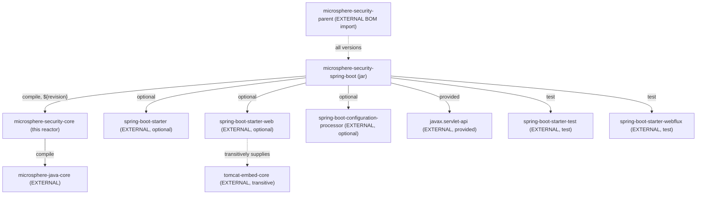
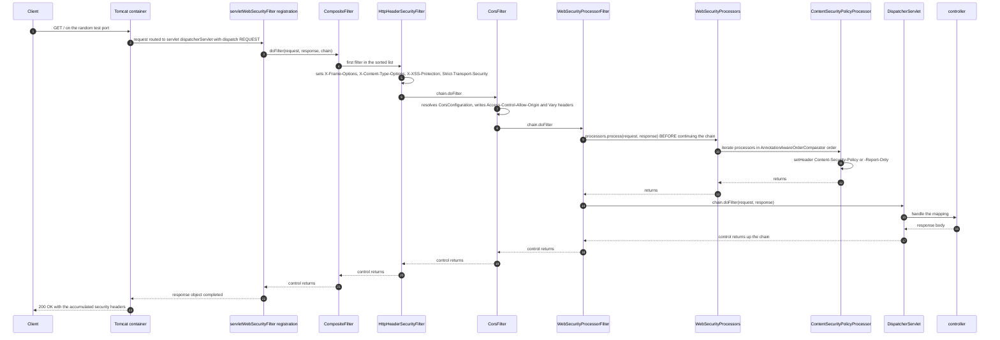
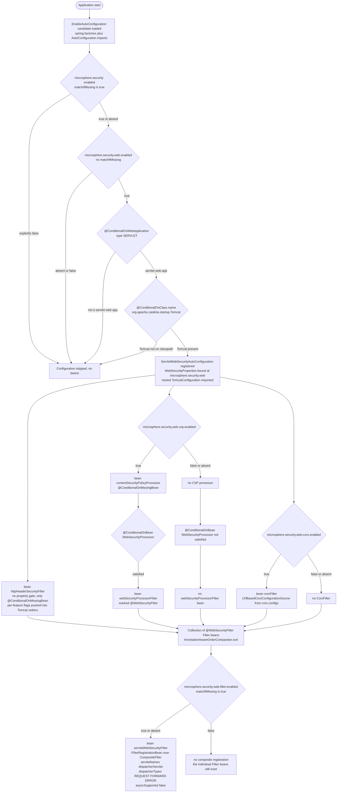
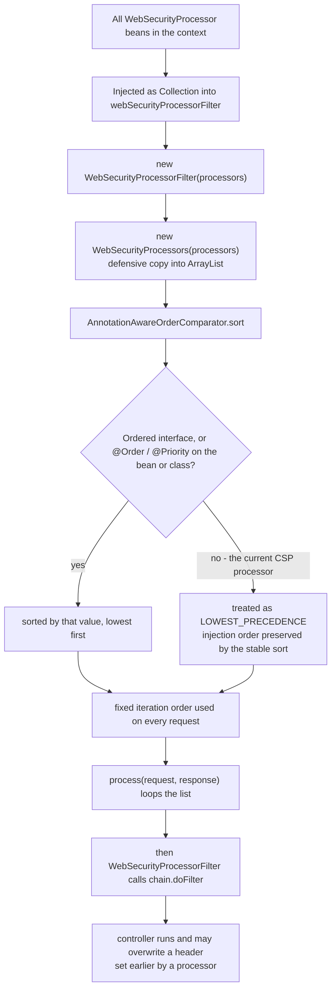

# microsphere-security-spring-boot

> **版本线说明：** 本仓库当前没有 `release` 或 `release-1.x` 分支。`current` 文档线由 `main` 分支生成（revision 为 `0.0.1-SNAPSHOT`，处于 1.0 之前，尚未发布任何版本）。javadoc 中的 `@since 1.0.0` 标记是对未来的承诺。仅有快照仓库：`https://s01.oss.sonatype.org/content/repositories/snapshots`。

- 索引：[README.zh.md](README.zh.md) · 架构：[architecture.zh.md](architecture.zh.md)
- 面向用户的文档：[../user-guide/microsphere-security-spring-boot.md](../user-guide/microsphere-security-spring-boot.zh.md)
- 英文原文：[microsphere-security-spring-boot.md](microsphere-security-spring-boot.md)

## 架构设计

Spring Boot 集成层。一个自动配置类注册一组 servlet 过滤器，用于输出安全响应头
（HSTS、XSS 防护、`X-Frame-Options`、`X-Content-Type-Options`、`Content-Security-Policy`）以及
CORS 处理，全部由一个 `@ConfigurationProperties` 聚合对象驱动。除非显式打开，一切都是关闭的；
并且其中四项头信息的输出是委托给 Tomcat 自己的 `HttpHeaderSecurityFilter` 完成的。

### 模块结构

```text
microsphere-security-spring-boot/
├── pom.xml                                            (no <packaging>: defaults to jar)
└── src/
    ├── main/java/io/microsphere/security/spring/boot/
    │   ├── annotation/WebSecurityFilter.java
    │   ├── condition/ConditionalOnEnabledSecurity.java
    │   ├── condition/ConditionalOnEnabledWebSecurity.java
    │   ├── autoconfigure/WebSecurityProperties.java
    │   ├── autoconfigure/web/servlet/ServletWebSecurityAutoConfiguration.java
    │   └── web/servlet/
    │       ├── WebSecurityProcessor.java
    │       ├── WebSecurityProcessors.java
    │       ├── WebSecurityProcessorFilter.java
    │       └── csp/ContentSecurityPolicyProcessor.java
    ├── main/resources/META-INF/
    │   ├── spring.factories
    │   └── spring/org.springframework.boot.autoconfigure.AutoConfiguration.imports
    └── test/java/io/microsphere/security/spring/boot/autoconfigure/web/servlet/
        └── ServletWebSecurityAutoConfigurationTest.java
```

## 模块依赖关系



| 依赖 | 作用域 | 存在的原因 |
| --- | --- | --- |
| `microsphere-security-core` | compile | 静态导入五个属性前缀。 |
| `spring-boot-starter` | compile，`optional` | 自动配置、`@ConditionalOn*`、`FilterRegistrationBean`。 |
| `spring-boot-starter-web` | compile，`optional` | `CompositeFilter`、`CorsFilter`、`UrlBasedCorsConfigurationSource`、Spring MVC 类型。 |
| `spring-boot-configuration-processor` | compile，`optional` | 构建期生成 `spring-configuration-metadata.json`。 |
| `javax.servlet-api` | provided | `Filter`、`HttpServletRequest`、`DispatcherType`。 |
| `tomcat-embed-core` | **未声明** | 代码直接 import 了 `org.apache.catalina.filters.HttpHeaderSecurityFilter`；它是经 `spring-boot-starter-web` 传递而来的。 |
| `spring-boot-starter-test` | test | JUnit 5 + AssertJ + `WebTestClient` 支持。 |
| `spring-boot-starter-webflux` | test | 仅为把 `WebTestClient` 放进 classpath。 |

`optional` 与 `provided` 合起来的含义是：这个 jar 针对 Spring Boot 和 Tomcat 编译，但**都不会**
传递给使用者 —— 应用必须自己引入 `spring-boot-starter-web`（以及基于 Tomcat 的容器）。

## 注册文件

该自动配置类被注册了两遍：

```text
# META-INF/spring.factories
org.springframework.boot.autoconfigure.EnableAutoConfiguration=\
io.microsphere.security.spring.boot.autoconfigure.web.servlet.ServletWebSecurityAutoConfiguration

# META-INF/spring/org.springframework.boot.autoconfigure.AutoConfiguration.imports
io.microsphere.security.spring.boot.autoconfigure.web.servlet.ServletWebSecurityAutoConfiguration
```

`spring.factories` 的 key 是 Spring Boot 2.x 的机制；
`...AutoConfiguration.imports` 文件从 Spring Boot 2.7 起被读取。两者都在，因此发现机制一侧已经
为新的注册方式做好了准备。但代码本身是针对 `javax.servlet.*` 编译的，使用的是 `javax` 时代的
Tomcat `HttpHeaderSecurityFilter`，也就是 Spring Boot 2.x 的 servlet 技术栈。**不要把 imports
文件的存在读成 Spring Boot 3 支持**：在 Boot 3 上必须先完成 `javax` → `jakarta` 的命名空间迁移。
请以你的应用实际解析到的 Spring Boot 版本为准（参见
[microsphere-security-parent.zh.md](microsphere-security-parent.zh.md) 中的 `help:effective-pom`）。

## 源码分析

### `annotation.WebSecurityFilter`

```java
@Target({ElementType.FIELD, ElementType.PARAMETER, ElementType.METHOD})
@Retention(RetentionPolicy.RUNTIME)
@Documented
@Inherited
@Qualifier
public @interface WebSecurityFilter {
}
```

这是一个不带 value 的自定义 `@Qualifier`。本模块中它的三处用途都在 `@Bean` **方法**上
（`httpHeaderSecurityFilter`、`corsFilter`、`webSecurityProcessorFilter`），外加
`servletWebSecurityFilter` 的**注入参数**上。由于 `@Target` 不含 `TYPE`，你无法把它标在过滤器
类上 —— 请标注在你自己的 `@Bean` 方法上。

正是这个 qualifier 把 `Collection<Filter>` 收窄为“这些安全过滤器”，而不是“context 里的每个
过滤器”，因此 `CharacterEncodingFilter` 或业务过滤器不会被卷进 composite。

### `condition.ConditionalOnEnabledSecurity`

```java
@ConditionalOnProperty(prefix = PROPERTY_NAME_PREFIX, name = ENABLED_PROPERTY_NAME, matchIfMissing = true)
public @interface ConditionalOnEnabledSecurity {
}
```

`PROPERTY_NAME_PREFIX` 是 `microsphere.security.`，`ENABLED_PROPERTY_NAME` 是外部常量 `"enabled"`。
**默认开启**：只有显式写 `microsphere.security.enabled=false` 才会关掉。

### `condition.ConditionalOnEnabledWebSecurity`

```java
@ConditionalOnEnabledSecurity
@ConditionalOnProperty(prefix = WEB_SECURITY_PROPERTY_NAME_PREFIX, name = ENABLED_PROPERTY_NAME)
public @interface ConditionalOnEnabledWebSecurity {
}
```

两个 `@ConditionalOnProperty` 元注解叠加在同一个注解上，而 web 层那个**没有** `matchIfMissing`。
由于 `WEB_SECURITY_PROPERTY_NAME_PREFIX` 是 `microsphere.security.web`（无结尾点），生效的 web
开关就是 `microsphere.security.web.enabled`，也就是说 web 安全**默认关闭**。

这个叠加所声明的*意图*是两级开关：`microsphere.security.enabled` 作为全局总开关，
`microsphere.security.web.enabled` 作为分区开关。本仓库**没有**弄清楚的，是 Spring Boot 如何合并
来自不同元注解层级的两个 `@ConditionalOnProperty`（`name` 是数组类型会被聚合；`prefix` 与
`matchIfMissing` 是单值类型）。全局那道门是否会与 web 那道门一起被求值，因此在本文档中属于未经
验证的假设 —— 在把 `microsphere.security.enabled=false` 写成单独足以关停之前，请用条件求值报告
（`-Ddebug=true`）确认。

### `autoconfigure.WebSecurityProperties`

绑定前缀为 `@ConfigurationProperties(prefix = WEB_SECURITY_PROPERTY_NAME_PREFIX)`，即
`microsphere.security.web`。六个嵌套段，全部提前实例化（getter 永不为 null），并且全部继承
**包私有**的 `BaseConfig`：

```java
static class BaseConfig {
    private boolean enabled = false;   // every feature is opt-in
    ...
    @Override public String toString() {
        return ReflectionToStringBuilder.toString(this, ToStringStyle.SHORT_PREFIX_STYLE);
    }
}
```

| 嵌套类型 | 属性路径 | 额外字段（默认值） | 消费者 |
| --- | --- | --- | --- |
| `Hsts` | `microsphere.security.web.hsts` | `maxAgeInSeconds`（`0`）、`includeSubDomains`（`false`）、`preload`（`false`） | `initHsts` → Tomcat 过滤器 |
| `Xss` | `microsphere.security.web.xss` | 无 | `initXssProtection` |
| `XContentType` | `microsphere.security.web.x-content-type` | 无 | `initXContentTypeOptions` |
| `XFrame` | `microsphere.security.web.x-frame` | `option`（`"DENY"`）、`uri`（`null`） | `initXFrameOptions` |
| `Csp` | `microsphere.security.web.csp` | `policyDirectives`（`null`）、`reportOnly`（`false`） | `contentSecurityPolicyProcessor` |
| `Cors` | `microsphere.security.web.cors` | `configs`（`LinkedHashMap<String, Config>`） | `corsFilter` |

`Cors.Config` 复刻了 Spring `CorsConfiguration` 的形状：`allowedOrigins`、`allowedMethods`、
`allowedHeaders`、`exposedHeaders`（均为 `List<String>`）、`allowCredentials`（`Boolean`）与
`maxAge`（`Long`）。映射只靠一行完成：

```java
private CorsConfiguration buildCorsConfiguration(WebSecurityProperties.Cors.Config config) {
    CorsConfiguration corsConfiguration = new CorsConfiguration();
    BeanUtils.copyProperties(config, corsConfiguration);
    return corsConfiguration;
}
```

**这是一份隐式的、以名字和类型耦合的契约。** `BeanUtils.copyProperties` 按 JavaBean 属性名匹配，
并且会静默跳过 getter 返回类型无法赋给 setter 参数类型的属性对。对维护者有两个后果：

- 重命名 `Cors.Config` 里的字段 —— 或者 Spring 在 `CorsConfiguration` 一侧改名 —— 不会报错，只会
  得到一条悄然失效的 CORS 规则。本仓库没有覆盖 `Access-Control-Allow-*` 取值的测试，只断言了
  `Vary` 三连。
- 这里 `maxAge` 声明为 `Long`，而现代 Spring Framework 的 `CorsConfiguration.maxAge` 是
  `Duration`。你写的 `...cors.configs.<id>.max-age` 究竟能否抵达过滤器，取决于实际解析到的 Spring
  版本及其 setter 重载。在把 `max-age` 写成受支持的能力之前，请先实测。

`BaseConfig`/`WebSecurityProperties` 上的 `ReflectionToStringBuilder` 意味着对这些对象调用
`toString()` 会反射输出全部字段，包括你配置的 origin 列表 —— 在打印这个 bean 之前请三思。

### `autoconfigure.web.servlet.ServletWebSecurityAutoConfiguration`

```java
@ConditionalOnEnabledWebSecurity
@ConditionalOnWebApplication(type = SERVLET)
@ConditionalOnClass(name = "org.apache.catalina.startup.Tomcat")
@AutoConfigureBefore(name = {
        "org.springframework.boot.autoconfigure.web.servlet.WebMvcAutoConfiguration",
        "org.springframework.boot.autoconfigure.web.servlet.DispatcherServletAutoConfiguration"
})
@Import(value = {ServletWebSecurityAutoConfiguration.TomcatConfiguration.class})
@EnableConfigurationProperties(WebSecurityProperties.class)
public class ServletWebSecurityAutoConfiguration {
```

- `@ConditionalOnClass(name = ...)` 使用的是**字符串**形式，因此 `tomcat-embed-core` 不是这个配置类
  的类级硬依赖；然而嵌套的 `TomcatConfiguration` 直接 import 了 `HttpHeaderSecurityFilter`，所以这道
  门是保护非 Tomcat 部署的唯一机制。Jetty/Undertow 用户得到的是被跳过的配置，而不是异常。
- `@AutoConfigureBefore` 把本配置排在 Web MVC 与 `DispatcherServlet` 自动配置之前，这对
  `@ConditionalOnBean` 的求值（processor bean 必须先于 `webSecurityProcessorFilter` 的判定存在）
  以及注册顺序都很关键。

**Bean：`contentSecurityPolicyProcessor`** —— `@ConditionalOnMissingBean` 加上
`@ConditionalOnProperty(prefix = WEB_SECURITY_CSP_PROPERTY_NAME_PREFIX, name = "enabled")` 且不带
`matchIfMissing`，因此 CSP 需要 `microsphere.security.web.csp.enabled=true`。方法把
`policyDirectives` 和 `reportOnly` 复制进 processor，**没有对 `policyDirectives` 做判空** —— 见陷阱。

**Bean：`servletWebSecurityFilter`** —— 装配点：

```java
@Bean
@ConditionalOnProperty(prefix = WEB_SECURITY_FILTER_PROPERTY_NAME_PREFIX, name = ENABLED_PROPERTY_NAME, matchIfMissing = true)
public FilterRegistrationBean<Filter> servletWebSecurityFilter(@Autowired @WebSecurityFilter Collection<Filter> filters) {
    ...
    CompositeFilter filter = new CompositeFilter();
    List<Filter> orderedFilters = new ArrayList<>(filters);
    AnnotationAwareOrderComparator.sort(orderedFilters);
    filter.setFilters(orderedFilters);
    filterRegistrationBean.setFilter(filter);
    filterRegistrationBean.setAsyncSupported(false);
    filterRegistrationBean.setDispatcherTypes(EnumSet.of(REQUEST, FORWARD, ERROR));
    filterRegistrationBean.setServletNames(asList(DEFAULT_DISPATCHER_SERVLET_BEAN_NAME));
```

它把所有带 `@WebSecurityFilter` qualifier 的 `Filter` bean 包进一个 Spring `CompositeFilter`，
排序之后，**按 servlet 名**（`dispatcherServlet`）而不是按 URL pattern 注册，作用于 `REQUEST`、
`FORWARD`、`ERROR` 三种 dispatch，并禁用异步支持。

**Bean：`webSecurityProcessorFilter`** —— `@WebSecurityFilter`、`@ConditionalOnBean(WebSecurityProcessor.class)`、
`@ConditionalOnMissingBean`；把 processor SPI 适配到 servlet `Filter` 契约。

**Bean：`corsFilter`** —— `@WebSecurityFilter`、`@ConditionalOnMissingBean`，受
`microsphere.security.web.cors.enabled` 控制。基于 `cors.configs` 构造
`UrlBasedCorsConfigurationSource`，该 Map 的 key 就是 URL pattern：

```java
corsConfigurationSource.setCorsConfigurations(corsConfigurations);
```

**嵌套的 `static class TomcatConfiguration`** —— 贡献 `httpHeaderSecurityFilter`
（`@WebSecurityFilter`、`@ConditionalOnMissingBean`，并且**完全没有属性门**）。四个私有 `init*`
方法把属性翻译成 Tomcat 的 setter：

| 属性段 | Tomcat setter |
| --- | --- |
| `hsts.*` | `setHstsEnabled`、`setHstsMaxAgeSeconds`、`setHstsIncludeSubDomains`、`setHstsPreload` |
| `xss.*` | `setXssProtectionEnabled` |
| `x-frame.*` | `setAntiClickJackingEnabled`、`setAntiClickJackingOption`，并且**仅当 `StringUtils.hasText(uri)`** 才调用 `setAntiClickJackingUri` |
| `x-content-type.*` | `setBlockContentTypeSniffingEnabled` |

`hasText` 这道判断的存在是因为否则 Tomcat 的过滤器会收到一个空的 `ALLOW-FROM` URI；其余 setter
都是无条件调用的，因此即使标志为 `false` 也会被显式推下去。

### `web.servlet.WebSecurityProcessor` (SPI)

```java
public interface WebSecurityProcessor {
    void process(HttpServletRequest request, HttpServletResponse response) throws IOException, ServletException;
}
```

这就是扩展缝隙：一个方法，没有顺序契约，没有返回值。实现方预期只做响应头修改。

### `web.servlet.WebSecurityProcessors`

包私有的 `implements WebSecurityProcessor`；构造函数把集合复制进一个 `ArrayList`，紧接着调用
`AnnotationAwareOrderComparator.sort(this.processors)`；`process` 按该顺序迭代。它是同一接口的
组合对象，因此将来做嵌套组合也能通过类型检查。

### `web.servlet.WebSecurityProcessorFilter`

```java
@Override
public final void doFilter(ServletRequest request, ServletResponse response, FilterChain chain) throws IOException, ServletException {
    // Processes the response
    processors.process((HttpServletRequest) request, (HttpServletResponse) response);
    chain.doFilter(request, response);
}
```

修改之前值得知道的四个细节：

1. `doFilter` 是 `final` 的 —— “先 processor 再 chain”这个次序无法通过子类覆盖改变。
2. Processor 在 `chain.doFilter` **之前**运行，也就是*早于* controller 执行。由于 `setHeader` 是
   替换语义，controller 之后对同一个头名调用 `response.setHeader(...)` 会胜出。仓库里没有测试锁定
   这一优先级；若你需要“安全头始终权威”，当前设计并不提供该保证。
3. 未做检查的强转意味着非 HTTP 的 dispatch 会抛出 `ClassCastException`，所以这个过滤器必须留在
   servlet 层的注册路径中。
4. `init` 是有意留空的，`destroy` 没有被覆盖（二者在 `javax.servlet.Filter` 上都是 `default` 方法）。

### `web.servlet.csp.ContentSecurityPolicyProcessor`

```java
response.setHeader((!reportOnly ? CONTENT_SECURITY_POLICY_HEADER : CONTENT_SECURITY_POLICY_REPORT_ONLY_HEADER), policyDirectives);
```

`reportOnly` 在 `Content-Security-Policy` 与 `Content-Security-Policy-Report-Only` 之间做选择；
`policyDirectives` 原样写出，不解析也不校验 —— 本项目不做任何 CSP 语法检查。

### 测试

`ServletWebSecurityAutoConfigurationTest` 以 `@SpringBootTest` 在 `RANDOM_PORT` 上启动，配合
`@EnableAutoConfiguration`，注册了一个内部 `@RestController`，设置
`microsphere.security.web.enabled=true` 以及各功能的开关，然后通过真实 HTTP 断言：
`X-Frame-Options=SAMEORIGIN`、`X-Content-Type-Options=nosniff`、
`X-XSS-Protection=1; mode=block`、配置的那串 `Content-Security-Policy`，以及 `Vary` 值
`[Origin, Access-Control-Request-Method, Access-Control-Request-Headers]`。

需要注意它证明了什么、没证明什么：它证明的是端到端的头结果。它没有断言 composite 内部顺序，
没有断言 `Access-Control-Allow-*` 的内容，也没有断言“属性缺省”时的默认行为。

## 设计模式

| 模式 | 代码证据 | 带来的后果 |
| --- | --- | --- |
| **Composite（组合）** | `WebSecurityProcessors implements WebSecurityProcessor`，内部持有已排序的 `List<WebSecurityProcessor>`；`servletWebSecurityFilter` 把 `Collection<Filter>` 包进 Spring 的 `CompositeFilter` | 两个层级、针对两种抽象的组合。新增一个 processor 或一个过滤器永远不需要改迭代代码；但两个组合都在构造时取*快照*，因此后注册的 bean 不会被纳入。 |
| **Chain of Responsibility（责任链）** | servlet 的 `FilterChain` 加上 `CompositeFilter` 的顺序 `chain.doFilter`；`WebSecurityProcessorFilter` 处理完再转发 | 每一段自行决定是否继续；任何一段都看不到下一段的结果，这正是头信息优先级由位置决定而非声明决定的原因。 |
| **Strategy / SPI（策略）** | `WebSecurityProcessor` 作为可插拔的头策略接口，唯一内置实现是 `ContentSecurityPolicyProcessor`；该 bean 由 `@ConditionalOnBean(WebSecurityProcessor.class)` 控制 | 新增一类头信息只需发布一个 bean，无需改动自动配置。代价是接口没有顺序契约也没有 `enabled()`，于是策略级开关必须在每个 bean 上重新实现。 |
| **Meta-annotation composition（元注解组合）** | `@ConditionalOnEnabledWebSecurity` 同时携带 `@ConditionalOnEnabledSecurity`（后者自身又带 `@ConditionalOnProperty`）*和*第二个 `@ConditionalOnProperty` | 两次出现来自不同的元注解层级，因此不会在编译期冲突，其意图是一个注解同时提供全局总开关与分区开关。但重复出现的 `@ConditionalOnProperty` 各属性的合并语义在本仓库中没有任何测试钉住，所以请把全局那一层视为意图而非已验证行为。另外两个 prefix 的结尾点形式不同，光看注解读不出属性名。 |
| **Marker / Qualifier annotation（标记）** | `@WebSecurityFilter`，一个无 value 的 `@Qualifier`，用在三个 bean 方法与一个注入参数上 | 为 composite 提供显式的成员清单，无关过滤器进不来。由于 `@Target` 不含 `TYPE`，该标记只能标在 `@Bean` 方法上 —— 被组件扫描的过滤器类无法自行加入。 |
| **Adapter（适配器）** | `WebSecurityProcessorFilter` 把 `Filter` 契约（含强转）翻译成 `WebSecurityProcessor.process` 调用；`buildCorsConfiguration` 把 `Cors.Config` 适配为 `CorsConfiguration` | 领域 SPI 得以不含 servlet 过滤器词汇。其中以 `BeanUtils` 实现的那个适配器是脆弱的一环（名字/类型耦合、静默跳过）。 |
| **Facade over configuration（外观）** | `WebSecurityProperties` 把六种互不相干的头策略聚在一个前缀之下，嵌套对象提前实例化且不为 null | 一个 `@EnableConfigurationProperties` 装配全部，getter 永不 NPE —— 但嵌套对象里的 `enabled=false` 并*不是*决定 bean 是否创建的因素；每个 bean 由自己的 `@ConditionalOnProperty` 把关，因此属性对象与条件注解是两套并行的真相来源。 |
| **Template Method（弱）** | `doFilter` 声明为 `final`，次序固定 | 保证了 processor-before-chain 的语义，代价是失去了通过继承扩展的能力；请通过新增 processor 来扩展。 |

## 工作流程：请求处理



三个过滤器之间的内部顺序是*推导*出来的、并未被断言：它们都没有实现 `Ordered` 也没有 `@Order`，
于是 `AnnotationAwareOrderComparator` 认为它们等价，稳定的排序保留了注入顺序，而注入顺序跟随
bean 定义顺序（`webSecurityProcessorFilter`、`corsFilter`、`httpHeaderSecurityFilter`）。不要把
功能建立在这个假设之上；若确实重要，请用 `@Order` 把它钉死。

## 工作流程：条件门控



`CN --> PN` 以及这些并行分支说明了一个重要事实：门控是**按 bean 独立生效**的，因此部分开启是
常态（例如 CORS 开、CSP 关），composite 里就少几个过滤器。如果最终的集合是空的，
`FilterRegistrationBean` 依然会被创建，里面是一个空的 `CompositeFilter` —— 一个注册好的空操作，
因为 `servletWebSecurityFilter` 只看 `filter.enabled`，并不检查集合非空。

图中把两道类级别的条件门画成两个独立步骤，是因为注解声明的意图正是如此；本仓库没有任何测试单独
验证过 `microsphere.security.enabled=false`，因此请用条件求值报告确认外层这道门，而不是想当然。

## 工作流程：处理器排序



排序只在构造时解析**一次**，而且 `processors` 是 `final` 字段，所以动态注册的 processor bean 永远
不会加入已经建好的列表。要控制顺序，请在你的 processor bean 方法上加 `@Order(n)`（或实现
`Ordered`）。

## 实际生效的属性清单

下面的名字是绑定属性对应的规范/宽松绑定名（由 `spring-boot-configuration-processor` 生成的
`META-INF/spring-configuration-metadata.json`）。

| 属性 | 类型 | 默认值 | 是否绑定到 `WebSecurityProperties`？ |
| --- | --- | --- | --- |
| `microsphere.security.enabled` | boolean | 视为 `true`（`matchIfMissing`） | **否** —— 仅用于条件 |
| `microsphere.security.web.enabled` | boolean | `false`（必须显式设置） | **否** —— 仅用于条件 |
| `microsphere.security.web.filter.enabled` | boolean | 视为 `true`（`matchIfMissing`） | **否** —— 仅用于条件 |
| `microsphere.security.web.hsts.enabled` | boolean | `false` | 是 |
| `microsphere.security.web.hsts.max-age-in-seconds` | int | `0` | 是 |
| `microsphere.security.web.hsts.include-sub-domains` | boolean | `false` | 是 |
| `microsphere.security.web.hsts.preload` | boolean | `false` | 是 |
| `microsphere.security.web.xss.enabled` | boolean | `false` | 是 |
| `microsphere.security.web.x-content-type.enabled` | boolean | `false` | 是 |
| `microsphere.security.web.x-frame.enabled` | boolean | `false` | 是 |
| `microsphere.security.web.x-frame.option` | String | `"DENY"` | 是 |
| `microsphere.security.web.x-frame.uri` | String | `null` | 是 |
| `microsphere.security.web.csp.enabled` | boolean | `false` | 是 |
| `microsphere.security.web.csp.policy-directives` | String | `null` | 是 |
| `microsphere.security.web.csp.report-only` | boolean | `false` | 是 |
| `microsphere.security.web.cors.enabled` | boolean | `false` | 是 |
| `microsphere.security.web.cors.configs.<url-pattern>.allowed-origins` | `List<String>` | `null` | 是 |
| `microsphere.security.web.cors.configs.<url-pattern>.allowed-methods` | `List<String>` | `null` | 是 |
| `microsphere.security.web.cors.configs.<url-pattern>.allowed-headers` | `List<String>` | `null` | 是 |
| `microsphere.security.web.cors.configs.<url-pattern>.exposed-headers` | `List<String>` | `null` | 是 |
| `microsphere.security.web.cors.configs.<url-pattern>.allow-credentials` | `Boolean` | `null` | 是 |
| `microsphere.security.web.cors.configs.<url-pattern>.max-age` | `Long` | `null` | 是，但见上文关于 `Duration` 的说明 |

那三个“仅用于条件”的属性，正是开发者在 `WebSecurityProperties` 里按 `enabled` 搜索 web 层开关
却一无所获的原因：`WebSecurityProperties` 没有顶层 `enabled` 字段，开关只存在于条件注解中。

## 扩展点

1. **新增一个安全头。** 实现 `WebSecurityProcessor`，把它暴露成一个 `@Bean`（若顺序重要就加
   `@Order`），并用你自己的
   `@ConditionalOnProperty(prefix = ..., name = ENABLED_PROPERTY_NAME)` 把关。
   `webSecurityProcessorFilter` 会通过 `@ConditionalOnBean(WebSecurityProcessor.class)` 接收它，
   组合对象负责排序 —— 前提是该 bean 在过滤器创建之前已定义，因此请把它放在顺序位于本配置*之后*
   的自动配置中，或者直接放在同一个类里。
2. **新增一个完整的 servlet 过滤器。** 声明一个返回 `Filter` 的 `@Bean`，并在方法上标注
   `@WebSecurityFilter`；它就会加入 composite，由 `AnnotationAwareOrderComparator` 排序。
3. **替换内置的某个过滤器。** 除 `servletWebSecurityFilter` 之外，每个 bean 都带
   `@ConditionalOnMissingBean`，因此只要你自己的 `HttpHeaderSecurityFilter`、`CorsFilter`、
   `WebSecurityProcessorFilter` 或 `ContentSecurityPolicyProcessor` bean 存在，默认实现就不会创建。
4. **新增一个属性段。** 在 `WebSecurityProperties` 中添加一个
   `public static class ... extends BaseConfig` 及对应字段/getter/setter，然后在自动配置里用
   **`microsphere-security-core` 中新增的带点常量**做门控。两半都缺一不可：只有绑定属性并不会
   创建 bean。
5. **全部关闭。** 写 `microsphere.security.web.enabled=false` —— 或者干脆不设置它 —— 就会让本配置
   的所有 bean 都不创建；不需要排除自动配置类。`microsphere.security.enabled=false` 是被声明为外层
   门的开关，但在单独依赖它之前，请参见上文关于元注解合并的说明。
6. **当前不支持：** 响应式/WebFlux 集成、非 Tomcat 容器，以及 `-starter` 构件（见
   [microsphere-security-dependencies.zh.md](microsphere-security-dependencies.zh.md)）。

## 构建与测试

```bash
mvn -B -pl microsphere-security-spring-boot -am verify     # from the repository root
mvn -B -pl microsphere-security-spring-boot test
mvn -B -pl microsphere-security-spring-boot test -Dtest=ServletWebSecurityAutoConfigurationTest
```

唯一的这个测试需要真实的 servlet 容器，因此会绑定随机端口；它通常是构建中最慢的一步。当某个头
缺失时，有用的诊断手段：

```bash
mvn -B -pl microsphere-security-spring-boot test -Ddebug=true   # prints the condition evaluation report
```

新增覆盖率时，请像现有测试那样按功能组织 `@SpringBootTest` 的属性集；如果只想断言条件求值结果、
不想起容器，可用 `ApplicationContextRunner`。

## 陷阱

1. **`enabled` 有两套并行的真相来源。** `BaseConfig.enabled`（默认 `false`）是一个*绑定字段*，
   而 bean 是否创建由读取同一个 key 的 `@ConditionalOnProperty` 决定。设置属性能生效；运行期修改
   绑定对象不会重新求值条件。一旦存在自定义过滤器 bean，就不要再想当然地认为
   `properties.getXss().isEnabled()` 与“XSS 头会被输出”是同一件事。
2. **`WEB_SECURITY_PROPERTY_NAME_PREFIX` 没有结尾点。** 这对 `@ConfigurationProperties` 和
   `@ConditionalOnProperty` 都是正确的，但三个带结尾点的同级常量（`filter.`、`csp.`、`cors.`）是用在
   `prefix` 属性上的，由 Spring Boot 负责前缀与属性名的拼接。这种混合约定很容易被错误地复制；对外
   文档中所使用的规范名称是上文中那些单点形式。改动任何 prefix 常量之后，请重新核对生成的
   `spring-configuration-metadata.json` 并用 `-Ddebug=true` 跑一次。
3. **仅支持 Tomcat，而且这一点是承重的。** 五种头信息里有四种来自 `HttpHeaderSecurityFilter`。
   在 Jetty/Undertow 上，`@ConditionalOnClass` 这道门会静默跳过整个配置 —— 不报错，也没有头信息。
   更换 `server.servlet.container` 是一次功能性变更，不是打包变更。
4. **注册是按 servlet 名进行的。** `setServletNames(asList("dispatcherServlet"))` 意味着 composite
   **不**覆盖由其他 servlet 处理的请求（Tomcat 服务静态资源的 `default` servlet 是最常见的例子），
   也不会应用任何 URL pattern。如果你需要给静态资源加头，本模块按当前写法做不到。
5. **`asyncSupported=false` 且没有 `ASYNC` dispatcher。** 以异步方式 dispatch 的请求
   （callable/deferred result、基于 `Writer` 的流式输出）在 async dispatch 阶段不会被 composite 包裹。
   再加上只注册了 `REQUEST/FORWARD/ERROR`，`INCLUDE` 与 `ASYNC` 都不在覆盖范围内。
6. **Processor 在 chain 之前运行。** controller（或下游过滤器）用同名头调用 `response.setHeader`
   会覆盖 processor 先前写入的值；若需要相反语义，请改用 `addHeader` 风格，或安排一个顺序靠后的
   响应式处理过滤器。
7. **`enabled=true` 但没写 `policy-directives` 的 CSP。** `policyDirectives` 默认为 `null`，会被直接
   传给 `response.setHeader(name, null)`，其在 servlet 容器中的效果是移除/忽略该头。请同时开启 CSP
   并设置指令。
8. **`Cors.Config` ↔ `CorsConfiguration` 的耦合。** `BeanUtils.copyProperties` 对名字/类型不匹配的
   属性只字不提地跳过；既没有编译期保护，也没有覆盖 Allow-* 头的测试。重命名其中任何一侧都是一次
   伪装成重构的破坏性变更。
9. **空的 composite 仍然会被注册。** `servletWebSecurityFilter` 没有 `@ConditionalOnBean`，所以当
   `filter.enabled` 打开而所有功能都关闭时，你会部署一个空操作的过滤器注册。
10. **`@ConditionalOnBean` 对顺序敏感。** `webSecurityProcessorFilter` 依赖求值时刻 processor bean
    已经存在；没有顺序保证的用户配置若注册了 processor，可能排在本自动配置之后从而被漏掉。
11. **过期的 `target/` 内容不是证据。** `microsphere-security-*/target/` 里是被 git 忽略的构建产物
    （包括与当前源码无关的历史 class 文件）；请以 `src/main/resources` 与 `src/main/java` 为准。
12. **`@since 1.0.0` 是愿景式的**，并且 `javax.servlet` 的用法意味着在完成命名空间迁移之前 Boot 3
    不在范围内 —— 见「注册文件」。

## 下一步

- 本模块使用的前缀：[microsphere-security-core.zh.md](microsphere-security-core.zh.md)
- Spring Boot / Tomcat / Servlet 版本来自哪里：
  [microsphere-security-parent.zh.md](microsphere-security-parent.zh.md)
- 全仓库视角：[architecture.zh.md](architecture.zh.md)

## English

[English](microsphere-security-spring-boot.md)
