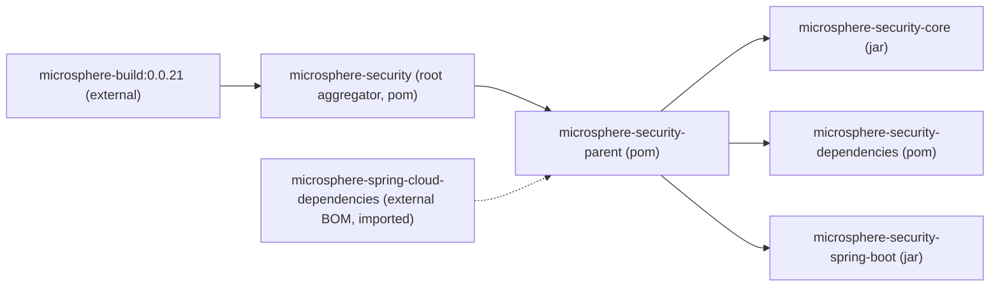

# microsphere-security-parent

> **Version-line note:** This repository currently has no `release` or `release-1.x` branch. The `current` documentation line is generated from the `main` branch (revision `0.0.1-SNAPSHOT`, pre-1.0, nothing released yet). `@since 1.0.0` javadoc tags are forward promises, not released versions. Artifacts are available only as snapshots from the Sonatype OSS snapshot repository (`https://s01.oss.sonatype.org/content/repositories/snapshots`), not from Maven Central.

## Overview

`microsphere-security-parent` is a `pom`-packaging module that carries the shared build
conventions for the other modules in this repository. It publishes no classes and no
resources; it exists so that `microsphere-security-core`,
`microsphere-security-dependencies` and `microsphere-security-spring-boot` can all declare
the same parent and inherit the same dependency management.

Its single substantive contribution is one BOM import:
`io.github.microsphere-projects:microsphere-spring-cloud-dependencies`. Through that import,
the versions of Spring Boot, Spring Framework, `commons-lang3`, the Servlet API, JUnit and
the other third-party libraries used by the code are decided **outside** this repository.

File: `microsphere-security-parent/pom.xml` (39 lines, no `<build>` section, no plugins).

## Maven coordinates

| Field | Value |
|---|---|
| groupId | `io.github.microsphere-projects` |
| artifactId | `microsphere-security-parent` |
| version | `${revision}` (resolved to `0.0.1-SNAPSHOT`) |
| packaging | `pom` |
| parent | `io.github.microsphere-projects:microsphere-security:${revision}` |
| name | `Microsphere :: Security :: Parent` |

## POM explained

### Inheritance chain



Note that the root POM's own parent is `io.github.microsphere-projects:microsphere-build`
version `0.0.21`, declared literally in `pom.xml`. That artifact is not part of this reactor.
`microsphere-security-parent` sits *below* the root POM, so the chain your module experiences
is `microsphere-build:0.0.21` → `microsphere-security` → `microsphere-security-parent` → your
module.

### The imported BOM

The whole `<dependencyManagement>` of this parent consists of one entry:

```xml
<dependencyManagement>
    <dependencies>

        <!-- Microsphere Spring Cloud Dependencies -->
        <dependency>
            <groupId>io.github.microsphere-projects</groupId>
            <artifactId>microsphere-spring-cloud-dependencies</artifactId>
            <version>${microsphere-spring-cloud.version}</version>
            <type>pom</type>
            <scope>import</scope>
        </dependency>

    </dependencies>
</dependencyManagement>
```

Because the entry has `<scope>import</scope>` and `<type>pom</type>`, Maven merges that BOM's
managed dependency list into this parent's. That is why none of the modules in this repository
write a version next to `spring-boot-starter`, `javax.servlet-api`, `commons-lang3` or
`junit-jupiter-api`.

### Which modules apply this parent

All three substantive modules declare it identically, with an explicit `relativePath`:

```xml
<parent>
    <groupId>io.github.microsphere-projects</groupId>
    <artifactId>microsphere-security-parent</artifactId>
    <version>${revision}</version>
    <relativePath>../microsphere-security-parent/pom.xml</relativePath>
</parent>
```

The parent itself is a module of the root aggregator, listed in `<modules>` alongside the
others. In the reactor build order it is resolved first because the other modules inherit from
it.

### What is not declared in this repository

This is the honest boundary of what you can learn from these POMs:

- **No JDK level.** The compiler source/target comes from the external parent
  `microsphere-build:0.0.21`. There is no `maven.compiler.source`, no `<release>` and no
  compiler plugin declaration in this repository.
- **No Spring Boot version.** It arrives via `microsphere-spring-cloud-dependencies`.
- **No Spring Framework, Servlet, commons or JUnit versions** — same external chain.
- **No plugin management, distribution management or SCM** in the parent POM; the
  `<distributionManagement>` and `<repositories>` that point at the Sonatype snapshot
  repository live in the root `pom.xml` instead.

## Configuration

### The `microsphere-spring-cloud.version` property

The parent defines one property:

```xml
<properties>
    <microsphere-spring-cloud.version>${revision}</microsphere-spring-cloud.version>
</properties>
```

Two consequences follow from the `${revision}` default:

1. The external BOM is requested at the *same* version as this project, i.e. `0.0.1-SNAPSHOT`.
   That means `microsphere-spring-cloud-dependencies` is itself an unpublished snapshot at the
   time of writing, so your build can only resolve it from a snapshot repository such as
   `https://s01.oss.sonatype.org/content/repositories/snapshots` or from a copy already installed
   in your local repository.
2. Overriding the property (`-Dmicrosphere-spring-cloud.version=...`) is the supported way to
   point the build at a different BOM snapshot without editing any POM.

## Code examples

### Consuming the parent from your own module

If you want your own module to inherit the same managed versions as this project's modules:

```xml
<parent>
    <groupId>io.github.microsphere-projects</groupId>
    <artifactId>microsphere-security-parent</artifactId>
    <version>0.0.1-SNAPSHOT</version>
</parent>
```

Then declare dependencies without versions, exactly as the modules in this repository do.
Remember that this pulls in the whole external chain, so the snapshot repository must be
configured — either by inheriting it from the root POM's `<repositories>` or by adding it
yourself.

### Verifying which version a dependency resolves to

Because nothing is visible in the POMs, confirm the effective versions with Maven rather than
guessing:

```bash
mvn -f microsphere-security-spring-boot/pom.xml dependency:tree
mvn -f microsphere-security-parent/pom.xml help:effective-pom
```

Pass `-Drevision=0.0.1-SNAPSHOT` (or the `-Drevision=0.0.1` form used by the CI workflow) when
your invocation does not resolve the property from the reactor.

## Version information

- Artifact version: `${revision}` → `0.0.1-SNAPSHOT`. Nothing is released, so this parent
  exists only as a snapshot.
- The parent's own parent, `microsphere-build`, is pinned to the literal `0.0.21` in the root
  `pom.xml` — that is a real external version, but it is the version of the *build* parent, not
  of this project's modules.
- `@since 1.0.0` javadoc tags elsewhere in the project say nothing about this module's
  availability; a POM module has no javadoc.

- **Release date:** none — as of revision `0.0.1-SNAPSHOT` this module has never been released
  (no git tags, no `release` branch, nothing in Maven Central).
- **Changelog summary:** the repository keeps no `CHANGELOG` or release-notes file; the `main`
  branch commit history is the only change record.

## Compatibility

- **Spring Boot generation:** the code in this repository compiles against `javax.servlet.*`
  and registers its auto-configuration through `META-INF/spring.factories`. Both are verifiable
  in `microsphere-security-spring-boot`: the sources import `javax.servlet.Filter`,
  `javax.servlet.http.HttpServletRequest` and `javax.servlet.DispatcherType`, and the resource
  file `src/main/resources/META-INF/spring.factories` uses the
  `org.springframework.boot.autoconfigure.EnableAutoConfiguration` key. That is the Spring Boot
  **2.x** servlet-stack contract — Spring Boot 3.x would require `jakarta.*` packages and
  `META-INF/spring/org.springframework.boot.autoconfigure.AutoConfiguration.imports`.
  So: Spring Boot 2.x generation; Spring Boot 3.x is not supported on this code line.
- **JDK:** inherited from the external parent `microsphere-build:0.0.21`, not declared in this
  repository.
- **All third-party versions:** inherited through the externally imported
  `microsphere-spring-cloud-dependencies` BOM; consult that BOM for what is actually managed.

### Java version matrix

This POM module compiles no bytecode itself; the applicable baseline is the one inherited by the
code modules (`microsphere-security-core`, `microsphere-security-spring-boot`):

| Java Version | Supported | Notes |
| --- | --- | --- |
| 8 | Yes | CI-verified (`.github/workflows/maven.yml`, Temurin `java: [ '8' ]`); the authoritative source/target level is inherited from the external parent `microsphere-build:0.0.21` and is not declared in this repository. |
| 11 | Unverified | No CI coverage here; the children use only Java 8-era APIs. |
| 17 | Unverified | No CI coverage here. |

### Dependency compatibility

| Dependency | Range on this line | Provenance |
| --- | --- | --- |
| Spring Boot and all third-party versions | Spring Boot **2.x** generation (children use `javax.servlet` + `spring.factories`); 3.x not supported | supplied by the imported external `microsphere-spring-cloud-dependencies` BOM — the concrete versions are **not** declared in this repository |
| `microsphere-java-core` and project artifacts | resolved from the same external chain / reactor | external BOM / reactor |

## Related documents

- [User Guide index](README.md) — back to the guide overview.
- [microsphere-security-dependencies](microsphere-security-dependencies.md) — the BOM that
  inherits from this parent.
- [microsphere-security-core](microsphere-security-core.md) — a jar module built on this parent.
- [microsphere-security-spring-boot](microsphere-security-spring-boot.md) — the module whose
  servlet usage proves the compatibility statement above.
- Developer Guide: [microsphere-security-parent](../developer-guide/microsphere-security-parent.md)

## 中文

[简体中文](microsphere-security-parent.zh.md)
