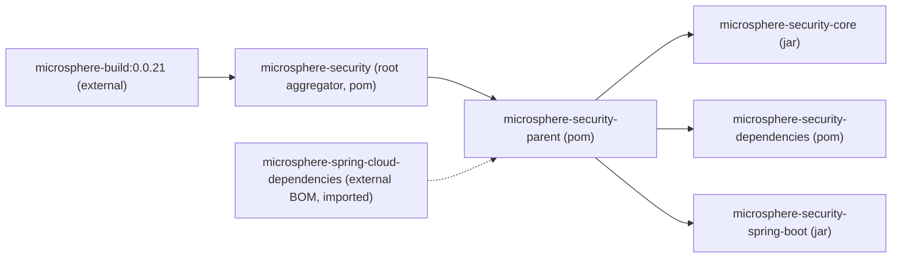

# microsphere-security-parent

> **版本线说明：** 本仓库目前不存在 `release` 或 `release-1.x` 分支。`current`
> 文档线由 `main` 分支生成（revision 为 `0.0.1-SNAPSHOT`，处于 1.0 之前，尚未发布任何版本）。
> javadoc 中的 `@since 1.0.0` 标签是对未来的承诺，并非已发布版本。
> 构件只能以快照形式从 Sonatype OSS 快照仓库获取
> （`https://s01.oss.sonatype.org/content/repositories/snapshots`），Maven Central 上没有。

## 概述

`microsphere-security-parent` 是一个 `pom` 打包方式的模块，承载本仓库其它模块共享的构建约定。
它不发布任何类，也不发布任何资源；它存在的意义是让 `microsphere-security-core`、
`microsphere-security-dependencies` 与 `microsphere-security-spring-boot` 声明同一个 parent，
从而继承同一套依赖管理。

它唯一的实质性贡献是一个 BOM 导入：
`io.github.microsphere-projects:microsphere-spring-cloud-dependencies`。正是通过这次导入，
Spring Boot、Spring Framework、`commons-lang3`、Servlet API、JUnit 以及代码用到的其它三方库
的版本在本仓库**之外**被决定。

文件：`microsphere-security-parent/pom.xml`（39 行，没有 `<build>` 段，也没有插件）。

## Maven 坐标

| 字段 | 值 |
|---|---|
| groupId | `io.github.microsphere-projects` |
| artifactId | `microsphere-security-parent` |
| version | `${revision}`（解析为 `0.0.1-SNAPSHOT`） |
| packaging | `pom` |
| parent | `io.github.microsphere-projects:microsphere-security:${revision}` |
| name | `Microsphere :: Security :: Parent` |

## POM 详解

### 继承链



需要留意的是，根 POM 自己的 parent 是 `io.github.microsphere-projects:microsphere-build`
版本 `0.0.21`，它以字面量写在 `pom.xml` 中，而该构件并不属于本 reactor。
`microsphere-security-parent` 位于根 POM **之下**，因此你的模块实际经历的链条是
`microsphere-build:0.0.21` → `microsphere-security` → `microsphere-security-parent` → 你的模块。

### 导入的 BOM

该 parent 的整个 `<dependencyManagement>` 只有一条记录：

```xml
<dependencyManagement>
    <dependencies>

        <!-- Microsphere Spring Cloud Dependencies -->
        <dependency>
            <groupId>io.github.microsphere-projects</groupId>
            <artifactId>microsphere-spring-cloud-dependencies</artifactId>
            <version>${microsphere-spring-cloud.version}</version>
            <type>pom</type>
            <scope>import</scope>
        </dependency>

    </dependencies>
</dependencyManagement>
```

由于这条记录带有 `<scope>import</scope>` 与 `<type>pom</type>`，Maven 会把该 BOM 的受管依赖
清单合并进这个 parent。这正是本仓库中各模块在 `spring-boot-starter`、`javax.servlet-api`、
`commons-lang3`、`junit-jupiter-api` 旁边都不写版本的原因。

### 哪些模块使用该父 POM

三个实质性模块都以完全相同的方式声明它，并且都带有显式的 `relativePath`：

```xml
<parent>
    <groupId>io.github.microsphere-projects</groupId>
    <artifactId>microsphere-security-parent</artifactId>
    <version>${revision}</version>
    <relativePath>../microsphere-security-parent/pom.xml</relativePath>
</parent>
```

parent 自身也是根聚合器 `<modules>` 中的一个模块，与其它模块并列。在 reactor 构建顺序中它会
被优先解析，因为其它模块都继承于它。

### 本仓库中没有声明的内容

以下是你能从这些 POM 中得知的事实边界，必须诚实说明：

- **没有 JDK 级别。** 编译器的 source/target 来自外部父 POM `microsphere-build:0.0.21`。
  本仓库里既没有 `maven.compiler.source`，也没有 `<release>`，更没有 compiler 插件声明。
- **没有 Spring Boot 版本。** 它经由 `microsphere-spring-cloud-dependencies` 传入。
- **没有 Spring Framework、Servlet、commons 或 JUnit 的版本**——同一条外部链条。
- **parent POM 中没有插件管理、发布管理或 SCM**；指向 Sonatype 快照仓库的
  `<distributionManagement>` 与 `<repositories>` 写在根 `pom.xml` 里。

## 配置

### microsphere-spring-cloud.version 属性

parent 只定义了一个属性：

```xml
<properties>
    <microsphere-spring-cloud.version>${revision}</microsphere-spring-cloud.version>
</properties>
```

由 `${revision}` 这个默认值可推出两点：

1. 外部 BOM 是与本项目**相同**的版本被请求的，也就是 `0.0.1-SNAPSHOT`。这意味着截至撰写时
   `microsphere-spring-cloud-dependencies` 本身也是一个未发布的快照，因此构建只能从
   `https://s01.oss.sonatype.org/content/repositories/snapshots` 这类快照仓库，或者从已经安装到
   本地仓库中的副本解析到它。
2. 覆盖该属性（`-Dmicrosphere-spring-cloud.version=...`）是在不修改任何 POM 的前提下，
   让构建指向另一个 BOM 快照的受支持方式。

## 代码示例

### 在自己的模块中使用该父 POM

如果你希望自己的模块继承与本项目模块相同的受管版本：

```xml
<parent>
    <groupId>io.github.microsphere-projects</groupId>
    <artifactId>microsphere-security-parent</artifactId>
    <version>0.0.1-SNAPSHOT</version>
</parent>
```

随后像本仓库的模块那样声明不带版本的依赖。请记住这会拉入整条外部链条，因此必须配置好快照
仓库——既可以通过根 POM 的 `<repositories>` 继承，也可以自行添加。

### 确认依赖最终解析到哪个版本

由于 POM 里看不到任何版本，请用 Maven 本身确认生效版本而不要去猜：

```bash
mvn -f microsphere-security-spring-boot/pom.xml dependency:tree
mvn -f microsphere-security-parent/pom.xml help:effective-pom
```

当你的调用方式无法从 reactor 解析出属性时，请附加 `-Drevision=0.0.1-SNAPSHOT`
（或 CI 工作流中使用的 `-Drevision=0.0.1` 形式）。

## 版本信息

- 构件版本：`${revision}` → `0.0.1-SNAPSHOT`。没有任何发布版本，因此该 parent 只以快照形式存在。
- parent 自己的父 POM `microsphere-build` 在根 `pom.xml` 中被钉为字面量 `0.0.21`——这是一个真实
  的外部版本，但它是*构建*父 POM 的版本，而不是本项目各模块的版本。
- 项目中其它地方的 `@since 1.0.0` javadoc 标签与本模块的可用性无关；POM 模块没有 javadoc。

## 兼容性

- **Spring Boot 代际：** 本仓库的代码针对 `javax.servlet.*` 编译，并通过
  `META-INF/spring.factories` 注册自动配置。这两点都能在 `microsphere-security-spring-boot`
  中核实：源码 import 了 `javax.servlet.Filter`、`javax.servlet.http.HttpServletRequest`
  与 `javax.servlet.DispatcherType`，资源文件
  `src/main/resources/META-INF/spring.factories` 使用的键是
  `org.springframework.boot.autoconfigure.EnableAutoConfiguration`。这就是 Spring Boot
  **2.x** 的 servlet 栈约定——Spring Boot 3.x 需要 `jakarta.*` 包以及
  `META-INF/spring/org.springframework.boot.autoconfigure.AutoConfiguration.imports`。
  因此：Spring Boot 2.x 这一代；该代码线不支持 Spring Boot 3.x。
- **JDK：** 继承自外部父 POM `microsphere-build:0.0.21`，本仓库中未声明。
- **所有三方版本：** 经由外部导入的 `microsphere-spring-cloud-dependencies` BOM 继承；
  实际管理了哪些内容请查阅该 BOM。

## 相关文档

- [用户指南索引](README.md)——返回指南总览。
- [microsphere-security-dependencies](microsphere-security-dependencies.zh.md)——继承自该 parent 的 BOM。
- [microsphere-security-core](microsphere-security-core.zh.md)——基于该 parent 构建的 jar 模块。
- [microsphere-security-spring-boot](microsphere-security-spring-boot.zh.md)——其 servlet 用法支撑上文兼容性结论的模块。
- 开发者指南：[microsphere-security-parent](../developer-guide/microsphere-security-parent.zh.md)

## English

[English](microsphere-security-parent.md)
