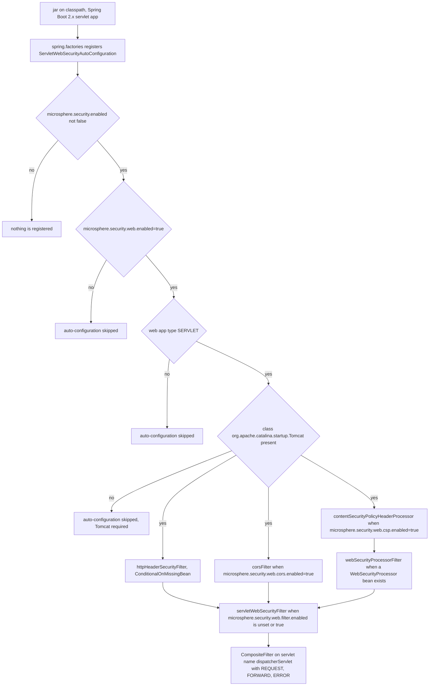

# microsphere-security-spring-boot

> **Version-line note:** This repository currently has no `release` or `release-1.x` branch. The `current` documentation line is generated from the `main` branch (revision `0.0.1-SNAPSHOT`, pre-1.0, nothing released yet). `@since 1.0.0` javadoc tags are forward promises, not released versions. Artifacts are available only as snapshots from the Sonatype OSS snapshot repository (`https://s01.oss.sonatype.org/content/repositories/snapshots`), not from Maven Central.

## Overview

`microsphere-security-spring-boot` is the module you actually use. It turns the property
prefixes defined in [microsphere-security-core](microsphere-security-core.md) into a live
servlet filter chain that decorates every response with the browser-protection headers listed
below, and it exposes a small SPI (`WebSecurityProcessor`) so you can add your own headers
without writing a `Filter`.

What it does:

| Capability | Property section | Header or behaviour |
|---|---|---|
| HSTS | `microsphere.security.web.hsts` | `Strict-Transport-Security` |
| XSS filter | `microsphere.security.web.xss` | `X-XSS-Protection: 1; mode=block` |
| Content-type sniffing | `microsphere.security.web.x-content-type` | `X-Content-Type-Options: nosniff` |
| Clickjacking | `microsphere.security.web.x-frame` | `X-Frame-Options` |
| CSP | `microsphere.security.web.csp` | `Content-Security-Policy` / `Content-Security-Policy-Report-Only` |
| CORS | `microsphere.security.web.cors` | `CorsFilter` plus preflight handling |

What it does **not** do: authentication, authorization, CSRF tokens, session management or any
of the other things Spring Security owns. It is a header and CORS layer only.

## Maven coordinates

| Field | Value |
|---|---|
| groupId | `io.github.microsphere-projects` |
| artifactId | `microsphere-security-spring-boot` |
| version | `${revision}` (resolved to `0.0.1-SNAPSHOT`) |
| packaging | not declared in the POM, so Maven's default `jar` applies |
| parent | `io.github.microsphere-projects:microsphere-security-parent:${revision}` |

```xml
<dependency>
    <groupId>io.github.microsphere-projects</groupId>
    <artifactId>microsphere-security-spring-boot</artifactId>
    <version>0.0.1-SNAPSHOT</version>
</dependency>
```

Note that the artifactId is `microsphere-security-spring-boot`, **not**
`microsphere-security-spring-boot-starter`. The `-starter` name appears only as a
forward-looking placeholder in [microsphere-security-dependencies](microsphere-security-dependencies.md)
and no such module is built by this reactor.

All Spring dependencies in this module's POM are `<optional>true</optional>`
(`spring-boot-starter`, `spring-boot-starter-web`, `spring-boot-configuration-processor`) and
`javax.servlet-api` is `provided`. Optional dependencies are not transitive, so **your**
application must bring `spring-boot-starter-web` (or an equivalent servlet starter) itself.

## How it is enabled and registered

### Auto-configuration registration

`microsphere-security-spring-boot/src/main/resources/META-INF/spring.factories` contains exactly
one entry:

```properties
org.springframework.boot.autoconfigure.EnableAutoConfiguration=\
io.microsphere.security.spring.boot.autoconfigure.web.servlet.ServletWebSecurityAutoConfiguration
```

So there is nothing to import or `@Enable`. Just having the jar on a Spring Boot 2.x classpath
registers the auto-configuration. (This `spring.factories` mechanism is itself the evidence that
the module belongs to the Spring Boot 2.x generation — see
[Compatibility](#compatibility).)

### The two-level enable switches

Two boolean properties gate everything, and their defaults are asymmetric:

| Property | Absent means | Consequence |
|---|---|---|
| `microsphere.security.enabled` | **enabled** — `@ConditionalOnEnabledSecurity` sets `matchIfMissing = true` | The master switch is on by default; set it to `false` to switch the whole project off. |
| `microsphere.security.web.enabled` | **disabled** — `@ConditionalOnEnabledWebSecurity` has no `matchIfMissing` | Nothing in this module touches your requests until you set it to `true`. |

`@ConditionalOnEnabledWebSecurity` is stacked on top of `@ConditionalOnEnabledSecurity`, so
`microsphere.security.enabled=false` also disables the web layer even if
`microsphere.security.web.enabled=true`.

Then, inside the web layer, every protection has its own `enabled` flag that defaults to `false`
in `WebSecurityProperties.BaseConfig`, plus one infrastructure switch,
`microsphere.security.web.filter.enabled`, which defaults to *on*.

## Quick start

### Properties format

Properties files use the kebab-case forms — these are the exact spellings used by the module's
own test:

```properties
microsphere.security.enabled=true
microsphere.security.web.enabled=true

microsphere.security.web.x-frame.enabled=true
microsphere.security.web.x-frame.option=SAMEORIGIN
microsphere.security.web.x-frame.uri=/

microsphere.security.web.x-content-type.enabled=true
microsphere.security.web.xss.enabled=true

microsphere.security.web.hsts.enabled=true
microsphere.security.web.hsts.max-age-in-seconds=31536000
microsphere.security.web.hsts.include-sub-domains=true

microsphere.security.web.csp.enabled=true
microsphere.security.web.csp.policy-directives=default-src 'none'; style-src cdn.example.com; report-uri /_/csp-reports

microsphere.security.web.cors.enabled=true
```

### YAML format

```yaml
microsphere:
  security:
    enabled: true
    web:
      enabled: true
      x-frame:
        enabled: true
        option: SAMEORIGIN
        uri: /
      x-content-type:
        enabled: true
      xss:
        enabled: true
      hsts:
        enabled: true
        max-age-in-seconds: 31536000
        include-sub-domains: true
      csp:
        enabled: true
        policy-directives: "default-src 'none'; style-src cdn.example.com; report-uri /_/csp-reports"
      cors:
        enabled: true
        configs:
          /api/**:
            allowed-origins:
              - "https://example.com"
            allowed-methods:
              - GET
              - POST
            allowed-headers:
              - "*"
            exposed-headers:
              - "X-Custom-Header"
            allow-credentials: true
            max-age: 3600
      filter:
        enabled: true
```

## Configuration property reference

Every row below is read from `WebSecurityProperties` and from the annotations on
`ServletWebSecurityAutoConfiguration`. The `since` column is `pre-1.0` everywhere because no
version of this library has been released; the javadoc `@since 1.0.0` tags are promises.

### Root and infrastructure

| Property | Type | Default | Effect | Since |
|---|---|---|---|---|
| `microsphere.security.enabled` | `boolean` | on when absent (`matchIfMissing = true`) | Master switch for the whole library | pre-1.0 |
| `microsphere.security.web.enabled` | `boolean` | off when absent (no `matchIfMissing`) | Enables `ServletWebSecurityAutoConfiguration` | pre-1.0 |
| `microsphere.security.web.filter.enabled` | `boolean` | on when absent (`matchIfMissing = true`) | Enables the `servletWebSecurityFilter` registration bean that composites the `@WebSecurityFilter` filters | pre-1.0 |

### HSTS — `microsphere.security.web.hsts`

| Property | Type | Default | Effect | Since |
|---|---|---|---|---|
| `...hsts.enabled` | `boolean` | `false` | Turns the `Strict-Transport-Security` header on | pre-1.0 |
| `...hsts.max-age-in-seconds` | `int` | `0` | `max-age` value; `0` tells browsers not to remember the upgrade | pre-1.0 |
| `...hsts.include-sub-domains` | `boolean` | `false` | Adds `includeSubDomains` | pre-1.0 |
| `...hsts.preload` | `boolean` | `false` | Adds `preload` | pre-1.0 |

### XSS and content sniffing

| Property | Type | Default | Effect | Since |
|---|---|---|---|---|
| `microsphere.security.web.xss.enabled` | `boolean` | `false` | `X-XSS-Protection: 1; mode=block` | pre-1.0 |
| `microsphere.security.web.x-content-type.enabled` | `boolean` | `false` | `X-Content-Type-Options: nosniff` | pre-1.0 |

`xss` and `x-content-type` have no further fields — `Xss` and `XContentType` are empty subclasses
of `BaseConfig`.

### X-Frame-Options — `microsphere.security.web.x-frame`

| Property | Type | Default | Effect | Since |
|---|---|---|---|---|
| `...x-frame.enabled` | `boolean` | `false` | Turns anti-clickjacking on | pre-1.0 |
| `...x-frame.option` | `String` | `DENY` | The `X-Frame-Options` value, e.g. `DENY` or `SAMEORIGIN` | pre-1.0 |
| `...x-frame.uri` | `String` | none | Handed to Tomcat's `setAntiClickJackingUri(...)`; applied only when it has text (`StringUtils.hasText`) | pre-1.0 |

### CSP — `microsphere.security.web.csp`

| Property | Type | Default | Effect | Since |
|---|---|---|---|---|
| `...csp.enabled` | `boolean` | `false` | Registers the `ContentSecurityPolicyProcessor` bean | pre-1.0 |
| `...csp.policy-directives` | `String` | none | The header value, written verbatim | pre-1.0 |
| `...csp.report-only` | `boolean` | `false` | `false` → `Content-Security-Policy`; `true` → `Content-Security-Policy-Report-Only` | pre-1.0 |

`policy-directives` has no default, so always configure it together with `csp.enabled=true`; the
value is passed straight to `HttpServletResponse#setHeader` without validation.

### CORS — `microsphere.security.web.cors`

| Property | Type | Default | Effect | Since |
|---|---|---|---|---|
| `...cors.enabled` | `boolean` | `false` | Registers the `corsFilter` bean | pre-1.0 |
| `...cors.configs` | `Map<String, Config>` | empty `LinkedHashMap` | Key = URL pattern (e.g. `/api/**`), value = one CORS rule | pre-1.0 |
| `...cors.configs.<pattern>.allowed-origins` | `List<String>` | `null` | Copied onto Spring's `CorsConfiguration` | pre-1.0 |
| `...cors.configs.<pattern>.allowed-methods` | `List<String>` | `null` | Copied onto `CorsConfiguration` | pre-1.0 |
| `...cors.configs.<pattern>.allowed-headers` | `List<String>` | `null` | Copied onto `CorsConfiguration` | pre-1.0 |
| `...cors.configs.<pattern>.exposed-headers` | `List<String>` | `null` | Copied onto `CorsConfiguration` | pre-1.0 |
| `...cors.configs.<pattern>.allow-credentials` | `Boolean` | `null` | Copied onto `CorsConfiguration` | pre-1.0 |
| `...cors.configs.<pattern>.max-age` | `Long` | `null` | Preflight cache duration, seconds | pre-1.0 |

The copy is done with `BeanUtils.copyProperties(config, corsConfiguration)`, so it matches purely
on property names. Fields you leave unset are copied as `null`, which is the same state a fresh
`CorsConfiguration` starts in. Map keys become the path patterns of a
`UrlBasedCorsConfigurationSource`.

## Public API reference

### `@ConditionalOnEnabledSecurity`

`io.microsphere.security.spring.boot.condition.ConditionalOnEnabledSecurity` — a meta-annotation
combining `@ConditionalOnProperty(prefix = PROPERTY_NAME_PREFIX, name = "enabled", matchIfMissing = true)`.
Target: `TYPE`, `METHOD`. Use it to gate your own configuration classes on the same master switch
as the library.

### `@ConditionalOnEnabledWebSecurity`

`io.microsphere.security.spring.boot.condition.ConditionalOnEnabledWebSecurity` — stacks
`@ConditionalOnEnabledSecurity` and adds
`@ConditionalOnProperty(prefix = WEB_SECURITY_PROPERTY_NAME_PREFIX, name = "enabled")` with **no**
`matchIfMissing`, hence off by default. Applied to `ServletWebSecurityAutoConfiguration`.

### `@WebSecurityFilter`

`io.microsphere.security.spring.boot.annotation.WebSecurityFilter` — a `@Qualifier` annotation
(`@Target({FIELD, PARAMETER, METHOD})`, `@Inherited`, runtime retention). Beans annotated with it
are collected by `servletWebSecurityFilter` and composed into one filter. Add it to your own
`Filter` bean if you want it inside the same composite, in order.

### `WebSecurityProperties`

`io.microsphere.security.spring.boot.autoconfigure.WebSecurityProperties` — bound with
`@ConfigurationProperties(prefix = WEB_SECURITY_PROPERTY_NAME_PREFIX)`, i.e. the prefix without a
trailing dot. It holds six nested sections (`Hsts`, `Xss`, `XContentType`, `XFrame`, `Csp`, `Cors`),
each instantiated eagerly and each extending the package-private `BaseConfig` whose only field is
`enabled = false`. `Cors.Config` is the nested-nested type holding the six CORS fields. All
sections carry `toString()` built with `ReflectionToStringBuilder`, which is handy when you want
to log what got bound.

### `WebSecurityProcessor`

`io.microsphere.security.spring.boot.web.servlet.WebSecurityProcessor` — the SPI:

```java
public interface WebSecurityProcessor {
    void process(HttpServletRequest request, HttpServletResponse response) throws IOException, ServletException;
}
```

Implementations may be ordered with `@Order` or by implementing `Ordered`; the ordering is applied
with `AnnotationAwareOrderComparator`.

### `WebSecurityProcessorFilter`

`io.microsphere.security.spring.boot.web.servlet.WebSecurityProcessorFilter` — a public `Filter`
that wraps a `Collection<WebSecurityProcessor>` in the package-private composite
`WebSecurityProcessors` (which sorts the delegate list and loops over it) and calls
`process(...)` **before** `chain.doFilter(...)`. `doFilter` is `final`. Practical consequence:
processors run ahead of your controller, and the response they modify has not been committed yet.

### `ContentSecurityPolicyProcessor`

`io.microsphere.security.spring.boot.web.servlet.csp.ContentSecurityPolicyProcessor` — the only
built-in processor. Two setters (`setPolicyDirectives`, `setReportOnly`) and two public header
name constants, `CONTENT_SECURITY_POLICY_HEADER` (`Content-Security-Policy`) and
`CONTENT_SECURITY_POLICY_REPORT_ONLY_HEADER` (`Content-Security-Policy-Report-Only`).

### `ServletWebSecurityAutoConfiguration`

`io.microsphere.security.spring.boot.autoconfigure.web.servlet.ServletWebSecurityAutoConfiguration`
— the entry point. Class-level conditions:

| Annotation | Requirement |
|---|---|
| `@ConditionalOnEnabledWebSecurity` | `microsphere.security.enabled` not `false` **and** `microsphere.security.web.enabled=true` |
| `@ConditionalOnWebApplication(type = SERVLET)` | a servlet web application (not reactive, not non-web) |
| `@ConditionalOnClass(name = "org.apache.catalina.startup.Tomcat")` | **Tomcat must be on the classpath** — the embedded container headers here come from `org.apache.catalina.filters.HttpHeaderSecurityFilter`. Jetty/Undertow-only applications get nothing. |
| `@AutoConfigureBefore(name = {...WebMvcAutoConfiguration, ...DispatcherServletAutoConfiguration})` | the filter beans exist before MVC/dispatcher registration |
| `@Import(ServletWebSecurityAutoConfiguration.TomcatConfiguration.class)` | pulls in the Tomcat-specific bean |
| `@EnableConfigurationProperties(WebSecurityProperties.class)` | binds the properties |

## Which bean registers under which condition



| Bean (method name) | Type | `@WebSecurityFilter`? | Registering condition |
|---|---|---|---|
| `httpHeaderSecurityFilter` | `org.apache.catalina.filters.HttpHeaderSecurityFilter` | yes | `@ConditionalOnMissingBean` only; declared in the static nested `TomcatConfiguration` class. It is created even when every section is disabled — the per-section `enabled` flags decide which headers it emits. |
| `corsFilter` | `org.springframework.web.filter.CorsFilter` | yes | `microsphere.security.web.cors.enabled=true`, `@ConditionalOnMissingBean` |
| `contentSecurityPolicyHeaderProcessor` | `ContentSecurityPolicyProcessor` | no | `microsphere.security.web.csp.enabled=true`, `@ConditionalOnMissingBean` |
| `webSecurityProcessorFilter` | `WebSecurityProcessorFilter` | yes | `@ConditionalOnBean(WebSecurityProcessor.class)` plus `@ConditionalOnMissingBean` |
| `servletWebSecurityFilter` | `FilterRegistrationBean<Filter>` | no | `microsphere.security.web.filter.enabled` unset or `true` |

Registration details of `servletWebSecurityFilter`: it wraps the collected filters into a Spring
`CompositeFilter`, sorts them with `AnnotationAwareOrderComparator`, sets
`asyncSupported = false`, dispatcher types `REQUEST`, `FORWARD` and `ERROR`, and binds it to the
servlet *names* list built from `DispatcherServletAutoConfiguration.DEFAULT_DISPATCHER_SERVLET_BEAN_NAME`.
Because `httpHeaderSecurityFilter` is always registered with `@WebSecurityFilter` whenever the
auto-configuration is active, that collected collection is never empty in practice.

## Worked example: the module's own integration test

The repository has **no** `test-cases` directory — all examples in this guide come from each
module's `src/test/java`. The canonical one is
`microsphere-security-spring-boot/src/test/java/io/microsphere/security/spring/boot/autoconfigure/web/servlet/ServletWebSecurityAutoConfigurationTest.java`.

It boots the application on a random port, registers a trivial controller, sets every switch, and
then asserts the resulting headers:

```java
@SpringBootTest(classes = {
        ServletWebSecurityAutoConfigurationTest.class,
        ServletWebSecurityAutoConfigurationTest.TestController.class
},
        webEnvironment = SpringBootTest.WebEnvironment.RANDOM_PORT,
        properties = {
                "microsphere.security.web.enabled=true",

                "microsphere.security.web.cors.enabled=true",

                "microsphere.security.web.xss.enabled=true",

                "microsphere.security.web.x-content-type.enabled=true",
                "microsphere.security.web.x-frame.enabled=true",
                "microsphere.security.web.x-frame.option=SAMEORIGIN",
                "microsphere.security.web.x-frame.uri=/",

                "microsphere.security.web.hsts.enabled=true",

                "microsphere.security.web.csp.enabled=true",
                "microsphere.security.web.csp.policy-directives=default-src 'none'; style-src cdn.example.com; report-uri /_/csp-reports"
        })
@EnableAutoConfiguration
public class ServletWebSecurityAutoConfigurationTest {
```

(the block is quoted from the test file; only its license header and imports are omitted.)
And the assertions:

```java
    @Test
    void test(@Autowired WebTestClient webClient) {
        webClient.get()
                .uri("/")
                .exchange()
                .expectStatus().isOk()
                .expectHeader().value("X-Frame-Options", value -> assertEquals("SAMEORIGIN", value))
                .expectHeader().value("X-Content-Type-Options", value -> assertEquals("nosniff", value))
                .expectHeader().value("X-XSS-Protection", value -> assertEquals("1; mode=block", value))
                .expectHeader().value("Content-Security-Policy", value -> assertEquals("default-src 'none'; style-src cdn.example.com; report-uri /_/csp-reports", value))
                .expectHeader().values("Vary", value -> assertEquals(Arrays.asList("Origin", "Access-Control-Request-Method", "Access-Control-Request-Headers"), value))
        ;
    }
```

What this proves, and what it does not:

- `x-frame.option=SAMEORIGIN` overrides the `DENY` default, and the `uri` is accepted.
- `x-content-type.enabled` and `xss.enabled` produce `nosniff` and `1; mode=block`.
- CSP directives set in properties arrive verbatim in `Content-Security-Policy`, proving that the
  processor bean, the `webSecurityProcessorFilter` and the composite registration all wired up.
- Enabling CORS is observable here only through the `Vary` header that `CorsFilter` adds; no
  cross-origin request is simulated.
- HSTS is switched on but its header is **not** asserted.
- The controller method is mapped with `@GetMapping("")` and returns `Hello,World`, and the test
  requests `/`.

## Writing a custom WebSecurityProcessor

Add a bean implementing `WebSecurityProcessor`; nothing else is required. As soon as one exists,
`webSecurityProcessorFilter` becomes eligible and joins the composite.

```java
package com.example.demo.security;

import io.microsphere.security.spring.boot.web.servlet.WebSecurityProcessor;
import org.springframework.core.annotation.Order;
import org.springframework.stereotype.Component;

import javax.servlet.http.HttpServletRequest;
import javax.servlet.http.HttpServletResponse;

@Component
@Order(200)
public class ReferrerPolicyProcessor implements WebSecurityProcessor {

    @Override
    public void process(HttpServletRequest request, HttpServletResponse response) {
        response.setHeader("Referrer-Policy", "strict-origin-when-cross-origin");
    }
}
```

How it is picked up:

1. `@Component` puts it in the context; the auto-configuration's
   `@ConditionalOnBean(WebSecurityProcessor.class)` then matches, so a
   `WebSecurityProcessorFilter` is created around the whole processor collection.
2. All `WebSecurityProcessor` beans are sorted with `AnnotationAwareOrderComparator`, so `@Order`
   (or `Ordered#getOrder()`) controls the sequence within one request. The built-in
   `ContentSecurityPolicyProcessor` carries no order annotation, which means it sorts as
   unordered; pick your values accordingly rather than assuming a position.
3. The filter runs the processors before `chain.doFilter`, so headers are set before your
   controller produces the body.
4. Everything above still requires `microsphere.security.web.enabled=true`. Without it, no
   auto-configuration runs and your processor bean is simply an unused bean — and note that a
   processor bean on its own does **not** enable the web security layer, since the condition is
   evaluated on properties, not on beans.

If instead you want a raw `Filter` inside the same composite, annotate its bean method with
`@WebSecurityFilter`; `@Order` sorts that collection too.

## Version information

- Version: `${revision}` → `0.0.1-SNAPSHOT`; no release exists for this module and there is no
  `release` branch.
- Available only from the Sonatype OSS snapshot repository
  (`https://s01.oss.sonatype.org/content/repositories/snapshots`).
- All `@since 1.0.0` javadoc tags in this module are forward promises, not released versions.
- The `<version>${revision}</version>` written on its `microsphere-security-core` dependency is
  resolved by the reactor, not by the BOM.

## Compatibility

- **Spring Boot 2.x servlet stack only.** The sources import `javax.servlet.Filter`,
  `javax.servlet.http.HttpServletRequest`, `javax.servlet.http.HttpServletResponse` and
  `javax.servlet.DispatcherType`, and auto-configuration is registered via
  `META-INF/spring.factories` with the `EnableAutoConfiguration` key. Spring Boot 3.x would
  require `jakarta.*` packages and
  `META-INF/spring/org.springframework.boot.autoconfigure.AutoConfiguration.imports`.
  So: Spring Boot 2.x generation; Spring Boot 3.x is not supported on this code line.
- **Tomcat is required** for any of the header features, because `httpHeaderSecurityFilter` is
  `org.apache.catalina.filters.HttpHeaderSecurityFilter` and the class-level condition demands
  `org.apache.catalina.startup.Tomcat`.
- **Servlet containers** only — reactive (`WebFlux`) applications are excluded by
  `@ConditionalOnWebApplication(type = SERVLET)`. `spring-boot-starter-webflux` appears in this
  POM purely with `test` scope, to obtain `WebTestClient` for the test above.
- **JDK:** inherited from the external parent `microsphere-build:0.0.21`, not declared in this
  repository. The CI workflow builds with a Temurin JDK 8, which describes CI only.
- **Spring Boot / Spring Framework / `commons-lang3` / Servlet API versions:** none are declared
  here; they are inherited through the externally imported
  `microsphere-spring-cloud-dependencies` BOM. Check your resolved tree instead of assuming.

## Related documents

- [User Guide index](README.md) — back to the guide overview.
- [microsphere-security-core](microsphere-security-core.md) — where the property prefixes come from.
- [microsphere-security-parent](microsphere-security-parent.md) — conventions and version sourcing.
- [microsphere-security-dependencies](microsphere-security-dependencies.md) — the BOM and the
  starter-name placeholder.
- Developer Guide: [microsphere-security-spring-boot](../developer-guide/microsphere-security-spring-boot.md)

## 中文

[简体中文](microsphere-security-spring-boot.zh.md)
