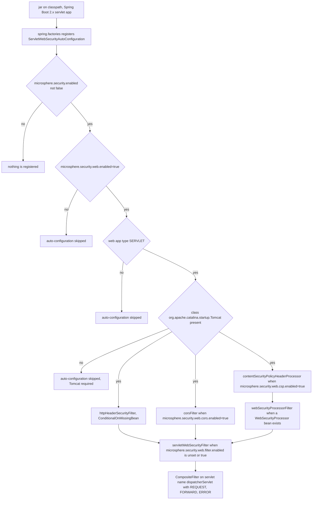

# microsphere-security-spring-boot

> **版本线说明：** 本仓库目前不存在 `release` 或 `release-1.x` 分支。`current`
> 文档线由 `main` 分支生成（revision 为 `0.0.1-SNAPSHOT`，处于 1.0 之前，尚未发布任何版本）。
> javadoc 中的 `@since 1.0.0` 标签是对未来的承诺，并非已发布版本。
> 构件只能以快照形式从 Sonatype OSS 快照仓库获取
> （`https://s01.oss.sonatype.org/content/repositories/snapshots`），Maven Central 上没有。

## 概述

`microsphere-security-spring-boot` 是你真正使用的模块。它把
[microsphere-security-core](microsphere-security-core.zh.md) 中定义的属性前缀变成一条真实的
Servlet 过滤器链，为每个响应加上后文列出的浏览器保护响应头；同时它暴露了一个小 SPI
（`WebSecurityProcessor`），让你无需编写 `Filter` 也能添加自己的响应头。

它做的事：

| 能力 | 属性段 | 响应头或行为 |
|---|---|---|
| HSTS | `microsphere.security.web.hsts` | `Strict-Transport-Security` |
| XSS 过滤 | `microsphere.security.web.xss` | `X-XSS-Protection: 1; mode=block` |
| 内容类型嗅探 | `microsphere.security.web.x-content-type` | `X-Content-Type-Options: nosniff` |
| 点击劫持 | `microsphere.security.web.x-frame` | `X-Frame-Options` |
| CSP | `microsphere.security.web.csp` | `Content-Security-Policy` / `Content-Security-Policy-Report-Only` |
| CORS | `microsphere.security.web.cors` | `CorsFilter` 以及预检（preflight）处理 |

它**不**做的事：认证、授权、CSRF 令牌、会话管理，以及 Spring Security 负责的那些事情。
它只是一个响应头与 CORS 层。

## Maven 坐标

| 字段 | 值 |
|---|---|
| groupId | `io.github.microsphere-projects` |
| artifactId | `microsphere-security-spring-boot` |
| version | `${revision}`（解析为 `0.0.1-SNAPSHOT`） |
| packaging | POM 中未声明，因此适用 Maven 默认的 `jar` |
| parent | `io.github.microsphere-projects:microsphere-security-parent:${revision}` |

```xml
<dependency>
    <groupId>io.github.microsphere-projects</groupId>
    <artifactId>microsphere-security-spring-boot</artifactId>
    <version>0.0.1-SNAPSHOT</version>
</dependency>
```

请注意 artifactId 是 `microsphere-security-spring-boot`，**不是**
`microsphere-security-spring-boot-starter`。带 `-starter` 的名字只作为面向未来的占位出现在
[microsphere-security-dependencies](microsphere-security-dependencies.zh.md) 中，本 reactor
并不产出该模块。

本模块 POM 中所有 Spring 依赖都是 `<optional>true</optional>`
（`spring-boot-starter`、`spring-boot-starter-web`、`spring-boot-configuration-processor`），
而 `javax.servlet-api` 是 `provided`。optional 依赖不具备传递性，因此**你的**应用必须自己引入
`spring-boot-starter-web`（或等价的 servlet starter）。

## 启用与注册机制

### 自动配置的注册

`microsphere-security-spring-boot/src/main/resources/META-INF/spring.factories` 只有一条记录：

```properties
org.springframework.boot.autoconfigure.EnableAutoConfiguration=\
io.microsphere.security.spring.boot.autoconfigure.web.servlet.ServletWebSecurityAutoConfiguration
```

因此不需要 import，也不需要 `@Enable`。只要把这个 jar 放到 Spring Boot 2.x 的 classpath 上，
自动配置就会被注册。而这个 `spring.factories` 机制本身就是该模块属于 Spring Boot 2.x 一代的
证据——见[兼容性](#兼容性)。

### 两级启用开关

两个布尔属性把守全部功能，而它们的默认值是不对称的：

| 属性 | 缺省时的含义 | 后果 |
|---|---|---|
| `microsphere.security.enabled` | **启用**——`@ConditionalOnEnabledSecurity` 设置了 `matchIfMissing = true` | 总开关默认打开；设为 `false` 可关闭整个库。 |
| `microsphere.security.web.enabled` | **关闭**——`@ConditionalOnEnabledWebSecurity` 没有 `matchIfMissing` | 在你显式设为 `true` 之前，本模块不会介入任何请求。 |

`@ConditionalOnEnabledWebSecurity` 叠加在 `@ConditionalOnEnabledSecurity` 之上，因此
`microsphere.security.enabled=false` 会连 Web 层一起关掉，即使
`microsphere.security.web.enabled=true` 也一样。

在此之上，Web 层内部每一项保护能力都有自己默认为 `false` 的 `enabled` 标志
（来自 `WebSecurityProperties.BaseConfig`），另有一个基础设施开关
`microsphere.security.web.filter.enabled`，它默认是**开**的。

## 快速开始

### properties 格式

properties 文件使用 kebab-case 写法——下列拼写直接取自模块自带的测试：

```properties
microsphere.security.enabled=true
microsphere.security.web.enabled=true

microsphere.security.web.x-frame.enabled=true
microsphere.security.web.x-frame.option=SAMEORIGIN
microsphere.security.web.x-frame.uri=/

microsphere.security.web.x-content-type.enabled=true
microsphere.security.web.xss.enabled=true

microsphere.security.web.hsts.enabled=true
microsphere.security.web.hsts.max-age-in-seconds=31536000
microsphere.security.web.hsts.include-sub-domains=true

microsphere.security.web.csp.enabled=true
microsphere.security.web.csp.policy-directives=default-src 'none'; style-src cdn.example.com; report-uri /_/csp-reports

microsphere.security.web.cors.enabled=true
```

### YAML 格式

```yaml
microsphere:
  security:
    enabled: true
    web:
      enabled: true
      x-frame:
        enabled: true
        option: SAMEORIGIN
        uri: /
      x-content-type:
        enabled: true
      xss:
        enabled: true
      hsts:
        enabled: true
        max-age-in-seconds: 31536000
        include-sub-domains: true
      csp:
        enabled: true
        policy-directives: "default-src 'none'; style-src cdn.example.com; report-uri /_/csp-reports"
      cors:
        enabled: true
        configs:
          /api/**:
            allowed-origins:
              - "https://example.com"
            allowed-methods:
              - GET
              - POST
            allowed-headers:
              - "*"
            exposed-headers:
              - "X-Custom-Header"
            allow-credentials: true
            max-age: 3600
      filter:
        enabled: true
```

## 配置属性参考

下表每一行都来自 `WebSecurityProperties` 以及 `ServletWebSecurityAutoConfiguration` 上的注解。
`since` 列处处是 `pre-1.0`，因为本库尚未发布任何版本；javadoc 中的 `@since 1.0.0` 是承诺。

### 根级与基础设施

| 属性 | 类型 | 默认值 | 作用 | since |
|---|---|---|---|---|
| `microsphere.security.enabled` | `boolean` | 缺省时为开（`matchIfMissing = true`） | 整个库的总开关 | pre-1.0 |
| `microsphere.security.web.enabled` | `boolean` | 缺省时为关（无 `matchIfMissing`） | 启用 `ServletWebSecurityAutoConfiguration` | pre-1.0 |
| `microsphere.security.web.filter.enabled` | `boolean` | 缺省时为开（`matchIfMissing = true`） | 启用把 `@WebSecurityFilter` 过滤器组合起来的 `servletWebSecurityFilter` 注册 Bean | pre-1.0 |

### HSTS —— `microsphere.security.web.hsts`

| 属性 | 类型 | 默认值 | 作用 | since |
|---|---|---|---|---|
| `...hsts.enabled` | `boolean` | `false` | 打开 `Strict-Transport-Security` 响应头 | pre-1.0 |
| `...hsts.max-age-in-seconds` | `int` | `0` | `max-age` 取值；`0` 表示不要求浏览器记住升级 | pre-1.0 |
| `...hsts.include-sub-domains` | `boolean` | `false` | 追加 `includeSubDomains` | pre-1.0 |
| `...hsts.preload` | `boolean` | `false` | 追加 `preload` | pre-1.0 |

### XSS 与内容嗅探

| 属性 | 类型 | 默认值 | 作用 | since |
|---|---|---|---|---|
| `microsphere.security.web.xss.enabled` | `boolean` | `false` | `X-XSS-Protection: 1; mode=block` | pre-1.0 |
| `microsphere.security.web.x-content-type.enabled` | `boolean` | `false` | `X-Content-Type-Options: nosniff` | pre-1.0 |

`xss` 与 `x-content-type` 没有更多字段——`Xss` 和 `XContentType` 只是 `BaseConfig` 的空子类。

### X-Frame-Options —— `microsphere.security.web.x-frame`

| 属性 | 类型 | 默认值 | 作用 | since |
|---|---|---|---|---|
| `...x-frame.enabled` | `boolean` | `false` | 打开防点击劫持 | pre-1.0 |
| `...x-frame.option` | `String` | `DENY` | `X-Frame-Options` 的取值，例如 `DENY` 或 `SAMEORIGIN` | pre-1.0 |
| `...x-frame.uri` | `String` | 无 | 传给 Tomcat 的 `setAntiClickJackingUri(...)`；仅当它有文本时才生效（`StringUtils.hasText`） | pre-1.0 |

### CSP —— `microsphere.security.web.csp`

| 属性 | 类型 | 默认值 | 作用 | since |
|---|---|---|---|---|
| `...csp.enabled` | `boolean` | `false` | 注册 `ContentSecurityPolicyProcessor` Bean | pre-1.0 |
| `...csp.policy-directives` | `String` | 无 | 响应头的值，原样写出 | pre-1.0 |
| `...csp.report-only` | `boolean` | `false` | `false` → `Content-Security-Policy`；`true` → `Content-Security-Policy-Report-Only` | pre-1.0 |

`policy-directives` 没有默认值，因此务必与 `csp.enabled=true` 一起配置；该值不经过校验，直接
传给 `HttpServletResponse#setHeader`。

### CORS —— `microsphere.security.web.cors`

| 属性 | 类型 | 默认值 | 作用 | since |
|---|---|---|---|---|
| `...cors.enabled` | `boolean` | `false` | 注册 `corsFilter` Bean | pre-1.0 |
| `...cors.configs` | `Map<String, Config>` | 空的 `LinkedHashMap` | 键 = URL 模式（例如 `/api/**`），值 = 一条 CORS 规则 | pre-1.0 |
| `...cors.configs.<pattern>.allowed-origins` | `List<String>` | `null` | 复制到 Spring 的 `CorsConfiguration` | pre-1.0 |
| `...cors.configs.<pattern>.allowed-methods` | `List<String>` | `null` | 复制到 `CorsConfiguration` | pre-1.0 |
| `...cors.configs.<pattern>.allowed-headers` | `List<String>` | `null` | 复制到 `CorsConfiguration` | pre-1.0 |
| `...cors.configs.<pattern>.exposed-headers` | `List<String>` | `null` | 复制到 `CorsConfiguration` | pre-1.0 |
| `...cors.configs.<pattern>.allow-credentials` | `Boolean` | `null` | 复制到 `CorsConfiguration` | pre-1.0 |
| `...cors.configs.<pattern>.max-age` | `Long` | `null` | 预检缓存时长，单位秒 | pre-1.0 |

复制工作由 `BeanUtils.copyProperties(config, corsConfiguration)` 完成，因此只按属性名匹配。
未设置的字段会以 `null` 被复制过去，而这与新建 `CorsConfiguration` 的初始状态相同。Map 的键
成为 `UrlBasedCorsConfigurationSource` 的路径模式。

## 公开 API 说明

### @ConditionalOnEnabledSecurity

`io.microsphere.security.spring.boot.condition.ConditionalOnEnabledSecurity`——一个元注解，
组合了 `@ConditionalOnProperty(prefix = PROPERTY_NAME_PREFIX, name = "enabled", matchIfMissing = true)`。
作用目标：`TYPE`、`METHOD`。可以用它让自己的配置类与库共用同一个总开关。

### @ConditionalOnEnabledWebSecurity

`io.microsphere.security.spring.boot.condition.ConditionalOnEnabledWebSecurity`——叠加
`@ConditionalOnEnabledSecurity`，并添加
`@ConditionalOnProperty(prefix = WEB_SECURITY_PROPERTY_NAME_PREFIX, name = "enabled")`，
**没有** `matchIfMissing`，因此默认关闭。它作用于 `ServletWebSecurityAutoConfiguration`。

### @WebSecurityFilter

`io.microsphere.security.spring.boot.annotation.WebSecurityFilter`——一个 `@Qualifier` 注解
（`@Target({FIELD, PARAMETER, METHOD})`、`@Inherited`、运行期保留）。带有它的 Bean 会被
`servletWebSecurityFilter` 收集并组合成一条过滤器链。如果你希望自己的 `Filter` Bean 有序地进入
同一个组合体，就给它加上这个注解。

### WebSecurityProperties

`io.microsphere.security.spring.boot.autoconfigure.WebSecurityProperties`——以
`@ConfigurationProperties(prefix = WEB_SECURITY_PROPERTY_NAME_PREFIX)` 绑定，也就是使用不带结尾
点的前缀。它包含六个嵌套段（`Hsts`、`Xss`、`XContentType`、`XFrame`、`Csp`、`Cors`），每一段都
立即实例化，且都继承包级私有的 `BaseConfig`，后者唯一字段是 `enabled = false`。六个 CORS 字段
位于“嵌套的嵌套”类型 `Cors.Config` 中。所有段的 `toString()` 都由 `ReflectionToStringBuilder`
生成，想记录实际绑定结果时很方便。

### WebSecurityProcessor

`io.microsphere.security.spring.boot.web.servlet.WebSecurityProcessor`——SPI：

```java
public interface WebSecurityProcessor {
    void process(HttpServletRequest request, HttpServletResponse response) throws IOException, ServletException;
}
```

实现类可以通过 `@Order` 或实现 `Ordered` 来排序；排序由 `AnnotationAwareOrderComparator` 执行。

#### 方法：`process(HttpServletRequest request, HttpServletResponse response)`

- 说明：将当前处理器应用于本次请求/响应对，通常用于设置安全响应头。在
  `WebSecurityProcessorFilter` 中它于 `chain.doFilter(...)` **之前**执行，即先于控制器，
  此时响应尚未提交。
- 参数：`request` —— 当前 `HttpServletRequest`；`response` —— 待修改的 `HttpServletResponse`。
- 返回值：`void`。
- 异常：`IOException`、`ServletException` —— 由接口声明并向容器传播；纯设置响应头的实现
  自身不产生 I/O。

### WebSecurityProcessorFilter

`io.microsphere.security.spring.boot.web.servlet.WebSecurityProcessorFilter`——一个公开的
`Filter`，它把 `Collection<WebSecurityProcessor>` 包装进包级私有的组合实现
`WebSecurityProcessors`（该类会先排序再逐个循环调用），并且在 `chain.doFilter(...)` **之前**调用
`process(...)`。`doFilter` 是 `final` 的。实际含义：处理器先于你的控制器执行，此时响应尚未提交。

### ContentSecurityPolicyProcessor

`io.microsphere.security.spring.boot.web.servlet.csp.ContentSecurityPolicyProcessor`——唯一内置的
处理器。两个 setter（`setPolicyDirectives`、`setReportOnly`）以及两个公开响应头名常量：
`CONTENT_SECURITY_POLICY_HEADER`（`Content-Security-Policy`）与
`CONTENT_SECURITY_POLICY_REPORT_ONLY_HEADER`（`Content-Security-Policy-Report-Only`）。

#### 方法：`process(...)`（CSP 实现）

- 说明：将 `policyDirectives` 写入 `Content-Security-Policy` 响应头；当 `reportOnly` 为
  `true` 时写入 `Content-Security-Policy-Report-Only`。
- 参数：当前请求与响应；请求不会被读取。
- 返回值：`void`。
- 异常：`IOException`、`ServletException` —— 仅为接口兼容性而声明；该实现只调用
  `response.setHeader(...)`。

#### 方法：`setPolicyDirectives(String policyDirectives)` / `setReportOnly(boolean reportOnly)`

- 说明：配置入口；`ServletWebSecurityAutoConfiguration` 从
  `microsphere.security.web.csp.policy-directives` 与 `microsphere.security.web.csp.report-only`
  取值注入。
- 参数：策略指令字符串 / report-only 开关。
- 返回值：`void`。
- 异常：无。
- 注意：**没有 null/空白防护** —— 若启用 CSP 而未设置 `policy-directives`，响应头将被写入
  字面量 `null`（源码可验证；参见开发者指南）。

### ServletWebSecurityAutoConfiguration

`io.microsphere.security.spring.boot.autoconfigure.web.servlet.ServletWebSecurityAutoConfiguration`
——入口类。类级条件：

| 注解 | 要求 |
|---|---|
| `@ConditionalOnEnabledWebSecurity` | `microsphere.security.enabled` 不为 `false` **且** `microsphere.security.web.enabled=true` |
| `@ConditionalOnWebApplication(type = SERVLET)` | Servlet Web 应用（非响应式、非非 Web） |
| `@ConditionalOnClass(name = "org.apache.catalina.startup.Tomcat")` | **classpath 上必须有 Tomcat**——这里的内嵌容器响应头来自 `org.apache.catalina.filters.HttpHeaderSecurityFilter`。只使用 Jetty/Undertow 的应用什么也得不到。 |
| `@AutoConfigureBefore(name = {...WebMvcAutoConfiguration, ...DispatcherServletAutoConfiguration})` | 在 MVC/dispatcher 注册之前过滤器 Bean 已就绪 |
| `@Import(ServletWebSecurityAutoConfiguration.TomcatConfiguration.class)` | 引入 Tomcat 专用的那个 Bean |
| `@EnableConfigurationProperties(WebSecurityProperties.class)` | 绑定属性 |

## 哪个 Bean 在什么条件下注册



| Bean（方法名） | 类型 | 有 `@WebSecurityFilter`？ | 注册条件 |
|---|---|---|---|
| `httpHeaderSecurityFilter` | `org.apache.catalina.filters.HttpHeaderSecurityFilter` | 是 | 仅 `@ConditionalOnMissingBean`；声明在静态嵌套类 `TomcatConfiguration` 中。即使所有段都关闭它仍会被创建——各段的 `enabled` 标志决定它输出哪些响应头。 |
| `corsFilter` | `org.springframework.web.filter.CorsFilter` | 是 | `microsphere.security.web.cors.enabled=true`，并有 `@ConditionalOnMissingBean` |
| `contentSecurityPolicyHeaderProcessor` | `ContentSecurityPolicyProcessor` | 否 | `microsphere.security.web.csp.enabled=true`，并有 `@ConditionalOnMissingBean` |
| `webSecurityProcessorFilter` | `WebSecurityProcessorFilter` | 是 | `@ConditionalOnBean(WebSecurityProcessor.class)` 加上 `@ConditionalOnMissingBean` |
| `servletWebSecurityFilter` | `FilterRegistrationBean<Filter>` | 否 | `microsphere.security.web.filter.enabled` 缺省或为 `true` |

`servletWebSecurityFilter` 的注册细节：它把收集到的过滤器包进 Spring 的 `CompositeFilter`，用
`AnnotationAwareOrderComparator` 排序，设置 `asyncSupported = false`、dispatcher 类型为 `REQUEST`、
`FORWARD`、`ERROR`，并把它绑定到由
`DispatcherServletAutoConfiguration.DEFAULT_DISPATCHER_SERVLET_BEAN_NAME` 构造的 servlet *名称*列表上。
由于自动配置一旦生效，`httpHeaderSecurityFilter` 总会带着 `@WebSecurityFilter` 被注册，因此实践中
被收集的这个集合不会为空。

## 实例解析：模块自带的集成测试

本仓库**没有** `test-cases` 目录——本指南的所有示例都取自各模块的 `src/test/java`。
权威性最强的例子是
`microsphere-security-spring-boot/src/test/java/io/microsphere/security/spring/boot/autoconfigure/web/servlet/ServletWebSecurityAutoConfigurationTest.java`。

它用随机端口启动应用，注册一个极简控制器，打开所有开关，然后断言最终响应头：

```java
@SpringBootTest(classes = {
        ServletWebSecurityAutoConfigurationTest.class,
        ServletWebSecurityAutoConfigurationTest.TestController.class
},
        webEnvironment = SpringBootTest.WebEnvironment.RANDOM_PORT,
        properties = {
                "microsphere.security.web.enabled=true",

                "microsphere.security.web.cors.enabled=true",

                "microsphere.security.web.xss.enabled=true",

                "microsphere.security.web.x-content-type.enabled=true",
                "microsphere.security.web.x-frame.enabled=true",
                "microsphere.security.web.x-frame.option=SAMEORIGIN",
                "microsphere.security.web.x-frame.uri=/",

                "microsphere.security.web.hsts.enabled=true",

                "microsphere.security.web.csp.enabled=true",
                "microsphere.security.web.csp.policy-directives=default-src 'none'; style-src cdn.example.com; report-uri /_/csp-reports"
        })
@EnableAutoConfiguration
public class ServletWebSecurityAutoConfigurationTest {
```

（该段引自测试文件，仅省略了它的许可证头与 import。）以及断言：

```java
    @Test
    void test(@Autowired WebTestClient webClient) {
        webClient.get()
                .uri("/")
                .exchange()
                .expectStatus().isOk()
                .expectHeader().value("X-Frame-Options", value -> assertEquals("SAMEORIGIN", value))
                .expectHeader().value("X-Content-Type-Options", value -> assertEquals("nosniff", value))
                .expectHeader().value("X-XSS-Protection", value -> assertEquals("1; mode=block", value))
                .expectHeader().value("Content-Security-Policy", value -> assertEquals("default-src 'none'; style-src cdn.example.com; report-uri /_/csp-reports", value))
                .expectHeader().values("Vary", value -> assertEquals(Arrays.asList("Origin", "Access-Control-Request-Method", "Access-Control-Request-Headers"), value))
        ;
    }
```

这段证明了什么、以及没证明什么：

- `x-frame.option=SAMEORIGIN` 覆盖了 `DENY` 默认值，并且 `uri` 被接受。
- `x-content-type.enabled` 与 `xss.enabled` 分别产出 `nosniff` 与 `1; mode=block`。
- 属性中配置的 CSP 指令原样出现在 `Content-Security-Policy` 中，这同时证明了处理器 Bean、
  `webSecurityProcessorFilter` 以及组合注册全都装配成功。
- CORS 被打开后在这里只能通过 `CorsFilter` 添加的 `Vary` 头观察到；测试并没有模拟跨域请求。
- HSTS 被打开，但它的响应头**没有**被断言。
- 控制器方法用 `@GetMapping("")` 映射并返回 `Hello,World`，测试请求的是 `/`。

## 编写自定义 WebSecurityProcessor

添加一个实现 `WebSecurityProcessor` 的 Bean 即可，不需要别的东西。一旦它存在，
`webSecurityProcessorFilter` 就满足条件并加入组合链。

```java
package com.example.demo.security;

import io.microsphere.security.spring.boot.web.servlet.WebSecurityProcessor;
import org.springframework.core.annotation.Order;
import org.springframework.stereotype.Component;

import javax.servlet.http.HttpServletRequest;
import javax.servlet.http.HttpServletResponse;

@Component
@Order(200)
public class ReferrerPolicyProcessor implements WebSecurityProcessor {

    @Override
    public void process(HttpServletRequest request, HttpServletResponse response) {
        response.setHeader("Referrer-Policy", "strict-origin-when-cross-origin");
    }
}
```

它被接管的流程：

1. `@Component` 使它进入容器；自动配置上的 `@ConditionalOnBean(WebSecurityProcessor.class)`
   随即成立，于是围绕整个处理器集合创建 `WebSecurityProcessorFilter`。
2. 所有 `WebSecurityProcessor` Bean 由 `AnnotationAwareOrderComparator` 排序，因此 `@Order`
   （或 `Ordered#getOrder()`）决定一次请求内的先后顺序。内置的
   `ContentSecurityPolicyProcessor` 没有排序注解，也就是说它按“未排序”参与比较；请据此选择你的
   数值，而不要假定自己的位置。
3. 过滤器在 `chain.doFilter` 之前运行处理器，因此响应头在控制器产生响应体之前就已设置。
4. 以上一切仍以 `microsphere.security.web.enabled=true` 为前提。缺少它时不会有任何自动配置运行，
   你的处理器 Bean 只是一个未被使用的 Bean——并且注意，仅有处理器 Bean 并**不**会启用 Web 安全层，
   因为条件是基于属性判定的，而非基于 Bean。

如果你想要的是进入同一组合链的原始 `Filter`，请给它的 Bean 方法加上 `@WebSecurityFilter`；
那个集合同样按 `@Order` 排序。

## 版本信息

- 版本：`${revision}` → `0.0.1-SNAPSHOT`；本模块没有发布版本，也没有 `release` 分支。
- 只能从 Sonatype OSS 快照仓库获取
  （`https://s01.oss.sonatype.org/content/repositories/snapshots`）。
- 本模块中所有 `@since 1.0.0` javadoc 标签都是对未来的承诺，不是已发布版本。
- 它在 `microsphere-security-core` 依赖上写的 `<version>${revision}</version>` 由 reactor 解析，
  而不是由 BOM 解析。

- **发布日期：** 无 —— 截至版本 `0.0.1-SNAPSHOT`，本模块从未正式发布（无 git 标签、无 `release`
  分支、未进入 Maven Central）。
- **变更日志摘要：** 仓库中没有 `CHANGELOG` 或发布说明文件；`main` 分支的提交历史是唯一的变更记录。

## 兼容性

- **仅支持 Spring Boot 2.x servlet 栈。** 源码 import 了 `javax.servlet.Filter`、
  `javax.servlet.http.HttpServletRequest`、`javax.servlet.http.HttpServletResponse` 与
  `javax.servlet.DispatcherType`，自动配置通过 `META-INF/spring.factories` 的
  `EnableAutoConfiguration` 键注册。Spring Boot 3.x 需要 `jakarta.*` 包以及
  `META-INF/spring/org.springframework.boot.autoconfigure.AutoConfiguration.imports`。
  因此：Spring Boot 2.x 这一代；该代码线不支持 Spring Boot 3.x。
- **任何响应头能力都要求 Tomcat**，因为 `httpHeaderSecurityFilter` 就是
  `org.apache.catalina.filters.HttpHeaderSecurityFilter`，而类级条件要求
  `org.apache.catalina.startup.Tomcat`。
- **仅 Servlet 容器**——响应式（`WebFlux`）应用被 `@ConditionalOnWebApplication(type = SERVLET)`
  排除。`spring-boot-starter-webflux` 在本 POM 中只以 `test` 作用域出现，用于为上文的测试提供
  `WebTestClient`。
- **JDK：** 继承自外部父 POM `microsphere-build:0.0.21`，本仓库中未声明。CI 工作流使用
  Temurin JDK 8 构建，但那只是 CI 的情况。
- **Spring Boot / Spring Framework / `commons-lang3` / Servlet API 版本：** 此处一个都没声明；
  它们经由外部导入的 `microsphere-spring-cloud-dependencies` BOM 继承。请查看你实际解析出的依赖树，
  不要臆测。

### Java 版本矩阵

| Java 版本 | 是否支持 | 说明 |
| --- | --- | --- |
| 8 | 支持 | CI 已验证（`.github/workflows/maven.yml`，Temurin `java: [ '8' ]`）；权威的 source/target 级别继承自外部父 POM `microsphere-build:0.0.21`，本仓库未声明。 |
| 11 | 未验证 | CI 未覆盖；源码没有使用 Java 8 之后的 API。 |
| 17 | 未验证 | CI 未覆盖；实际支持程度还取决于外部管理的 Spring Boot 2.x 依赖版本。 |

### 依赖兼容性矩阵

| 依赖 | 本版本线的范围 | 说明 |
| --- | --- | --- |
| Spring Boot | **2.x** servlet 代际；**不支持 3.x**（`javax.servlet.*` import 加 `spring.factories` 注册；Boot 3 需要 `jakarta.*` 与 `AutoConfiguration.imports`） | 版本继承自外部 `microsphere-spring-cloud-dependencies` BOM —— 本仓库未声明 |
| `javax.servlet:javax.servlet-api` | 解析时由外部链决定的版本 | 本 POM 中声明为 `provided` |
| 内嵌 Tomcat | 运行时必需 | 自动配置要求 `org.apache.catalina.startup.Tomcat` 与 `HttpHeaderSecurityFilter`；经可选的 `spring-boot-starter-web` 传递而来 |
| `microsphere-security-core` | 与本模块相同的 `${revision}` | reactor 内的显式依赖 |
| `spring-boot-starter-webflux` | 仅 test 作用域 | 只为获得 `WebTestClient`；本模块不是响应式的 |

## 相关文档

- [用户指南索引](README.md)——返回指南总览。
- [microsphere-security-core](microsphere-security-core.zh.md)——属性前缀的来源。
- [microsphere-security-parent](microsphere-security-parent.zh.md)——约定与版本来源。
- [microsphere-security-dependencies](microsphere-security-dependencies.zh.md)——BOM 与 starter 占位名。
- 开发者指南：[microsphere-security-spring-boot](../developer-guide/microsphere-security-spring-boot.zh.md)

## English

[English](microsphere-security-spring-boot.md)
